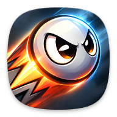
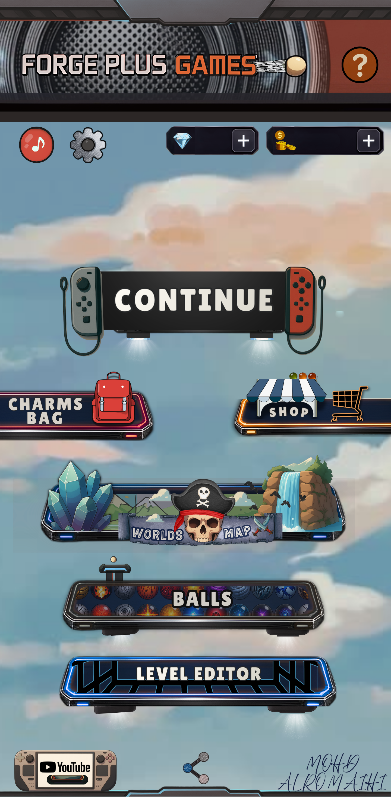
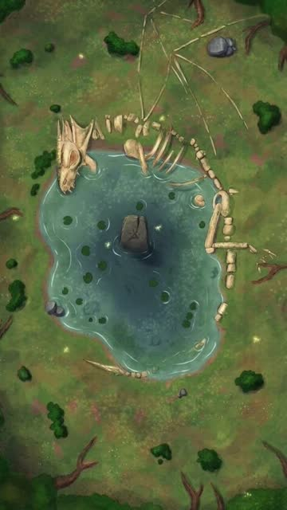
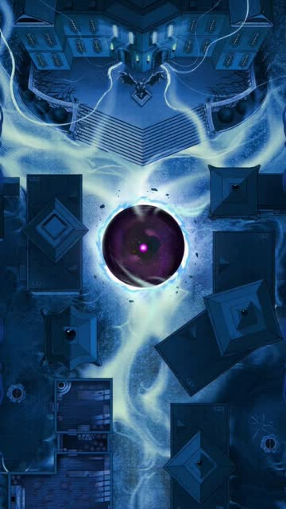

# Brick Breaker Ball

**Aim. Launch. Break through nine worlds.**

[العربية](README_AR.md) · [Play in your browser](https://bricks-breaker-ball.vercel.app/en/play) · [Latest Android release](https://github.com/Msr7799/Brick_Breaker_GAME/releases/latest)

Brick Breaker Ball is a portrait Android game built with **Kotlin and LibGDX**. Guide the paddle in Classic mode or aim a volley of balls at descending formations. Collect power-ups, unlock cosmetics, and advance through nine themed Volley worlds.

## See the game

  
  
  

These images come directly from the Android game's runtime assets. The project also includes its own world backgrounds, bosses, brick art, music, and interface sprites.

## Play and connected services

| Service | What it does |
| --- | --- |
|  | Android store listing. The GitHub APK may be a newer build than the store version. |
| [ Google Play Games](https://developers.google.com/games/services) | The Android app includes Play Games sign-in and connected progress features. |
| [ Google AdMob](https://admob.google.com/) | Rewarded ads are integrated into the Android game. |
| [Browser game](https://bricks-breaker-ball.vercel.app/en/play) | Play on the game's website. |

Google Play Games and AdMob require their respective Google services to be available on the device. Store billing and rewarded ads depend on their service and account configuration.

## Android download

Download the signed **APK** from [GitHub Releases](https://github.com/Msr7799/Brick_Breaker_GAME/releases/latest), or install the [Google Play version](https://play.google.com/store/apps/details?id=com.forgepulse.brickbreakerball). Release APKs are distributed through Releases, not committed to the source tree.

## Project map

Open each folder below to see its purpose. The final expandable section lists every public source and runtime asset file with a short description.

<strong>Project root and Android build</strong>

| Path | Purpose |
| --- | --- |
| `app/` | Android application module. |
| `app/build.gradle.kts` | App ID, version, dependencies, build variants, and release signing setup. |
| `app/proguard-rules.pro` | Code shrinking rules for release builds. |
| `app/src/main/AndroidManifest.xml` | Android components, permissions, and app metadata. |
| `build.gradle.kts` | Root Gradle plugin configuration. |
| `settings.gradle.kts` | Project and module declarations. |
| `gradle/libs.versions.toml` | Dependency versions and aliases. |
| `gradle/wrapper/` | Pinned Gradle wrapper. |
| `gradle.properties` | Project-wide Gradle settings. |
| `gradlew`, `gradlew.bat` | Gradle launchers for Unix and Windows. |
| `readme-assets/` | Downloaded service logos used only by these READMEs. |
| `README.md`, `README_AR.md` | English and Arabic project guides. |

<strong>Android game code · app/src/main/java</strong>

| Folder | Purpose |
| --- | --- |
| `app/` | Platform actions, navigation, account connection, and progress APIs. |
| `assets/` | Asset loading, atlases, sprites, and world art. |
| `campaign/` | Worlds, authored levels, progression, and save migration. |
| `cosmetics/` | Ball appearances, abilities, and cosmetic unlocks. |
| `economy/` | Rewards, shop, billing, and advertising integration. |
| `gameplay/` | Physics, collisions, Volley sessions, and level generation. |
| `ui/` | LibGDX screens, rendering, controls, and tutorials. |
| `MainActivity.kt` | Android entry point and platform service wiring. |
| `BrickBreakerGame.kt` | LibGDX game lifecycle and screen coordination. |

<strong>Runtime artwork and Android resources</strong>

| Folder | Purpose |
| --- | --- |
| `app/src/main/assets/atlases/` | Packed game atlases and their coordinate maps. |
| `audio/` | Game music and sound effects. |
| `backgrounds/` | Start screen, settings, and map visuals. |
| `fonts/` | Fonts loaded by the game. |
| `hazard/`, `rules/`, `privacy/` | Hazard art, rule diagrams, and privacy content. |
| `sprites/`, `ui/` | Ball, board, button, icon, and HUD art. |
| `volley-loading/`, `volley-orbs/` | Volley loading and collectible orb visuals. |
| `volley-source/` | Authored stage data, brick art, and stage metadata required at runtime. |
| `volley-world/` | Nine worlds of stage backgrounds, bosses, loading art, and thumbnails. |
| `app/src/main/res/mipmap-*/` | Launcher icon sizes; the header uses `mipmap-xxxhdpi/ic_launcher.png`. |
| `app/src/main/res/values/`, `xml/` | Android strings, themes, and platform configuration. |

Paths in the table after `atlases/` share the `app/src/main/assets/` prefix.

<!-- FILE_INDEX_START -->

<strong>Complete public file index · 488 files</strong>

Android resources / mipmap-anydpi-v26 · 2

- [`app/src/main/res/mipmap-anydpi-v26/ic_launcher.xml`](app/src/main/res/mipmap-anydpi-v26/ic_launcher.xml) — Launcher icon layer for this Android density.
- [`app/src/main/res/mipmap-anydpi-v26/ic_launcher_round.xml`](app/src/main/res/mipmap-anydpi-v26/ic_launcher_round.xml) — Launcher icon layer for this Android density.

Android resources / mipmap-hdpi · 4

- [`app/src/main/res/mipmap-hdpi/ic_launcher.png`](app/src/main/res/mipmap-hdpi/ic_launcher.png) — Launcher icon layer for this Android density.
- [`app/src/main/res/mipmap-hdpi/ic_launcher_background.png`](app/src/main/res/mipmap-hdpi/ic_launcher_background.png) — Launcher icon layer for this Android density.
- [`app/src/main/res/mipmap-hdpi/ic_launcher_foreground.png`](app/src/main/res/mipmap-hdpi/ic_launcher_foreground.png) — Launcher icon layer for this Android density.
- [`app/src/main/res/mipmap-hdpi/ic_launcher_monochrome.png`](app/src/main/res/mipmap-hdpi/ic_launcher_monochrome.png) — Launcher icon layer for this Android density.

Android resources / mipmap-mdpi · 4

- [`app/src/main/res/mipmap-mdpi/ic_launcher.png`](app/src/main/res/mipmap-mdpi/ic_launcher.png) — Launcher icon layer for this Android density.
- [`app/src/main/res/mipmap-mdpi/ic_launcher_background.png`](app/src/main/res/mipmap-mdpi/ic_launcher_background.png) — Launcher icon layer for this Android density.
- [`app/src/main/res/mipmap-mdpi/ic_launcher_foreground.png`](app/src/main/res/mipmap-mdpi/ic_launcher_foreground.png) — Launcher icon layer for this Android density.
- [`app/src/main/res/mipmap-mdpi/ic_launcher_monochrome.png`](app/src/main/res/mipmap-mdpi/ic_launcher_monochrome.png) — Launcher icon layer for this Android density.

Android resources / mipmap-xhdpi · 4

- [`app/src/main/res/mipmap-xhdpi/ic_launcher.png`](app/src/main/res/mipmap-xhdpi/ic_launcher.png) — Launcher icon layer for this Android density.
- [`app/src/main/res/mipmap-xhdpi/ic_launcher_background.png`](app/src/main/res/mipmap-xhdpi/ic_launcher_background.png) — Launcher icon layer for this Android density.
- [`app/src/main/res/mipmap-xhdpi/ic_launcher_foreground.png`](app/src/main/res/mipmap-xhdpi/ic_launcher_foreground.png) — Launcher icon layer for this Android density.
- [`app/src/main/res/mipmap-xhdpi/ic_launcher_monochrome.png`](app/src/main/res/mipmap-xhdpi/ic_launcher_monochrome.png) — Launcher icon layer for this Android density.

Android resources / mipmap-xxhdpi · 4

- [`app/src/main/res/mipmap-xxhdpi/ic_launcher.png`](app/src/main/res/mipmap-xxhdpi/ic_launcher.png) — Launcher icon layer for this Android density.
- [`app/src/main/res/mipmap-xxhdpi/ic_launcher_background.png`](app/src/main/res/mipmap-xxhdpi/ic_launcher_background.png) — Launcher icon layer for this Android density.
- [`app/src/main/res/mipmap-xxhdpi/ic_launcher_foreground.png`](app/src/main/res/mipmap-xxhdpi/ic_launcher_foreground.png) — Launcher icon layer for this Android density.
- [`app/src/main/res/mipmap-xxhdpi/ic_launcher_monochrome.png`](app/src/main/res/mipmap-xxhdpi/ic_launcher_monochrome.png) — Launcher icon layer for this Android density.

Android resources / mipmap-xxxhdpi · 4

- [`app/src/main/res/mipmap-xxxhdpi/ic_launcher.png`](app/src/main/res/mipmap-xxxhdpi/ic_launcher.png) — Launcher icon layer for this Android density.
- [`app/src/main/res/mipmap-xxxhdpi/ic_launcher_background.png`](app/src/main/res/mipmap-xxxhdpi/ic_launcher_background.png) — Launcher icon layer for this Android density.
- [`app/src/main/res/mipmap-xxxhdpi/ic_launcher_foreground.png`](app/src/main/res/mipmap-xxxhdpi/ic_launcher_foreground.png) — Launcher icon layer for this Android density.
- [`app/src/main/res/mipmap-xxxhdpi/ic_launcher_monochrome.png`](app/src/main/res/mipmap-xxxhdpi/ic_launcher_monochrome.png) — Launcher icon layer for this Android density.

Android resources / play_store_512.png · 1

- [`app/src/main/res/play_store_512.png`](app/src/main/res/play_store_512.png) — Android image resource.

Android resources / values · 2

- [`app/src/main/res/values/strings.xml`](app/src/main/res/values/strings.xml) — Android XML resource or configuration.
- [`app/src/main/res/values/themes.xml`](app/src/main/res/values/themes.xml) — Android XML resource or configuration.

Android resources / values-night · 1

- [`app/src/main/res/values-night/themes.xml`](app/src/main/res/values-night/themes.xml) — Android XML resource or configuration.

Android resources / xml · 2

- [`app/src/main/res/xml/backup_rules.xml`](app/src/main/res/xml/backup_rules.xml) — Android XML resource or configuration.
- [`app/src/main/res/xml/data_extraction_rules.xml`](app/src/main/res/xml/data_extraction_rules.xml) — Android XML resource or configuration.

Code / app · 8

- [`app/src/main/java/com/example/brick_breaker_ball/app/CloudProgress.kt`](app/src/main/java/com/example/brick_breaker_ball/app/CloudProgress.kt) — Represents cloud-backed player progress.
- [`app/src/main/java/com/example/brick_breaker_ball/app/CloudProgressApiClient.kt`](app/src/main/java/com/example/brick_breaker_ball/app/CloudProgressApiClient.kt) — Calls the cloud progress service.
- [`app/src/main/java/com/example/brick_breaker_ball/app/DailyRewardApiClient.kt`](app/src/main/java/com/example/brick_breaker_ball/app/DailyRewardApiClient.kt) — Daily Reward Api Client logic for Android services and navigation.
- [`app/src/main/java/com/example/brick_breaker_ball/app/DevelopmentAccess.kt`](app/src/main/java/com/example/brick_breaker_ball/app/DevelopmentAccess.kt) — Development Access logic for Android services and navigation.
- [`app/src/main/java/com/example/brick_breaker_ball/app/Navigator.kt`](app/src/main/java/com/example/brick_breaker_ball/app/Navigator.kt) — Navigator logic for Android services and navigation.
- [`app/src/main/java/com/example/brick_breaker_ball/app/PlatformActions.kt`](app/src/main/java/com/example/brick_breaker_ball/app/PlatformActions.kt) — Platform Actions logic for Android services and navigation.
- [`app/src/main/java/com/example/brick_breaker_ball/app/PlayGamesBridgeClient.kt`](app/src/main/java/com/example/brick_breaker_ball/app/PlayGamesBridgeClient.kt) — Connects game actions to Play Games services.
- [`app/src/main/java/com/example/brick_breaker_ball/app/QaDiagnosticsOverlay.kt`](app/src/main/java/com/example/brick_breaker_ball/app/QaDiagnosticsOverlay.kt) — Qa Diagnostics Overlay logic for Android services and navigation.

Code / assets · 13

- [`app/src/main/java/com/example/brick_breaker_ball/assets/BoardAtlasRepository.kt`](app/src/main/java/com/example/brick_breaker_ball/assets/BoardAtlasRepository.kt) — Board Atlas Repository logic for art and asset loading.
- [`app/src/main/java/com/example/brick_breaker_ball/assets/BoardSpriteNames.kt`](app/src/main/java/com/example/brick_breaker_ball/assets/BoardSpriteNames.kt) — Board Sprite Names logic for art and asset loading.
- [`app/src/main/java/com/example/brick_breaker_ball/assets/EnglishDigitGlyphs.kt`](app/src/main/java/com/example/brick_breaker_ball/assets/EnglishDigitGlyphs.kt) — English Digit Glyphs logic for art and asset loading.
- [`app/src/main/java/com/example/brick_breaker_ball/assets/GameAssets.kt`](app/src/main/java/com/example/brick_breaker_ball/assets/GameAssets.kt) — Loads and caches the game's runtime media.
- [`app/src/main/java/com/example/brick_breaker_ball/assets/GuideHelpText.kt`](app/src/main/java/com/example/brick_breaker_ball/assets/GuideHelpText.kt) — Guide Help Text logic for art and asset loading.
- [`app/src/main/java/com/example/brick_breaker_ball/assets/SpriteId.kt`](app/src/main/java/com/example/brick_breaker_ball/assets/SpriteId.kt) — Sprite Id logic for art and asset loading.
- [`app/src/main/java/com/example/brick_breaker_ball/assets/VisualUiArt.kt`](app/src/main/java/com/example/brick_breaker_ball/assets/VisualUiArt.kt) — Visual Ui Art logic for art and asset loading.
- [`app/src/main/java/com/example/brick_breaker_ball/assets/VolleyAssetCatalog.kt`](app/src/main/java/com/example/brick_breaker_ball/assets/VolleyAssetCatalog.kt) — Volley Asset Catalog logic for art and asset loading.
- [`app/src/main/java/com/example/brick_breaker_ball/assets/VolleyBrickPalette.kt`](app/src/main/java/com/example/brick_breaker_ball/assets/VolleyBrickPalette.kt) — Volley Brick Palette logic for art and asset loading.
- [`app/src/main/java/com/example/brick_breaker_ball/assets/VolleySourceBrickArt.kt`](app/src/main/java/com/example/brick_breaker_ball/assets/VolleySourceBrickArt.kt) — Volley Source Brick Art logic for art and asset loading.
- [`app/src/main/java/com/example/brick_breaker_ball/assets/VolleyWorldArt.kt`](app/src/main/java/com/example/brick_breaker_ball/assets/VolleyWorldArt.kt) — Volley World Art logic for art and asset loading.
- [`app/src/main/java/com/example/brick_breaker_ball/assets/WebpAssets.kt`](app/src/main/java/com/example/brick_breaker_ball/assets/WebpAssets.kt) — Webp Assets logic for art and asset loading.
- [`app/src/main/java/com/example/brick_breaker_ball/assets/WorldVideoBackgrounds.kt`](app/src/main/java/com/example/brick_breaker_ball/assets/WorldVideoBackgrounds.kt) — World Video Backgrounds logic for art and asset loading.

Code / campaign · 12

- [`app/src/main/java/com/example/brick_breaker_ball/campaign/Campaign.kt`](app/src/main/java/com/example/brick_breaker_ball/campaign/Campaign.kt) — Campaign logic for campaign progression and saves.
- [`app/src/main/java/com/example/brick_breaker_ball/campaign/CampaignBrickPalette.kt`](app/src/main/java/com/example/brick_breaker_ball/campaign/CampaignBrickPalette.kt) — Campaign Brick Palette logic for campaign progression and saves.
- [`app/src/main/java/com/example/brick_breaker_ball/campaign/CampaignGemPolicy.kt`](app/src/main/java/com/example/brick_breaker_ball/campaign/CampaignGemPolicy.kt) — Campaign Gem Policy logic for campaign progression and saves.
- [`app/src/main/java/com/example/brick_breaker_ball/campaign/CloudProgressSync.kt`](app/src/main/java/com/example/brick_breaker_ball/campaign/CloudProgressSync.kt) — Cloud Progress Sync logic for campaign progression and saves.
- [`app/src/main/java/com/example/brick_breaker_ball/campaign/CloudSaveCodec.kt`](app/src/main/java/com/example/brick_breaker_ball/campaign/CloudSaveCodec.kt) — Cloud Save Codec logic for campaign progression and saves.
- [`app/src/main/java/com/example/brick_breaker_ball/campaign/VolleyCampaign.kt`](app/src/main/java/com/example/brick_breaker_ball/campaign/VolleyCampaign.kt) — Builds the Volley world and stage campaign.
- [`app/src/main/java/com/example/brick_breaker_ball/campaign/VolleyOrbInventory.kt`](app/src/main/java/com/example/brick_breaker_ball/campaign/VolleyOrbInventory.kt) — Volley Orb Inventory logic for campaign progression and saves.
- [`app/src/main/java/com/example/brick_breaker_ball/campaign/VolleyPausedSessionStore.kt`](app/src/main/java/com/example/brick_breaker_ball/campaign/VolleyPausedSessionStore.kt) — Volley Paused Session Store logic for campaign progression and saves.
- [`app/src/main/java/com/example/brick_breaker_ball/campaign/VolleyProgressMigration.kt`](app/src/main/java/com/example/brick_breaker_ball/campaign/VolleyProgressMigration.kt) — Volley Progress Migration logic for campaign progression and saves.
- [`app/src/main/java/com/example/brick_breaker_ball/campaign/VolleySourceHealth.kt`](app/src/main/java/com/example/brick_breaker_ball/campaign/VolleySourceHealth.kt) — Volley Source Health logic for campaign progression and saves.
- [`app/src/main/java/com/example/brick_breaker_ball/campaign/VolleySourceStageData.kt`](app/src/main/java/com/example/brick_breaker_ball/campaign/VolleySourceStageData.kt) — Converts authored stage data into playable levels.
- [`app/src/main/java/com/example/brick_breaker_ball/campaign/WorldMapSelectionPolicy.kt`](app/src/main/java/com/example/brick_breaker_ball/campaign/WorldMapSelectionPolicy.kt) — World Map Selection Policy logic for campaign progression and saves.

Code / cosmetics · 5

- [`app/src/main/java/com/example/brick_breaker_ball/cosmetics/BallAbilities.kt`](app/src/main/java/com/example/brick_breaker_ball/cosmetics/BallAbilities.kt) — Ball Abilities logic for ball cosmetics and abilities.
- [`app/src/main/java/com/example/brick_breaker_ball/cosmetics/BallCollectionCatalog.kt`](app/src/main/java/com/example/brick_breaker_ball/cosmetics/BallCollectionCatalog.kt) — Ball Collection Catalog logic for ball cosmetics and abilities.
- [`app/src/main/java/com/example/brick_breaker_ball/cosmetics/CosmeticModels.kt`](app/src/main/java/com/example/brick_breaker_ball/cosmetics/CosmeticModels.kt) — Cosmetic Models logic for ball cosmetics and abilities.
- [`app/src/main/java/com/example/brick_breaker_ball/cosmetics/CosmeticProgression.kt`](app/src/main/java/com/example/brick_breaker_ball/cosmetics/CosmeticProgression.kt) — Cosmetic Progression logic for ball cosmetics and abilities.
- [`app/src/main/java/com/example/brick_breaker_ball/cosmetics/CosmeticSpriteRepository.kt`](app/src/main/java/com/example/brick_breaker_ball/cosmetics/CosmeticSpriteRepository.kt) — Cosmetic Sprite Repository logic for ball cosmetics and abilities.

Code / economy · 9

- [`app/src/main/java/com/example/brick_breaker_ball/economy/AndroidMonetization.kt`](app/src/main/java/com/example/brick_breaker_ball/economy/AndroidMonetization.kt) — Android billing and rewarded AdMob integration.
- [`app/src/main/java/com/example/brick_breaker_ball/economy/BoosterStores.kt`](app/src/main/java/com/example/brick_breaker_ball/economy/BoosterStores.kt) — Booster Stores logic for shop, rewards, and monetization.
- [`app/src/main/java/com/example/brick_breaker_ball/economy/Economy.kt`](app/src/main/java/com/example/brick_breaker_ball/economy/Economy.kt) — Economy logic for shop, rewards, and monetization.
- [`app/src/main/java/com/example/brick_breaker_ball/economy/EnglishPlayPrice.kt`](app/src/main/java/com/example/brick_breaker_ball/economy/EnglishPlayPrice.kt) — English Play Price logic for shop, rewards, and monetization.
- [`app/src/main/java/com/example/brick_breaker_ball/economy/MonetizationServices.kt`](app/src/main/java/com/example/brick_breaker_ball/economy/MonetizationServices.kt) — Monetization Services logic for shop, rewards, and monetization.
- [`app/src/main/java/com/example/brick_breaker_ball/economy/OrbShopPricing.kt`](app/src/main/java/com/example/brick_breaker_ball/economy/OrbShopPricing.kt) — Orb Shop Pricing logic for shop, rewards, and monetization.
- [`app/src/main/java/com/example/brick_breaker_ball/economy/ShopModels.kt`](app/src/main/java/com/example/brick_breaker_ball/economy/ShopModels.kt) — Shop Models logic for shop, rewards, and monetization.
- [`app/src/main/java/com/example/brick_breaker_ball/economy/ShopPagination.kt`](app/src/main/java/com/example/brick_breaker_ball/economy/ShopPagination.kt) — Shop Pagination logic for shop, rewards, and monetization.
- [`app/src/main/java/com/example/brick_breaker_ball/economy/StorePurchaseConfirmation.kt`](app/src/main/java/com/example/brick_breaker_ball/economy/StorePurchaseConfirmation.kt) — Store Purchase Confirmation logic for shop, rewards, and monetization.

Code / entry points · 2

- [`app/src/main/java/com/example/brick_breaker_ball/BrickBreakerGame.kt`](app/src/main/java/com/example/brick_breaker_ball/BrickBreakerGame.kt) — LibGDX lifecycle and screen coordinator.
- [`app/src/main/java/com/example/brick_breaker_ball/MainActivity.kt`](app/src/main/java/com/example/brick_breaker_ball/MainActivity.kt) — Android entry point and Google service bridge.

Code / gameplay · 22

- [`app/src/main/java/com/example/brick_breaker_ball/gameplay/GameModels.kt`](app/src/main/java/com/example/brick_breaker_ball/gameplay/GameModels.kt) — Game Models logic for physics and game rules.
- [`app/src/main/java/com/example/brick_breaker_ball/gameplay/GameplayMode.kt`](app/src/main/java/com/example/brick_breaker_ball/gameplay/GameplayMode.kt) — Gameplay Mode logic for physics and game rules.
- [`app/src/main/java/com/example/brick_breaker_ball/gameplay/GameplayTuning.kt`](app/src/main/java/com/example/brick_breaker_ball/gameplay/GameplayTuning.kt) — Gameplay Tuning logic for physics and game rules.
- [`app/src/main/java/com/example/brick_breaker_ball/gameplay/ItemEffectCatalog.kt`](app/src/main/java/com/example/brick_breaker_ball/gameplay/ItemEffectCatalog.kt) — Item Effect Catalog logic for physics and game rules.
- [`app/src/main/java/com/example/brick_breaker_ball/gameplay/SweptCollision.kt`](app/src/main/java/com/example/brick_breaker_ball/gameplay/SweptCollision.kt) — Swept Collision logic for physics and game rules.
- [`app/src/main/java/com/example/brick_breaker_ball/gameplay/VolleyAimGesture.kt`](app/src/main/java/com/example/brick_breaker_ball/gameplay/VolleyAimGesture.kt) — Volley Aim Gesture logic for physics and game rules.
- [`app/src/main/java/com/example/brick_breaker_ball/gameplay/VolleyEditorData.kt`](app/src/main/java/com/example/brick_breaker_ball/gameplay/VolleyEditorData.kt) — Volley Editor Data logic for physics and game rules.
- [`app/src/main/java/com/example/brick_breaker_ball/gameplay/VolleyGeneratedLevelJson.kt`](app/src/main/java/com/example/brick_breaker_ball/gameplay/VolleyGeneratedLevelJson.kt) — Volley Generated Level Json logic for physics and game rules.
- [`app/src/main/java/com/example/brick_breaker_ball/gameplay/VolleyGeneratorFeature.kt`](app/src/main/java/com/example/brick_breaker_ball/gameplay/VolleyGeneratorFeature.kt) — Volley Generator Feature logic for physics and game rules.
- [`app/src/main/java/com/example/brick_breaker_ball/gameplay/VolleyGeneratorSamples.kt`](app/src/main/java/com/example/brick_breaker_ball/gameplay/VolleyGeneratorSamples.kt) — Volley Generator Samples logic for physics and game rules.
- [`app/src/main/java/com/example/brick_breaker_ball/gameplay/VolleyItemController.kt`](app/src/main/java/com/example/brick_breaker_ball/gameplay/VolleyItemController.kt) — Volley Item Controller logic for physics and game rules.
- [`app/src/main/java/com/example/brick_breaker_ball/gameplay/VolleyLayout.kt`](app/src/main/java/com/example/brick_breaker_ball/gameplay/VolleyLayout.kt) — Volley Layout logic for physics and game rules.
- [`app/src/main/java/com/example/brick_breaker_ball/gameplay/VolleyLevelGenerator.kt`](app/src/main/java/com/example/brick_breaker_ball/gameplay/VolleyLevelGenerator.kt) — Volley Level Generator logic for physics and game rules.
- [`app/src/main/java/com/example/brick_breaker_ball/gameplay/VolleyLevelProbe.kt`](app/src/main/java/com/example/brick_breaker_ball/gameplay/VolleyLevelProbe.kt) — Volley Level Probe logic for physics and game rules.
- [`app/src/main/java/com/example/brick_breaker_ball/gameplay/VolleyModels.kt`](app/src/main/java/com/example/brick_breaker_ball/gameplay/VolleyModels.kt) — Volley Models logic for physics and game rules.
- [`app/src/main/java/com/example/brick_breaker_ball/gameplay/VolleyOpeningSalvo.kt`](app/src/main/java/com/example/brick_breaker_ball/gameplay/VolleyOpeningSalvo.kt) — Volley Opening Salvo logic for physics and game rules.
- [`app/src/main/java/com/example/brick_breaker_ball/gameplay/VolleyOrbCatalog.kt`](app/src/main/java/com/example/brick_breaker_ball/gameplay/VolleyOrbCatalog.kt) — Volley Orb Catalog logic for physics and game rules.
- [`app/src/main/java/com/example/brick_breaker_ball/gameplay/VolleyOrbEffects.kt`](app/src/main/java/com/example/brick_breaker_ball/gameplay/VolleyOrbEffects.kt) — Volley Orb Effects logic for physics and game rules.
- [`app/src/main/java/com/example/brick_breaker_ball/gameplay/VolleyRankedFormation.kt`](app/src/main/java/com/example/brick_breaker_ball/gameplay/VolleyRankedFormation.kt) — Volley Ranked Formation logic for physics and game rules.
- [`app/src/main/java/com/example/brick_breaker_ball/gameplay/VolleyRankedGeometry.kt`](app/src/main/java/com/example/brick_breaker_ball/gameplay/VolleyRankedGeometry.kt) — Volley Ranked Geometry logic for physics and game rules.
- [`app/src/main/java/com/example/brick_breaker_ball/gameplay/VolleySession.kt`](app/src/main/java/com/example/brick_breaker_ball/gameplay/VolleySession.kt) — Tracks the state and turns of a Volley run.
- [`app/src/main/java/com/example/brick_breaker_ball/gameplay/VolleySourceOrbDrops.kt`](app/src/main/java/com/example/brick_breaker_ball/gameplay/VolleySourceOrbDrops.kt) — Volley Source Orb Drops logic for physics and game rules.

Code / ui · 35

- [`app/src/main/java/com/example/brick_breaker_ball/ui/AppUpdateScreen.kt`](app/src/main/java/com/example/brick_breaker_ball/ui/AppUpdateScreen.kt) — App Update Screen logic for game screens and controls.
- [`app/src/main/java/com/example/brick_breaker_ball/ui/BagScrollMath.kt`](app/src/main/java/com/example/brick_breaker_ball/ui/BagScrollMath.kt) — Bag Scroll Math logic for game screens and controls.
- [`app/src/main/java/com/example/brick_breaker_ball/ui/BallPowerDetailScreen.kt`](app/src/main/java/com/example/brick_breaker_ball/ui/BallPowerDetailScreen.kt) — Ball Power Detail Screen logic for game screens and controls.
- [`app/src/main/java/com/example/brick_breaker_ball/ui/BallPowerPreview.kt`](app/src/main/java/com/example/brick_breaker_ball/ui/BallPowerPreview.kt) — Ball Power Preview logic for game screens and controls.
- [`app/src/main/java/com/example/brick_breaker_ball/ui/CharmTutorial.kt`](app/src/main/java/com/example/brick_breaker_ball/ui/CharmTutorial.kt) — Charm Tutorial logic for game screens and controls.
- [`app/src/main/java/com/example/brick_breaker_ball/ui/CharmsBagScreen.kt`](app/src/main/java/com/example/brick_breaker_ball/ui/CharmsBagScreen.kt) — Charms Bag Screen logic for game screens and controls.
- [`app/src/main/java/com/example/brick_breaker_ball/ui/CloudSaveScreen.kt`](app/src/main/java/com/example/brick_breaker_ball/ui/CloudSaveScreen.kt) — Cloud Save Screen logic for game screens and controls.
- [`app/src/main/java/com/example/brick_breaker_ball/ui/CosmeticUnlockRevealScreen.kt`](app/src/main/java/com/example/brick_breaker_ball/ui/CosmeticUnlockRevealScreen.kt) — Cosmetic Unlock Reveal Screen logic for game screens and controls.
- [`app/src/main/java/com/example/brick_breaker_ball/ui/CustomizationScreen.kt`](app/src/main/java/com/example/brick_breaker_ball/ui/CustomizationScreen.kt) — Customization Screen logic for game screens and controls.
- [`app/src/main/java/com/example/brick_breaker_ball/ui/DailyRewardsScreen.kt`](app/src/main/java/com/example/brick_breaker_ball/ui/DailyRewardsScreen.kt) — Daily Rewards Screen logic for game screens and controls.
- [`app/src/main/java/com/example/brick_breaker_ball/ui/ForgeUiPalette.kt`](app/src/main/java/com/example/brick_breaker_ball/ui/ForgeUiPalette.kt) — Forge Ui Palette logic for game screens and controls.
- [`app/src/main/java/com/example/brick_breaker_ball/ui/ForgeUiRenderer.kt`](app/src/main/java/com/example/brick_breaker_ball/ui/ForgeUiRenderer.kt) — Forge Ui Renderer logic for game screens and controls.
- [`app/src/main/java/com/example/brick_breaker_ball/ui/ForgeUiTheme.kt`](app/src/main/java/com/example/brick_breaker_ball/ui/ForgeUiTheme.kt) — Forge Ui Theme logic for game screens and controls.
- [`app/src/main/java/com/example/brick_breaker_ball/ui/HeroGuide.kt`](app/src/main/java/com/example/brick_breaker_ball/ui/HeroGuide.kt) — Hero Guide logic for game screens and controls.
- [`app/src/main/java/com/example/brick_breaker_ball/ui/HeroStoryScreen.kt`](app/src/main/java/com/example/brick_breaker_ball/ui/HeroStoryScreen.kt) — Hero Story Screen logic for game screens and controls.
- [`app/src/main/java/com/example/brick_breaker_ball/ui/Pressable.kt`](app/src/main/java/com/example/brick_breaker_ball/ui/Pressable.kt) — Pressable logic for game screens and controls.
- [`app/src/main/java/com/example/brick_breaker_ball/ui/PrivacyPolicyScreen.kt`](app/src/main/java/com/example/brick_breaker_ball/ui/PrivacyPolicyScreen.kt) — Privacy Policy Screen logic for game screens and controls.
- [`app/src/main/java/com/example/brick_breaker_ball/ui/RewardFxSystem.kt`](app/src/main/java/com/example/brick_breaker_ball/ui/RewardFxSystem.kt) — Reward Fx System logic for game screens and controls.
- [`app/src/main/java/com/example/brick_breaker_ball/ui/RewardRevealScreen.kt`](app/src/main/java/com/example/brick_breaker_ball/ui/RewardRevealScreen.kt) — Reward Reveal Screen logic for game screens and controls.
- [`app/src/main/java/com/example/brick_breaker_ball/ui/RulesScreen.kt`](app/src/main/java/com/example/brick_breaker_ball/ui/RulesScreen.kt) — Rules Screen logic for game screens and controls.
- [`app/src/main/java/com/example/brick_breaker_ball/ui/ShopScreen.kt`](app/src/main/java/com/example/brick_breaker_ball/ui/ShopScreen.kt) — Shop Screen logic for game screens and controls.
- [`app/src/main/java/com/example/brick_breaker_ball/ui/UiConfirmation.kt`](app/src/main/java/com/example/brick_breaker_ball/ui/UiConfirmation.kt) — Ui Confirmation logic for game screens and controls.
- [`app/src/main/java/com/example/brick_breaker_ball/ui/UiFeedback.kt`](app/src/main/java/com/example/brick_breaker_ball/ui/UiFeedback.kt) — Ui Feedback logic for game screens and controls.
- [`app/src/main/java/com/example/brick_breaker_ball/ui/UiMetrics.kt`](app/src/main/java/com/example/brick_breaker_ball/ui/UiMetrics.kt) — Ui Metrics logic for game screens and controls.
- [`app/src/main/java/com/example/brick_breaker_ball/ui/UiMotion.kt`](app/src/main/java/com/example/brick_breaker_ball/ui/UiMotion.kt) — Ui Motion logic for game screens and controls.
- [`app/src/main/java/com/example/brick_breaker_ball/ui/UiScreens.kt`](app/src/main/java/com/example/brick_breaker_ball/ui/UiScreens.kt) — Ui Screens logic for game screens and controls.
- [`app/src/main/java/com/example/brick_breaker_ball/ui/VisualGameUi.kt`](app/src/main/java/com/example/brick_breaker_ball/ui/VisualGameUi.kt) — Visual Game Ui logic for game screens and controls.
- [`app/src/main/java/com/example/brick_breaker_ball/ui/VisualHelpOverlay.kt`](app/src/main/java/com/example/brick_breaker_ball/ui/VisualHelpOverlay.kt) — Visual Help Overlay logic for game screens and controls.
- [`app/src/main/java/com/example/brick_breaker_ball/ui/VolleyBossDialogueScreen.kt`](app/src/main/java/com/example/brick_breaker_ball/ui/VolleyBossDialogueScreen.kt) — Volley Boss Dialogue Screen logic for game screens and controls.
- [`app/src/main/java/com/example/brick_breaker_ball/ui/VolleyControlTutorial.kt`](app/src/main/java/com/example/brick_breaker_ball/ui/VolleyControlTutorial.kt) — Volley Control Tutorial logic for game screens and controls.
- [`app/src/main/java/com/example/brick_breaker_ball/ui/VolleyGameScreen.kt`](app/src/main/java/com/example/brick_breaker_ball/ui/VolleyGameScreen.kt) — Volley Game Screen logic for game screens and controls.
- [`app/src/main/java/com/example/brick_breaker_ball/ui/VolleyLevelEditorScreen.kt`](app/src/main/java/com/example/brick_breaker_ball/ui/VolleyLevelEditorScreen.kt) — Volley Level Editor Screen logic for game screens and controls.
- [`app/src/main/java/com/example/brick_breaker_ball/ui/VolleyLoadingScreen.kt`](app/src/main/java/com/example/brick_breaker_ball/ui/VolleyLoadingScreen.kt) — Volley Loading Screen logic for game screens and controls.
- [`app/src/main/java/com/example/brick_breaker_ball/ui/VolleyOrbsScreen.kt`](app/src/main/java/com/example/brick_breaker_ball/ui/VolleyOrbsScreen.kt) — Volley Orbs Screen logic for game screens and controls.
- [`app/src/main/java/com/example/brick_breaker_ball/ui/WalletText.kt`](app/src/main/java/com/example/brick_breaker_ball/ui/WalletText.kt) — Wallet Text logic for game screens and controls.

Game assets / atlases · 8

- [`app/src/main/assets/atlases/assets_sheet_atlas.atlas`](app/src/main/assets/atlases/assets_sheet_atlas.atlas) — Runtime sprite atlas.
- [`app/src/main/assets/atlases/assets_sheet_atlas.png`](app/src/main/assets/atlases/assets_sheet_atlas.png) — Runtime sprite atlas.
- [`app/src/main/assets/atlases/balls.atlas`](app/src/main/assets/atlases/balls.atlas) — Runtime sprite atlas.
- [`app/src/main/assets/atlases/balls.png`](app/src/main/assets/atlases/balls.png) — Runtime sprite atlas.
- [`app/src/main/assets/atlases/particles.atlas`](app/src/main/assets/atlases/particles.atlas) — Runtime sprite atlas.
- [`app/src/main/assets/atlases/particles.png`](app/src/main/assets/atlases/particles.png) — Runtime sprite atlas.
- [`app/src/main/assets/atlases/volley.atlas`](app/src/main/assets/atlases/volley.atlas) — Runtime sprite atlas.
- [`app/src/main/assets/atlases/volley.png`](app/src/main/assets/atlases/volley.png) — Runtime sprite atlas.

Game assets / audio · 32

- [`app/src/main/assets/audio/boss_final_war_drums.ogg`](app/src/main/assets/audio/boss_final_war_drums.ogg) — Runtime music or sound effect.
- [`app/src/main/assets/audio/boss_intro_evil_laugh.ogg`](app/src/main/assets/audio/boss_intro_evil_laugh.ogg) — Runtime music or sound effect.
- [`app/src/main/assets/audio/brick_hit.ogg`](app/src/main/assets/audio/brick_hit.ogg) — Runtime music or sound effect.
- [`app/src/main/assets/audio/explosion.ogg`](app/src/main/assets/audio/explosion.ogg) — Runtime music or sound effect.
- [`app/src/main/assets/audio/glass_hit.ogg`](app/src/main/assets/audio/glass_hit.ogg) — Runtime music or sound effect.
- [`app/src/main/assets/audio/laser_fire.ogg`](app/src/main/assets/audio/laser_fire.ogg) — Runtime music or sound effect.
- [`app/src/main/assets/audio/level_up.ogg`](app/src/main/assets/audio/level_up.ogg) — Runtime music or sound effect.
- [`app/src/main/assets/audio/menu_intro_theme.ogg`](app/src/main/assets/audio/menu_intro_theme.ogg) — Runtime music or sound effect.
- [`app/src/main/assets/audio/metal_hit.ogg`](app/src/main/assets/audio/metal_hit.ogg) — Runtime music or sound effect.
- [`app/src/main/assets/audio/pop_shoot.wav`](app/src/main/assets/audio/pop_shoot.wav) — Runtime music or sound effect.
- [`app/src/main/assets/audio/powerup.ogg`](app/src/main/assets/audio/powerup.ogg) — Runtime music or sound effect.
- [`app/src/main/assets/audio/source_orb_found.wav`](app/src/main/assets/audio/source_orb_found.wav) — Runtime music or sound effect.
- [`app/src/main/assets/audio/source_orb_legendary.wav`](app/src/main/assets/audio/source_orb_legendary.wav) — Runtime music or sound effect.
- [`app/src/main/assets/audio/thud3.mp3`](app/src/main/assets/audio/thud3.mp3) — Runtime music or sound effect.
- [`app/src/main/assets/audio/ui_click.ogg`](app/src/main/assets/audio/ui_click.ogg) — Runtime music or sound effect.
- [`app/src/main/assets/audio/ui_pop.ogg`](app/src/main/assets/audio/ui_pop.ogg) — Runtime music or sound effect.
- [`app/src/main/assets/audio/wall_hit.ogg`](app/src/main/assets/audio/wall_hit.ogg) — Runtime music or sound effect.
- [`app/src/main/assets/audio/world_01_forest_theme.ogg`](app/src/main/assets/audio/world_01_forest_theme.ogg) — Runtime music or sound effect.
- [`app/src/main/assets/audio/world_02_venom_theme.ogg`](app/src/main/assets/audio/world_02_venom_theme.ogg) — Runtime music or sound effect.
- [`app/src/main/assets/audio/world_02_water_drips.ogg`](app/src/main/assets/audio/world_02_water_drips.ogg) — Runtime music or sound effect.
- [`app/src/main/assets/audio/world_03_04_aqua_desert_theme.ogg`](app/src/main/assets/audio/world_03_04_aqua_desert_theme.ogg) — Runtime music or sound effect.
- [`app/src/main/assets/audio/world_05_blizzard_ambience.ogg`](app/src/main/assets/audio/world_05_blizzard_ambience.ogg) — Runtime music or sound effect.
- [`app/src/main/assets/audio/world_06_ghost_whisper.ogg`](app/src/main/assets/audio/world_06_ghost_whisper.ogg) — Runtime music or sound effect.
- [`app/src/main/assets/audio/world_06_raven_call.ogg`](app/src/main/assets/audio/world_06_raven_call.ogg) — Runtime music or sound effect.
- [`app/src/main/assets/audio/world_06_souls_theme.ogg`](app/src/main/assets/audio/world_06_souls_theme.ogg) — Runtime music or sound effect.
- [`app/src/main/assets/audio/world_06_wolf_howl.ogg`](app/src/main/assets/audio/world_06_wolf_howl.ogg) — Runtime music or sound effect.
- [`app/src/main/assets/audio/world_07_moon_theme.ogg`](app/src/main/assets/audio/world_07_moon_theme.ogg) — Runtime music or sound effect.
- [`app/src/main/assets/audio/world_08_dragon_breath.ogg`](app/src/main/assets/audio/world_08_dragon_breath.ogg) — Runtime music or sound effect.
- [`app/src/main/assets/audio/world_08_dragon_exhale.ogg`](app/src/main/assets/audio/world_08_dragon_exhale.ogg) — Runtime music or sound effect.
- [`app/src/main/assets/audio/world_08_fire_crackling.ogg`](app/src/main/assets/audio/world_08_fire_crackling.ogg) — Runtime music or sound effect.
- [`app/src/main/assets/audio/world_08_infernal_theme.ogg`](app/src/main/assets/audio/world_08_infernal_theme.ogg) — Runtime music or sound effect.
- [`app/src/main/assets/audio/world_09_final_eclipse_theme.ogg`](app/src/main/assets/audio/world_09_final_eclipse_theme.ogg) — Runtime music or sound effect.

Game assets / backgrounds · 22

- [`app/src/main/assets/backgrounds/splash.mp4`](app/src/main/assets/backgrounds/splash.mp4) — Runtime menu or map visual.
- [`app/src/main/assets/backgrounds/start-screen/lock-icon.png`](app/src/main/assets/backgrounds/start-screen/lock-icon.png) — Runtime menu or map visual.
- [`app/src/main/assets/backgrounds/start-screen/main-screen/main-screen-FINAIL.json`](app/src/main/assets/backgrounds/start-screen/main-screen/main-screen-FINAIL.json) — Runtime data or coordinates for menu or map visual.
- [`app/src/main/assets/backgrounds/start-screen/main-screen/main-screen-volley.mp4`](app/src/main/assets/backgrounds/start-screen/main-screen/main-screen-volley.mp4) — Runtime menu or map visual.
- [`app/src/main/assets/backgrounds/start-screen/main-screen/main-screen-volley.png`](app/src/main/assets/backgrounds/start-screen/main-screen/main-screen-volley.png) — Runtime menu or map visual.
- [`app/src/main/assets/backgrounds/start-screen/main-screen/new-game-btn-final.png`](app/src/main/assets/backgrounds/start-screen/main-screen/new-game-btn-final.png) — Runtime menu or map visual.
- [`app/src/main/assets/backgrounds/start-screen/main-screen/sound-off-btn-final.png`](app/src/main/assets/backgrounds/start-screen/main-screen/sound-off-btn-final.png) — Runtime menu or map visual.
- [`app/src/main/assets/backgrounds/start-screen/setting/check-off.png`](app/src/main/assets/backgrounds/start-screen/setting/check-off.png) — Runtime menu or map visual.
- [`app/src/main/assets/backgrounds/start-screen/setting/check-on.png`](app/src/main/assets/backgrounds/start-screen/setting/check-on.png) — Runtime menu or map visual.
- [`app/src/main/assets/backgrounds/start-screen/setting/color-blind-palette.png`](app/src/main/assets/backgrounds/start-screen/setting/color-blind-palette.png) — Runtime menu or map visual.
- [`app/src/main/assets/backgrounds/start-screen/setting/contrest-ball.png`](app/src/main/assets/backgrounds/start-screen/setting/contrest-ball.png) — Runtime menu or map visual.
- [`app/src/main/assets/backgrounds/start-screen/setting/game-developer.png`](app/src/main/assets/backgrounds/start-screen/setting/game-developer.png) — Runtime menu or map visual.
- [`app/src/main/assets/backgrounds/start-screen/setting/github.png`](app/src/main/assets/backgrounds/start-screen/setting/github.png) — Runtime menu or map visual.
- [`app/src/main/assets/backgrounds/start-screen/setting/haptics.png`](app/src/main/assets/backgrounds/start-screen/setting/haptics.png) — Runtime menu or map visual.
- [`app/src/main/assets/backgrounds/start-screen/setting/motion.png`](app/src/main/assets/backgrounds/start-screen/setting/motion.png) — Runtime menu or map visual.
- [`app/src/main/assets/backgrounds/start-screen/setting/save&amp;back.png`](app/src/main/assets/backgrounds/start-screen/setting/save%26back.png) — Runtime menu or map visual.
- [`app/src/main/assets/backgrounds/start-screen/setting/sound-btn-off.png`](app/src/main/assets/backgrounds/start-screen/setting/sound-btn-off.png) — Runtime menu or map visual.
- [`app/src/main/assets/backgrounds/start-screen/setting/sound-btn.png`](app/src/main/assets/backgrounds/start-screen/setting/sound-btn.png) — Runtime menu or map visual.
- [`app/src/main/assets/backgrounds/start-screen/setting/sound.png`](app/src/main/assets/backgrounds/start-screen/setting/sound.png) — Runtime menu or map visual.
- [`app/src/main/assets/backgrounds/worlds-map-images/star-off.png`](app/src/main/assets/backgrounds/worlds-map-images/star-off.png) — Runtime menu or map visual.
- [`app/src/main/assets/backgrounds/worlds-map-images/star-on.png`](app/src/main/assets/backgrounds/worlds-map-images/star-on.png) — Runtime menu or map visual.
- [`app/src/main/assets/backgrounds/worlds-map-images/worlds-maps-lock-icon.png`](app/src/main/assets/backgrounds/worlds-map-images/worlds-maps-lock-icon.png) — Runtime menu or map visual.

Game assets / fonts · 3

- [`app/src/main/assets/fonts/GOTHAM-BOLD.TTF`](app/src/main/assets/fonts/GOTHAM-BOLD.TTF) — Runtime game font.
- [`app/src/main/assets/fonts/Insignia.ttf`](app/src/main/assets/fonts/Insignia.ttf) — Runtime game font.
- [`app/src/main/assets/fonts/TANHEADLINE-Regular.ttf`](app/src/main/assets/fonts/TANHEADLINE-Regular.ttf) — Runtime game font.

Game assets / hazard · 1

- [`app/src/main/assets/hazard/electric_floor_wire.png`](app/src/main/assets/hazard/electric_floor_wire.png) — Runtime hazard art.

Game assets / privacy · 1

- [`app/src/main/assets/privacy/privacy_policy.txt`](app/src/main/assets/privacy/privacy_policy.txt) — Runtime privacy content.

Game assets / rules · 1

- [`app/src/main/assets/rules/BrickBreakerBall_Volley_Rules_EN.txt`](app/src/main/assets/rules/BrickBreakerBall_Volley_Rules_EN.txt) — Runtime game rule illustration.

Game assets / sprites · 2

- [`app/src/main/assets/sprites/balls-sprites/New-Balls.json`](app/src/main/assets/sprites/balls-sprites/New-Balls.json) — Runtime data or coordinates for ball or paddle sprite.
- [`app/src/main/assets/sprites/balls-sprites/New-Balls.png`](app/src/main/assets/sprites/balls-sprites/New-Balls.png) — Runtime ball or paddle sprite.

Game assets / ui · 31

- [`app/src/main/assets/ui/ball_collection_buttons.json`](app/src/main/assets/ui/ball_collection_buttons.json) — Runtime data or coordinates for interface artwork.
- [`app/src/main/assets/ui/ball_collection_buttons.png`](app/src/main/assets/ui/ball_collection_buttons.png) — Runtime interface artwork.
- [`app/src/main/assets/ui/boards.json`](app/src/main/assets/ui/boards.json) — Runtime data or coordinates for interface artwork.
- [`app/src/main/assets/ui/boards1.png`](app/src/main/assets/ui/boards1.png) — Runtime interface artwork.
- [`app/src/main/assets/ui/boards2.json`](app/src/main/assets/ui/boards2.json) — Runtime data or coordinates for interface artwork.
- [`app/src/main/assets/ui/boards2.png`](app/src/main/assets/ui/boards2.png) — Runtime interface artwork.
- [`app/src/main/assets/ui/game-icons/back.png`](app/src/main/assets/ui/game-icons/back.png) — Runtime interface artwork.
- [`app/src/main/assets/ui/game-icons/ball.png`](app/src/main/assets/ui/game-icons/ball.png) — Runtime interface artwork.
- [`app/src/main/assets/ui/game-icons/home.png`](app/src/main/assets/ui/game-icons/home.png) — Runtime interface artwork.
- [`app/src/main/assets/ui/game-icons/pause.png`](app/src/main/assets/ui/game-icons/pause.png) — Runtime interface artwork.
- [`app/src/main/assets/ui/game-icons/play.png`](app/src/main/assets/ui/game-icons/play.png) — Runtime interface artwork.
- [`app/src/main/assets/ui/game-icons/restart.png`](app/src/main/assets/ui/game-icons/restart.png) — Runtime interface artwork.
- [`app/src/main/assets/ui/game-icons/use.png`](app/src/main/assets/ui/game-icons/use.png) — Runtime interface artwork.
- [`app/src/main/assets/ui/game-symbols/balls.png`](app/src/main/assets/ui/game-symbols/balls.png) — Runtime interface artwork.
- [`app/src/main/assets/ui/game-symbols/check.png`](app/src/main/assets/ui/game-symbols/check.png) — Runtime interface artwork.
- [`app/src/main/assets/ui/game-symbols/damage.png`](app/src/main/assets/ui/game-symbols/damage.png) — Runtime interface artwork.
- [`app/src/main/assets/ui/game-symbols/details.png`](app/src/main/assets/ui/game-symbols/details.png) — Runtime interface artwork.
- [`app/src/main/assets/ui/game-symbols/help.png`](app/src/main/assets/ui/game-symbols/help.png) — Runtime interface artwork.
- [`app/src/main/assets/ui/game-symbols/manifest.json`](app/src/main/assets/ui/game-symbols/manifest.json) — Runtime data or coordinates for interface artwork.
- [`app/src/main/assets/ui/game-symbols/spread.png`](app/src/main/assets/ui/game-symbols/spread.png) — Runtime interface artwork.
- [`app/src/main/assets/ui/game-symbols/straight.png`](app/src/main/assets/ui/game-symbols/straight.png) — Runtime interface artwork.
- [`app/src/main/assets/ui/hero-guide/forge_dragon_guide.png`](app/src/main/assets/ui/hero-guide/forge_dragon_guide.png) — Runtime interface artwork.
- [`app/src/main/assets/ui/hero-guide/help-en.json`](app/src/main/assets/ui/hero-guide/help-en.json) — Runtime data or coordinates for interface artwork.
- [`app/src/main/assets/ui/hero-guide/orb_sage_guide.png`](app/src/main/assets/ui/hero-guide/orb_sage_guide.png) — Runtime interface artwork.
- [`app/src/main/assets/ui/splash_keyart.png`](app/src/main/assets/ui/splash_keyart.png) — Runtime interface artwork.
- [`app/src/main/assets/ui/star_icon.png`](app/src/main/assets/ui/star_icon.png) — Runtime interface artwork.
- [`app/src/main/assets/ui/volley_editor_atlas.json`](app/src/main/assets/ui/volley_editor_atlas.json) — Runtime data or coordinates for interface artwork.
- [`app/src/main/assets/ui/volley_editor_atlas.png`](app/src/main/assets/ui/volley_editor_atlas.png) — Runtime interface artwork.
- [`app/src/main/assets/ui/volley_editor_controls.json`](app/src/main/assets/ui/volley_editor_controls.json) — Runtime data or coordinates for interface artwork.
- [`app/src/main/assets/ui/volley_editor_controls.png`](app/src/main/assets/ui/volley_editor_controls.png) — Runtime interface artwork.
- [`app/src/main/assets/ui/world_done_icon.png`](app/src/main/assets/ui/world_done_icon.png) — Runtime interface artwork.

Game assets / volley-loading · 12

- [`app/src/main/assets/volley-loading/loader/frame_00.png`](app/src/main/assets/volley-loading/loader/frame_00.png) — Runtime Volley loading visual.
- [`app/src/main/assets/volley-loading/loader/frame_01.png`](app/src/main/assets/volley-loading/loader/frame_01.png) — Runtime Volley loading visual.
- [`app/src/main/assets/volley-loading/loader/frame_02.png`](app/src/main/assets/volley-loading/loader/frame_02.png) — Runtime Volley loading visual.
- [`app/src/main/assets/volley-loading/loader/frame_03.png`](app/src/main/assets/volley-loading/loader/frame_03.png) — Runtime Volley loading visual.
- [`app/src/main/assets/volley-loading/loader/frame_04.png`](app/src/main/assets/volley-loading/loader/frame_04.png) — Runtime Volley loading visual.
- [`app/src/main/assets/volley-loading/loader/frame_05.png`](app/src/main/assets/volley-loading/loader/frame_05.png) — Runtime Volley loading visual.
- [`app/src/main/assets/volley-loading/loader/frame_06.png`](app/src/main/assets/volley-loading/loader/frame_06.png) — Runtime Volley loading visual.
- [`app/src/main/assets/volley-loading/loader/frame_07.png`](app/src/main/assets/volley-loading/loader/frame_07.png) — Runtime Volley loading visual.
- [`app/src/main/assets/volley-loading/loader/frame_08.png`](app/src/main/assets/volley-loading/loader/frame_08.png) — Runtime Volley loading visual.
- [`app/src/main/assets/volley-loading/loader/frame_09.png`](app/src/main/assets/volley-loading/loader/frame_09.png) — Runtime Volley loading visual.
- [`app/src/main/assets/volley-loading/loader/frame_10.png`](app/src/main/assets/volley-loading/loader/frame_10.png) — Runtime Volley loading visual.
- [`app/src/main/assets/volley-loading/loader/frame_11.png`](app/src/main/assets/volley-loading/loader/frame_11.png) — Runtime Volley loading visual.

Game assets / volley-orbs · 2

- [`app/src/main/assets/volley-orbs/orb-atlas.json`](app/src/main/assets/volley-orbs/orb-atlas.json) — Runtime data or coordinates for Volley orb artwork.
- [`app/src/main/assets/volley-orbs/orb-atlas.png`](app/src/main/assets/volley-orbs/orb-atlas.png) — Runtime Volley orb artwork.

Game assets / volley-source · 71

- [`app/src/main/assets/volley-source/bricks/Enemies/Addons/Enemy_reinforced_top1.png`](app/src/main/assets/volley-source/bricks/Enemies/Addons/Enemy_reinforced_top1.png) — Runtime authored Volley brick art.
- [`app/src/main/assets/volley-source/bricks/Enemies/Addons/Enemy_reinforced_top3.png`](app/src/main/assets/volley-source/bricks/Enemies/Addons/Enemy_reinforced_top3.png) — Runtime authored Volley brick art.
- [`app/src/main/assets/volley-source/bricks/Enemies/Black/Enemy_black_2x2_DL.png`](app/src/main/assets/volley-source/bricks/Enemies/Black/Enemy_black_2x2_DL.png) — Runtime authored Volley brick art.
- [`app/src/main/assets/volley-source/bricks/Enemies/Black/Enemy_black_2x2_DR.png`](app/src/main/assets/volley-source/bricks/Enemies/Black/Enemy_black_2x2_DR.png) — Runtime authored Volley brick art.
- [`app/src/main/assets/volley-source/bricks/Enemies/Black/Enemy_black_2x2_SQ.png`](app/src/main/assets/volley-source/bricks/Enemies/Black/Enemy_black_2x2_SQ.png) — Runtime authored Volley brick art.
- [`app/src/main/assets/volley-source/bricks/Enemies/Black/Enemy_black_2x2_UL.png`](app/src/main/assets/volley-source/bricks/Enemies/Black/Enemy_black_2x2_UL.png) — Runtime authored Volley brick art.
- [`app/src/main/assets/volley-source/bricks/Enemies/Black/Enemy_black_2x2_UR.png`](app/src/main/assets/volley-source/bricks/Enemies/Black/Enemy_black_2x2_UR.png) — Runtime authored Volley brick art.
- [`app/src/main/assets/volley-source/bricks/Enemies/Blocker/Black1/Enemy_black_block_SQ112.png`](app/src/main/assets/volley-source/bricks/Enemies/Blocker/Black1/Enemy_black_block_SQ112.png) — Runtime authored Volley brick art.
- [`app/src/main/assets/volley-source/bricks/Enemies/Blocker/Black1/Enemy_black_blocker_DL2.png`](app/src/main/assets/volley-source/bricks/Enemies/Blocker/Black1/Enemy_black_blocker_DL2.png) — Runtime authored Volley brick art.
- [`app/src/main/assets/volley-source/bricks/Enemies/Blocker/Black1/Enemy_black_blocker_DR2.png`](app/src/main/assets/volley-source/bricks/Enemies/Blocker/Black1/Enemy_black_blocker_DR2.png) — Runtime authored Volley brick art.
- [`app/src/main/assets/volley-source/bricks/Enemies/Blocker/Black1/Enemy_black_blocker_UL2.png`](app/src/main/assets/volley-source/bricks/Enemies/Blocker/Black1/Enemy_black_blocker_UL2.png) — Runtime authored Volley brick art.
- [`app/src/main/assets/volley-source/bricks/Enemies/Blocker/Black1/Enemy_black_blocker_UR2.png`](app/src/main/assets/volley-source/bricks/Enemies/Blocker/Black1/Enemy_black_blocker_UR2.png) — Runtime authored Volley brick art.
- [`app/src/main/assets/volley-source/bricks/Enemies/Blocker/DestroyableDF/Enemy_DestroyableDF_2x2_DL.png`](app/src/main/assets/volley-source/bricks/Enemies/Blocker/DestroyableDF/Enemy_DestroyableDF_2x2_DL.png) — Runtime authored Volley brick art.
- [`app/src/main/assets/volley-source/bricks/Enemies/Blocker/DestroyableDF/Enemy_DestroyableDF_2x2_DR.png`](app/src/main/assets/volley-source/bricks/Enemies/Blocker/DestroyableDF/Enemy_DestroyableDF_2x2_DR.png) — Runtime authored Volley brick art.
- [`app/src/main/assets/volley-source/bricks/Enemies/Blocker/DestroyableDF/Enemy_DestroyableDF_2x2_SQ.png`](app/src/main/assets/volley-source/bricks/Enemies/Blocker/DestroyableDF/Enemy_DestroyableDF_2x2_SQ.png) — Runtime authored Volley brick art.
- [`app/src/main/assets/volley-source/bricks/Enemies/Blocker/DestroyableDF/Enemy_DestroyableDF_2x2_UL.png`](app/src/main/assets/volley-source/bricks/Enemies/Blocker/DestroyableDF/Enemy_DestroyableDF_2x2_UL.png) — Runtime authored Volley brick art.
- [`app/src/main/assets/volley-source/bricks/Enemies/Blocker/DestroyableDF/Enemy_DestroyableDF_2x2_UR.png`](app/src/main/assets/volley-source/bricks/Enemies/Blocker/DestroyableDF/Enemy_DestroyableDF_2x2_UR.png) — Runtime authored Volley brick art.
- [`app/src/main/assets/volley-source/bricks/Enemies/Blocker/Ice_Block1/Enemy_ice_block1_2x2_DL.png`](app/src/main/assets/volley-source/bricks/Enemies/Blocker/Ice_Block1/Enemy_ice_block1_2x2_DL.png) — Runtime authored Volley brick art.
- [`app/src/main/assets/volley-source/bricks/Enemies/Blocker/Ice_Block1/Enemy_ice_block1_2x2_DR.png`](app/src/main/assets/volley-source/bricks/Enemies/Blocker/Ice_Block1/Enemy_ice_block1_2x2_DR.png) — Runtime authored Volley brick art.
- [`app/src/main/assets/volley-source/bricks/Enemies/Blocker/Ice_Block1/Enemy_ice_block1_2x2_SQ.png`](app/src/main/assets/volley-source/bricks/Enemies/Blocker/Ice_Block1/Enemy_ice_block1_2x2_SQ.png) — Runtime authored Volley brick art.
- [`app/src/main/assets/volley-source/bricks/Enemies/Blocker/Ice_Block1/Enemy_ice_block1_2x2_UR.png`](app/src/main/assets/volley-source/bricks/Enemies/Blocker/Ice_Block1/Enemy_ice_block1_2x2_UR.png) — Runtime authored Volley brick art.
- [`app/src/main/assets/volley-source/bricks/Enemies/Blocker/Ice_Block1/Enemy_ice_blocker1_2x2_UL.png`](app/src/main/assets/volley-source/bricks/Enemies/Blocker/Ice_Block1/Enemy_ice_blocker1_2x2_UL.png) — Runtime authored Volley brick art.
- [`app/src/main/assets/volley-source/bricks/Enemies/Blocker/Rock1/Enemy_Rock1_2x2_DL.png`](app/src/main/assets/volley-source/bricks/Enemies/Blocker/Rock1/Enemy_Rock1_2x2_DL.png) — Runtime authored Volley brick art.
- [`app/src/main/assets/volley-source/bricks/Enemies/Blocker/Rock1/Enemy_Rock1_2x2_DR.png`](app/src/main/assets/volley-source/bricks/Enemies/Blocker/Rock1/Enemy_Rock1_2x2_DR.png) — Runtime authored Volley brick art.
- [`app/src/main/assets/volley-source/bricks/Enemies/Blocker/Rock1/Enemy_Rock1_2x2_SQ.png`](app/src/main/assets/volley-source/bricks/Enemies/Blocker/Rock1/Enemy_Rock1_2x2_SQ.png) — Runtime authored Volley brick art.
- [`app/src/main/assets/volley-source/bricks/Enemies/Blocker/Rock1/Enemy_Rock1_2x2_UL.png`](app/src/main/assets/volley-source/bricks/Enemies/Blocker/Rock1/Enemy_Rock1_2x2_UL.png) — Runtime authored Volley brick art.
- [`app/src/main/assets/volley-source/bricks/Enemies/Blocker/Rock1/Enemy_Rock1_2x2_UR.png`](app/src/main/assets/volley-source/bricks/Enemies/Blocker/Rock1/Enemy_Rock1_2x2_UR.png) — Runtime authored Volley brick art.
- [`app/src/main/assets/volley-source/bricks/Enemies/Blocker/Sliders/Enemy_Barrens_Slider_2x2.png`](app/src/main/assets/volley-source/bricks/Enemies/Blocker/Sliders/Enemy_Barrens_Slider_2x2.png) — Runtime authored Volley brick art.
- [`app/src/main/assets/volley-source/bricks/Enemies/Blocker/Stone1/Enemy_Stone1_256x320_2x2_block_SQ.png`](app/src/main/assets/volley-source/bricks/Enemies/Blocker/Stone1/Enemy_Stone1_256x320_2x2_block_SQ.png) — Runtime authored Volley brick art.
- [`app/src/main/assets/volley-source/bricks/Enemies/Blocker/Stone1/Enemy_Stone1_2x2_DL.png`](app/src/main/assets/volley-source/bricks/Enemies/Blocker/Stone1/Enemy_Stone1_2x2_DL.png) — Runtime authored Volley brick art.
- [`app/src/main/assets/volley-source/bricks/Enemies/Blocker/Stone1/Enemy_Stone1_2x2_DR.png`](app/src/main/assets/volley-source/bricks/Enemies/Blocker/Stone1/Enemy_Stone1_2x2_DR.png) — Runtime authored Volley brick art.
- [`app/src/main/assets/volley-source/bricks/Enemies/Blocker/Stone1/Enemy_Stone1_2x2_UL.png`](app/src/main/assets/volley-source/bricks/Enemies/Blocker/Stone1/Enemy_Stone1_2x2_UL.png) — Runtime authored Volley brick art.
- [`app/src/main/assets/volley-source/bricks/Enemies/Blocker/Stone1/Enemy_Stone1_2x2_UR.png`](app/src/main/assets/volley-source/bricks/Enemies/Blocker/Stone1/Enemy_Stone1_2x2_UR.png) — Runtime authored Volley brick art.
- [`app/src/main/assets/volley-source/bricks/Enemies/Burn/Enemy_burn_SQ.png`](app/src/main/assets/volley-source/bricks/Enemies/Burn/Enemy_burn_SQ.png) — Runtime authored Volley brick art.
- [`app/src/main/assets/volley-source/bricks/Enemies/Dynamite/Enemy_Dynamite_2x2.png`](app/src/main/assets/volley-source/bricks/Enemies/Dynamite/Enemy_Dynamite_2x2.png) — Runtime authored Volley brick art.
- [`app/src/main/assets/volley-source/bricks/Enemies/Grass/Enemy_Grass_256x320_2x2_block_SQ.png`](app/src/main/assets/volley-source/bricks/Enemies/Grass/Enemy_Grass_256x320_2x2_block_SQ.png) — Runtime authored Volley brick art.
- [`app/src/main/assets/volley-source/bricks/Enemies/Grass/Enemy_Grass_256x384_2x2_DL.png`](app/src/main/assets/volley-source/bricks/Enemies/Grass/Enemy_Grass_256x384_2x2_DL.png) — Runtime authored Volley brick art.
- [`app/src/main/assets/volley-source/bricks/Enemies/Grass/Enemy_Grass_256x384_2x2_DR.png`](app/src/main/assets/volley-source/bricks/Enemies/Grass/Enemy_Grass_256x384_2x2_DR.png) — Runtime authored Volley brick art.
- [`app/src/main/assets/volley-source/bricks/Enemies/Grass/Enemy_Grass_256x384_2x2_UL.png`](app/src/main/assets/volley-source/bricks/Enemies/Grass/Enemy_Grass_256x384_2x2_UL.png) — Runtime authored Volley brick art.
- [`app/src/main/assets/volley-source/bricks/Enemies/Grass/Enemy_Grass_256x384_2x2_UR.png`](app/src/main/assets/volley-source/bricks/Enemies/Grass/Enemy_Grass_256x384_2x2_UR.png) — Runtime authored Volley brick art.
- [`app/src/main/assets/volley-source/bricks/Enemies/Ice/Enemy_ice_2x2_DL.png`](app/src/main/assets/volley-source/bricks/Enemies/Ice/Enemy_ice_2x2_DL.png) — Runtime authored Volley brick art.
- [`app/src/main/assets/volley-source/bricks/Enemies/Ice/Enemy_ice_2x2_DR.png`](app/src/main/assets/volley-source/bricks/Enemies/Ice/Enemy_ice_2x2_DR.png) — Runtime authored Volley brick art.
- [`app/src/main/assets/volley-source/bricks/Enemies/Ice/Enemy_ice_2x2_SQ.png`](app/src/main/assets/volley-source/bricks/Enemies/Ice/Enemy_ice_2x2_SQ.png) — Runtime authored Volley brick art.
- [`app/src/main/assets/volley-source/bricks/Enemies/Ice/Enemy_ice_2x2_UL.png`](app/src/main/assets/volley-source/bricks/Enemies/Ice/Enemy_ice_2x2_UL.png) — Runtime authored Volley brick art.
- [`app/src/main/assets/volley-source/bricks/Enemies/Ice/Enemy_ice_2x2_UR.png`](app/src/main/assets/volley-source/bricks/Enemies/Ice/Enemy_ice_2x2_UR.png) — Runtime authored Volley brick art.
- [`app/src/main/assets/volley-source/bricks/Enemies/Ice_Freeze/Enemy_ice_Freeze_SQ.png`](app/src/main/assets/volley-source/bricks/Enemies/Ice_Freeze/Enemy_ice_Freeze_SQ.png) — Runtime authored Volley brick art.
- [`app/src/main/assets/volley-source/bricks/Enemies/Ice_Freeze/Ice_Freeze_orb256.png`](app/src/main/assets/volley-source/bricks/Enemies/Ice_Freeze/Ice_Freeze_orb256.png) — Runtime authored Volley brick art.
- [`app/src/main/assets/volley-source/bricks/Enemies/OSB/Enemy_SandOSB_down_2x2.png`](app/src/main/assets/volley-source/bricks/Enemies/OSB/Enemy_SandOSB_down_2x2.png) — Runtime authored Volley brick art.
- [`app/src/main/assets/volley-source/bricks/Enemies/OSB/Enemy_SandOSB_left_2x2.png`](app/src/main/assets/volley-source/bricks/Enemies/OSB/Enemy_SandOSB_left_2x2.png) — Runtime authored Volley brick art.
- [`app/src/main/assets/volley-source/bricks/Enemies/OSB/Enemy_SandOSB_right_2x2.png`](app/src/main/assets/volley-source/bricks/Enemies/OSB/Enemy_SandOSB_right_2x2.png) — Runtime authored Volley brick art.
- [`app/src/main/assets/volley-source/bricks/Enemies/OSB/Enemy_SandOSB_up_2x2.png`](app/src/main/assets/volley-source/bricks/Enemies/OSB/Enemy_SandOSB_up_2x2.png) — Runtime authored Volley brick art.
- [`app/src/main/assets/volley-source/bricks/Enemies/Rotating/Enemy_rotating_black.png`](app/src/main/assets/volley-source/bricks/Enemies/Rotating/Enemy_rotating_black.png) — Runtime authored Volley brick art.
- [`app/src/main/assets/volley-source/bricks/Enemies/Sand/Enemy_sand_2x2_DL.png`](app/src/main/assets/volley-source/bricks/Enemies/Sand/Enemy_sand_2x2_DL.png) — Runtime authored Volley brick art.
- [`app/src/main/assets/volley-source/bricks/Enemies/Sand/Enemy_sand_2x2_DR.png`](app/src/main/assets/volley-source/bricks/Enemies/Sand/Enemy_sand_2x2_DR.png) — Runtime authored Volley brick art.
- [`app/src/main/assets/volley-source/bricks/Enemies/Sand/Enemy_sand_2x2_SQ.png`](app/src/main/assets/volley-source/bricks/Enemies/Sand/Enemy_sand_2x2_SQ.png) — Runtime authored Volley brick art.
- [`app/src/main/assets/volley-source/bricks/Enemies/Sand/Enemy_sand_2x2_UL.png`](app/src/main/assets/volley-source/bricks/Enemies/Sand/Enemy_sand_2x2_UL.png) — Runtime authored Volley brick art.
- [`app/src/main/assets/volley-source/bricks/Enemies/Sand/Enemy_sand_2x2_UR.png`](app/src/main/assets/volley-source/bricks/Enemies/Sand/Enemy_sand_2x2_UR.png) — Runtime authored Volley brick art.
- [`app/src/main/assets/volley-source/bricks/Enemies/Suicide/Enemy_Suicide_256x320_2x2.png`](app/src/main/assets/volley-source/bricks/Enemies/Suicide/Enemy_Suicide_256x320_2x2.png) — Runtime authored Volley brick art.
- [`app/src/main/assets/volley-source/bricks/Enemies/Torch/Enemy_Torch_Ice_2x2.png`](app/src/main/assets/volley-source/bricks/Enemies/Torch/Enemy_Torch_Ice_2x2.png) — Runtime authored Volley brick art.
- [`app/src/main/assets/volley-source/bricks/Enemies/protector/Enemy_protector_black.png`](app/src/main/assets/volley-source/bricks/Enemies/protector/Enemy_protector_black.png) — Runtime authored Volley brick art.
- [`app/src/main/assets/volley-source/bricks/Forge/Addons/barrier.png`](app/src/main/assets/volley-source/bricks/Forge/Addons/barrier.png) — Runtime authored Volley brick art.
- [`app/src/main/assets/volley-source/bricks/Forge/Addons/bonus_balls.png`](app/src/main/assets/volley-source/bricks/Forge/Addons/bonus_balls.png) — Runtime authored Volley brick art.
- [`app/src/main/assets/volley-source/bricks/Forge/Addons/damage_boost.png`](app/src/main/assets/volley-source/bricks/Forge/Addons/damage_boost.png) — Runtime authored Volley brick art.
- [`app/src/main/assets/volley-source/bricks/Forge/Addons/four_way_blast.png`](app/src/main/assets/volley-source/bricks/Forge/Addons/four_way_blast.png) — Runtime authored Volley brick art.
- [`app/src/main/assets/volley-source/bricks/Forge/Addons/linked_bomb.png`](app/src/main/assets/volley-source/bricks/Forge/Addons/linked_bomb.png) — Runtime authored Volley brick art.
- [`app/src/main/assets/volley-source/bricks/manifest.json`](app/src/main/assets/volley-source/bricks/manifest.json) — Runtime data or coordinates for authored Volley brick art.
- [`app/src/main/assets/volley-source/orbs.json`](app/src/main/assets/volley-source/orbs.json) — Definitions of collectible Volley orbs.
- [`app/src/main/assets/volley-source/solvability_gates.json`](app/src/main/assets/volley-source/solvability_gates.json) — Passages used by the Volley stage geometry.
- [`app/src/main/assets/volley-source/special-brick-behaviors.json`](app/src/main/assets/volley-source/special-brick-behaviors.json) — Overrides for authored special bricks.
- [`app/src/main/assets/volley-source/stages.json`](app/src/main/assets/volley-source/stages.json) — Authored layouts for the 160 Volley stages.
- [`app/src/main/assets/volley-source/world-brick-palettes.json`](app/src/main/assets/volley-source/world-brick-palettes.json) — Runtime data or coordinates for authored Volley brick art.

Game assets / volley-world · 148

- [`app/src/main/assets/volley-world/01_Mystery_Forest/1.webp`](app/src/main/assets/volley-world/01_Mystery_Forest/1.webp) — Portrait background for a world stage.
- [`app/src/main/assets/volley-world/01_Mystery_Forest/10.webp`](app/src/main/assets/volley-world/01_Mystery_Forest/10.webp) — Portrait background for a world stage.
- [`app/src/main/assets/volley-world/01_Mystery_Forest/2.webp`](app/src/main/assets/volley-world/01_Mystery_Forest/2.webp) — Portrait background for a world stage.
- [`app/src/main/assets/volley-world/01_Mystery_Forest/3.webp`](app/src/main/assets/volley-world/01_Mystery_Forest/3.webp) — Portrait background for a world stage.
- [`app/src/main/assets/volley-world/01_Mystery_Forest/4.webp`](app/src/main/assets/volley-world/01_Mystery_Forest/4.webp) — Portrait background for a world stage.
- [`app/src/main/assets/volley-world/01_Mystery_Forest/5.webp`](app/src/main/assets/volley-world/01_Mystery_Forest/5.webp) — Portrait background for a world stage.
- [`app/src/main/assets/volley-world/01_Mystery_Forest/6.webp`](app/src/main/assets/volley-world/01_Mystery_Forest/6.webp) — Portrait background for a world stage.
- [`app/src/main/assets/volley-world/01_Mystery_Forest/7.webp`](app/src/main/assets/volley-world/01_Mystery_Forest/7.webp) — Portrait background for a world stage.
- [`app/src/main/assets/volley-world/01_Mystery_Forest/8.webp`](app/src/main/assets/volley-world/01_Mystery_Forest/8.webp) — Portrait background for a world stage.
- [`app/src/main/assets/volley-world/01_Mystery_Forest/9.webp`](app/src/main/assets/volley-world/01_Mystery_Forest/9.webp) — Portrait background for a world stage.
- [`app/src/main/assets/volley-world/01_Mystery_Forest/Boss_Enemy1.webp`](app/src/main/assets/volley-world/01_Mystery_Forest/Boss_Enemy1.webp) — World boss artwork.
- [`app/src/main/assets/volley-world/01_Mystery_Forest/Mystery_Forest_Cannon.webp`](app/src/main/assets/volley-world/01_Mystery_Forest/Mystery_Forest_Cannon.webp) — World sprite sheet or themed artwork.
- [`app/src/main/assets/volley-world/01_Mystery_Forest/atlas-pic.json`](app/src/main/assets/volley-world/01_Mystery_Forest/atlas-pic.json) — World sprite sheet or themed artwork.
- [`app/src/main/assets/volley-world/01_Mystery_Forest/atlas-pic.webp`](app/src/main/assets/volley-world/01_Mystery_Forest/atlas-pic.webp) — World sprite sheet or themed artwork.
- [`app/src/main/assets/volley-world/02_Venom_Wilds/1.webp`](app/src/main/assets/volley-world/02_Venom_Wilds/1.webp) — Portrait background for a world stage.
- [`app/src/main/assets/volley-world/02_Venom_Wilds/10.webp`](app/src/main/assets/volley-world/02_Venom_Wilds/10.webp) — Portrait background for a world stage.
- [`app/src/main/assets/volley-world/02_Venom_Wilds/2.webp`](app/src/main/assets/volley-world/02_Venom_Wilds/2.webp) — Portrait background for a world stage.
- [`app/src/main/assets/volley-world/02_Venom_Wilds/3.webp`](app/src/main/assets/volley-world/02_Venom_Wilds/3.webp) — Portrait background for a world stage.
- [`app/src/main/assets/volley-world/02_Venom_Wilds/4.webp`](app/src/main/assets/volley-world/02_Venom_Wilds/4.webp) — Portrait background for a world stage.
- [`app/src/main/assets/volley-world/02_Venom_Wilds/5.webp`](app/src/main/assets/volley-world/02_Venom_Wilds/5.webp) — Portrait background for a world stage.
- [`app/src/main/assets/volley-world/02_Venom_Wilds/6.webp`](app/src/main/assets/volley-world/02_Venom_Wilds/6.webp) — Portrait background for a world stage.
- [`app/src/main/assets/volley-world/02_Venom_Wilds/7.webp`](app/src/main/assets/volley-world/02_Venom_Wilds/7.webp) — Portrait background for a world stage.
- [`app/src/main/assets/volley-world/02_Venom_Wilds/8.webp`](app/src/main/assets/volley-world/02_Venom_Wilds/8.webp) — Portrait background for a world stage.
- [`app/src/main/assets/volley-world/02_Venom_Wilds/9.webp`](app/src/main/assets/volley-world/02_Venom_Wilds/9.webp) — Portrait background for a world stage.
- [`app/src/main/assets/volley-world/02_Venom_Wilds/Boss_Enemy2.webp`](app/src/main/assets/volley-world/02_Venom_Wilds/Boss_Enemy2.webp) — World boss artwork.
- [`app/src/main/assets/volley-world/02_Venom_Wilds/Venom_Wilds_Cannon.webp`](app/src/main/assets/volley-world/02_Venom_Wilds/Venom_Wilds_Cannon.webp) — World sprite sheet or themed artwork.
- [`app/src/main/assets/volley-world/02_Venom_Wilds/atlas-pic.json`](app/src/main/assets/volley-world/02_Venom_Wilds/atlas-pic.json) — World sprite sheet or themed artwork.
- [`app/src/main/assets/volley-world/02_Venom_Wilds/atlas.json`](app/src/main/assets/volley-world/02_Venom_Wilds/atlas.json) — World sprite sheet or themed artwork.
- [`app/src/main/assets/volley-world/02_Venom_Wilds/spritesheet.webp`](app/src/main/assets/volley-world/02_Venom_Wilds/spritesheet.webp) — World sprite sheet or themed artwork.
- [`app/src/main/assets/volley-world/03_Aqua_Vortex/1.webp`](app/src/main/assets/volley-world/03_Aqua_Vortex/1.webp) — Portrait background for a world stage.
- [`app/src/main/assets/volley-world/03_Aqua_Vortex/10.webp`](app/src/main/assets/volley-world/03_Aqua_Vortex/10.webp) — Portrait background for a world stage.
- [`app/src/main/assets/volley-world/03_Aqua_Vortex/2.webp`](app/src/main/assets/volley-world/03_Aqua_Vortex/2.webp) — Portrait background for a world stage.
- [`app/src/main/assets/volley-world/03_Aqua_Vortex/3.webp`](app/src/main/assets/volley-world/03_Aqua_Vortex/3.webp) — Portrait background for a world stage.
- [`app/src/main/assets/volley-world/03_Aqua_Vortex/4.webp`](app/src/main/assets/volley-world/03_Aqua_Vortex/4.webp) — Portrait background for a world stage.
- [`app/src/main/assets/volley-world/03_Aqua_Vortex/5.webp`](app/src/main/assets/volley-world/03_Aqua_Vortex/5.webp) — Portrait background for a world stage.
- [`app/src/main/assets/volley-world/03_Aqua_Vortex/6.webp`](app/src/main/assets/volley-world/03_Aqua_Vortex/6.webp) — Portrait background for a world stage.
- [`app/src/main/assets/volley-world/03_Aqua_Vortex/7.webp`](app/src/main/assets/volley-world/03_Aqua_Vortex/7.webp) — Portrait background for a world stage.
- [`app/src/main/assets/volley-world/03_Aqua_Vortex/8.webp`](app/src/main/assets/volley-world/03_Aqua_Vortex/8.webp) — Portrait background for a world stage.
- [`app/src/main/assets/volley-world/03_Aqua_Vortex/9.webp`](app/src/main/assets/volley-world/03_Aqua_Vortex/9.webp) — Portrait background for a world stage.
- [`app/src/main/assets/volley-world/03_Aqua_Vortex/Aqua_Vortex_Cannon.webp`](app/src/main/assets/volley-world/03_Aqua_Vortex/Aqua_Vortex_Cannon.webp) — World sprite sheet or themed artwork.
- [`app/src/main/assets/volley-world/03_Aqua_Vortex/Boss_Enemy3.webp`](app/src/main/assets/volley-world/03_Aqua_Vortex/Boss_Enemy3.webp) — World boss artwork.
- [`app/src/main/assets/volley-world/03_Aqua_Vortex/atlas.json`](app/src/main/assets/volley-world/03_Aqua_Vortex/atlas.json) — World sprite sheet or themed artwork.
- [`app/src/main/assets/volley-world/03_Aqua_Vortex/spritesheet.webp`](app/src/main/assets/volley-world/03_Aqua_Vortex/spritesheet.webp) — World sprite sheet or themed artwork.
- [`app/src/main/assets/volley-world/04_Desert_Spirits/1.webp`](app/src/main/assets/volley-world/04_Desert_Spirits/1.webp) — Portrait background for a world stage.
- [`app/src/main/assets/volley-world/04_Desert_Spirits/10.webp`](app/src/main/assets/volley-world/04_Desert_Spirits/10.webp) — Portrait background for a world stage.
- [`app/src/main/assets/volley-world/04_Desert_Spirits/2.webp`](app/src/main/assets/volley-world/04_Desert_Spirits/2.webp) — Portrait background for a world stage.
- [`app/src/main/assets/volley-world/04_Desert_Spirits/3.webp`](app/src/main/assets/volley-world/04_Desert_Spirits/3.webp) — Portrait background for a world stage.
- [`app/src/main/assets/volley-world/04_Desert_Spirits/4.webp`](app/src/main/assets/volley-world/04_Desert_Spirits/4.webp) — Portrait background for a world stage.
- [`app/src/main/assets/volley-world/04_Desert_Spirits/5.webp`](app/src/main/assets/volley-world/04_Desert_Spirits/5.webp) — Portrait background for a world stage.
- [`app/src/main/assets/volley-world/04_Desert_Spirits/6.webp`](app/src/main/assets/volley-world/04_Desert_Spirits/6.webp) — Portrait background for a world stage.
- [`app/src/main/assets/volley-world/04_Desert_Spirits/7.webp`](app/src/main/assets/volley-world/04_Desert_Spirits/7.webp) — Portrait background for a world stage.
- [`app/src/main/assets/volley-world/04_Desert_Spirits/8.webp`](app/src/main/assets/volley-world/04_Desert_Spirits/8.webp) — Portrait background for a world stage.
- [`app/src/main/assets/volley-world/04_Desert_Spirits/9.webp`](app/src/main/assets/volley-world/04_Desert_Spirits/9.webp) — Portrait background for a world stage.
- [`app/src/main/assets/volley-world/04_Desert_Spirits/Boss_Enemy4.webp`](app/src/main/assets/volley-world/04_Desert_Spirits/Boss_Enemy4.webp) — World boss artwork.
- [`app/src/main/assets/volley-world/04_Desert_Spirits/Desert_Spirits_Cannon.webp`](app/src/main/assets/volley-world/04_Desert_Spirits/Desert_Spirits_Cannon.webp) — World sprite sheet or themed artwork.
- [`app/src/main/assets/volley-world/04_Desert_Spirits/atlas.json`](app/src/main/assets/volley-world/04_Desert_Spirits/atlas.json) — World sprite sheet or themed artwork.
- [`app/src/main/assets/volley-world/04_Desert_Spirits/spritesheet.webp`](app/src/main/assets/volley-world/04_Desert_Spirits/spritesheet.webp) — World sprite sheet or themed artwork.
- [`app/src/main/assets/volley-world/05_Ice_Grave/1.webp`](app/src/main/assets/volley-world/05_Ice_Grave/1.webp) — Portrait background for a world stage.
- [`app/src/main/assets/volley-world/05_Ice_Grave/10.webp`](app/src/main/assets/volley-world/05_Ice_Grave/10.webp) — Portrait background for a world stage.
- [`app/src/main/assets/volley-world/05_Ice_Grave/2.webp`](app/src/main/assets/volley-world/05_Ice_Grave/2.webp) — Portrait background for a world stage.
- [`app/src/main/assets/volley-world/05_Ice_Grave/3.webp`](app/src/main/assets/volley-world/05_Ice_Grave/3.webp) — Portrait background for a world stage.
- [`app/src/main/assets/volley-world/05_Ice_Grave/4.webp`](app/src/main/assets/volley-world/05_Ice_Grave/4.webp) — Portrait background for a world stage.
- [`app/src/main/assets/volley-world/05_Ice_Grave/5.webp`](app/src/main/assets/volley-world/05_Ice_Grave/5.webp) — Portrait background for a world stage.
- [`app/src/main/assets/volley-world/05_Ice_Grave/6.webp`](app/src/main/assets/volley-world/05_Ice_Grave/6.webp) — Portrait background for a world stage.
- [`app/src/main/assets/volley-world/05_Ice_Grave/7.webp`](app/src/main/assets/volley-world/05_Ice_Grave/7.webp) — Portrait background for a world stage.
- [`app/src/main/assets/volley-world/05_Ice_Grave/8.webp`](app/src/main/assets/volley-world/05_Ice_Grave/8.webp) — Portrait background for a world stage.
- [`app/src/main/assets/volley-world/05_Ice_Grave/9.webp`](app/src/main/assets/volley-world/05_Ice_Grave/9.webp) — Portrait background for a world stage.
- [`app/src/main/assets/volley-world/05_Ice_Grave/Boss_enemy5.webp`](app/src/main/assets/volley-world/05_Ice_Grave/Boss_enemy5.webp) — World boss artwork.
- [`app/src/main/assets/volley-world/05_Ice_Grave/Ice_Grave_Cannon.webp`](app/src/main/assets/volley-world/05_Ice_Grave/Ice_Grave_Cannon.webp) — World sprite sheet or themed artwork.
- [`app/src/main/assets/volley-world/05_Ice_Grave/atlas.json`](app/src/main/assets/volley-world/05_Ice_Grave/atlas.json) — World sprite sheet or themed artwork.
- [`app/src/main/assets/volley-world/05_Ice_Grave/spritesheet.webp`](app/src/main/assets/volley-world/05_Ice_Grave/spritesheet.webp) — World sprite sheet or themed artwork.
- [`app/src/main/assets/volley-world/06_Tormented_Souls/1.webp`](app/src/main/assets/volley-world/06_Tormented_Souls/1.webp) — Portrait background for a world stage.
- [`app/src/main/assets/volley-world/06_Tormented_Souls/10.webp`](app/src/main/assets/volley-world/06_Tormented_Souls/10.webp) — Portrait background for a world stage.
- [`app/src/main/assets/volley-world/06_Tormented_Souls/2.webp`](app/src/main/assets/volley-world/06_Tormented_Souls/2.webp) — Portrait background for a world stage.
- [`app/src/main/assets/volley-world/06_Tormented_Souls/3.webp`](app/src/main/assets/volley-world/06_Tormented_Souls/3.webp) — Portrait background for a world stage.
- [`app/src/main/assets/volley-world/06_Tormented_Souls/4.webp`](app/src/main/assets/volley-world/06_Tormented_Souls/4.webp) — Portrait background for a world stage.
- [`app/src/main/assets/volley-world/06_Tormented_Souls/5.webp`](app/src/main/assets/volley-world/06_Tormented_Souls/5.webp) — Portrait background for a world stage.
- [`app/src/main/assets/volley-world/06_Tormented_Souls/6.webp`](app/src/main/assets/volley-world/06_Tormented_Souls/6.webp) — Portrait background for a world stage.
- [`app/src/main/assets/volley-world/06_Tormented_Souls/7.webp`](app/src/main/assets/volley-world/06_Tormented_Souls/7.webp) — Portrait background for a world stage.
- [`app/src/main/assets/volley-world/06_Tormented_Souls/8.webp`](app/src/main/assets/volley-world/06_Tormented_Souls/8.webp) — Portrait background for a world stage.
- [`app/src/main/assets/volley-world/06_Tormented_Souls/9.webp`](app/src/main/assets/volley-world/06_Tormented_Souls/9.webp) — Portrait background for a world stage.
- [`app/src/main/assets/volley-world/06_Tormented_Souls/Boss_Enemy-6.webp`](app/src/main/assets/volley-world/06_Tormented_Souls/Boss_Enemy-6.webp) — World boss artwork.
- [`app/src/main/assets/volley-world/06_Tormented_Souls/Tormented_Souls_Cannon.webp`](app/src/main/assets/volley-world/06_Tormented_Souls/Tormented_Souls_Cannon.webp) — World sprite sheet or themed artwork.
- [`app/src/main/assets/volley-world/06_Tormented_Souls/atlas.json`](app/src/main/assets/volley-world/06_Tormented_Souls/atlas.json) — World sprite sheet or themed artwork.
- [`app/src/main/assets/volley-world/06_Tormented_Souls/spritesheet.webp`](app/src/main/assets/volley-world/06_Tormented_Souls/spritesheet.webp) — World sprite sheet or themed artwork.
- [`app/src/main/assets/volley-world/07_Moon_light/1.webp`](app/src/main/assets/volley-world/07_Moon_light/1.webp) — Portrait background for a world stage.
- [`app/src/main/assets/volley-world/07_Moon_light/10.webp`](app/src/main/assets/volley-world/07_Moon_light/10.webp) — Portrait background for a world stage.
- [`app/src/main/assets/volley-world/07_Moon_light/2.webp`](app/src/main/assets/volley-world/07_Moon_light/2.webp) — Portrait background for a world stage.
- [`app/src/main/assets/volley-world/07_Moon_light/3.webp`](app/src/main/assets/volley-world/07_Moon_light/3.webp) — Portrait background for a world stage.
- [`app/src/main/assets/volley-world/07_Moon_light/4.webp`](app/src/main/assets/volley-world/07_Moon_light/4.webp) — Portrait background for a world stage.
- [`app/src/main/assets/volley-world/07_Moon_light/5.webp`](app/src/main/assets/volley-world/07_Moon_light/5.webp) — Portrait background for a world stage.
- [`app/src/main/assets/volley-world/07_Moon_light/6.webp`](app/src/main/assets/volley-world/07_Moon_light/6.webp) — Portrait background for a world stage.
- [`app/src/main/assets/volley-world/07_Moon_light/7.webp`](app/src/main/assets/volley-world/07_Moon_light/7.webp) — Portrait background for a world stage.
- [`app/src/main/assets/volley-world/07_Moon_light/8.webp`](app/src/main/assets/volley-world/07_Moon_light/8.webp) — Portrait background for a world stage.
- [`app/src/main/assets/volley-world/07_Moon_light/9.webp`](app/src/main/assets/volley-world/07_Moon_light/9.webp) — Portrait background for a world stage.
- [`app/src/main/assets/volley-world/07_Moon_light/Boss_Enemy7.webp`](app/src/main/assets/volley-world/07_Moon_light/Boss_Enemy7.webp) — World boss artwork.
- [`app/src/main/assets/volley-world/07_Moon_light/Moon_Light_Cannon.webp`](app/src/main/assets/volley-world/07_Moon_light/Moon_Light_Cannon.webp) — World sprite sheet or themed artwork.
- [`app/src/main/assets/volley-world/07_Moon_light/atlas.json`](app/src/main/assets/volley-world/07_Moon_light/atlas.json) — World sprite sheet or themed artwork.
- [`app/src/main/assets/volley-world/07_Moon_light/spritesheet.webp`](app/src/main/assets/volley-world/07_Moon_light/spritesheet.webp) — World sprite sheet or themed artwork.
- [`app/src/main/assets/volley-world/08_Infernal_Gates/1.webp`](app/src/main/assets/volley-world/08_Infernal_Gates/1.webp) — Portrait background for a world stage.
- [`app/src/main/assets/volley-world/08_Infernal_Gates/10.webp`](app/src/main/assets/volley-world/08_Infernal_Gates/10.webp) — Portrait background for a world stage.
- [`app/src/main/assets/volley-world/08_Infernal_Gates/2.webp`](app/src/main/assets/volley-world/08_Infernal_Gates/2.webp) — Portrait background for a world stage.
- [`app/src/main/assets/volley-world/08_Infernal_Gates/3.webp`](app/src/main/assets/volley-world/08_Infernal_Gates/3.webp) — Portrait background for a world stage.
- [`app/src/main/assets/volley-world/08_Infernal_Gates/4.webp`](app/src/main/assets/volley-world/08_Infernal_Gates/4.webp) — Portrait background for a world stage.
- [`app/src/main/assets/volley-world/08_Infernal_Gates/5.webp`](app/src/main/assets/volley-world/08_Infernal_Gates/5.webp) — Portrait background for a world stage.
- [`app/src/main/assets/volley-world/08_Infernal_Gates/6.webp`](app/src/main/assets/volley-world/08_Infernal_Gates/6.webp) — Portrait background for a world stage.
- [`app/src/main/assets/volley-world/08_Infernal_Gates/7.webp`](app/src/main/assets/volley-world/08_Infernal_Gates/7.webp) — Portrait background for a world stage.
- [`app/src/main/assets/volley-world/08_Infernal_Gates/8.webp`](app/src/main/assets/volley-world/08_Infernal_Gates/8.webp) — Portrait background for a world stage.
- [`app/src/main/assets/volley-world/08_Infernal_Gates/9.webp`](app/src/main/assets/volley-world/08_Infernal_Gates/9.webp) — Portrait background for a world stage.
- [`app/src/main/assets/volley-world/08_Infernal_Gates/Boss_Enemy-7.webp`](app/src/main/assets/volley-world/08_Infernal_Gates/Boss_Enemy-7.webp) — World boss artwork.
- [`app/src/main/assets/volley-world/08_Infernal_Gates/Infernal_Gates_Cannon.webp`](app/src/main/assets/volley-world/08_Infernal_Gates/Infernal_Gates_Cannon.webp) — World sprite sheet or themed artwork.
- [`app/src/main/assets/volley-world/08_Infernal_Gates/atlas.json`](app/src/main/assets/volley-world/08_Infernal_Gates/atlas.json) — World sprite sheet or themed artwork.
- [`app/src/main/assets/volley-world/08_Infernal_Gates/spritesheet.webp`](app/src/main/assets/volley-world/08_Infernal_Gates/spritesheet.webp) — World sprite sheet or themed artwork.
- [`app/src/main/assets/volley-world/09_Final_Eclipse/1.webp`](app/src/main/assets/volley-world/09_Final_Eclipse/1.webp) — Portrait background for a world stage.
- [`app/src/main/assets/volley-world/09_Final_Eclipse/10.webp`](app/src/main/assets/volley-world/09_Final_Eclipse/10.webp) — Portrait background for a world stage.
- [`app/src/main/assets/volley-world/09_Final_Eclipse/2.webp`](app/src/main/assets/volley-world/09_Final_Eclipse/2.webp) — Portrait background for a world stage.
- [`app/src/main/assets/volley-world/09_Final_Eclipse/3.webp`](app/src/main/assets/volley-world/09_Final_Eclipse/3.webp) — Portrait background for a world stage.
- [`app/src/main/assets/volley-world/09_Final_Eclipse/4.webp`](app/src/main/assets/volley-world/09_Final_Eclipse/4.webp) — Portrait background for a world stage.
- [`app/src/main/assets/volley-world/09_Final_Eclipse/5.webp`](app/src/main/assets/volley-world/09_Final_Eclipse/5.webp) — Portrait background for a world stage.
- [`app/src/main/assets/volley-world/09_Final_Eclipse/6.webp`](app/src/main/assets/volley-world/09_Final_Eclipse/6.webp) — Portrait background for a world stage.
- [`app/src/main/assets/volley-world/09_Final_Eclipse/7.webp`](app/src/main/assets/volley-world/09_Final_Eclipse/7.webp) — Portrait background for a world stage.
- [`app/src/main/assets/volley-world/09_Final_Eclipse/8.webp`](app/src/main/assets/volley-world/09_Final_Eclipse/8.webp) — Portrait background for a world stage.
- [`app/src/main/assets/volley-world/09_Final_Eclipse/9.webp`](app/src/main/assets/volley-world/09_Final_Eclipse/9.webp) — Portrait background for a world stage.
- [`app/src/main/assets/volley-world/09_Final_Eclipse/Boss_Enemy9.webp`](app/src/main/assets/volley-world/09_Final_Eclipse/Boss_Enemy9.webp) — World boss artwork.
- [`app/src/main/assets/volley-world/09_Final_Eclipse/Final_Eclipse_Cannon.webp`](app/src/main/assets/volley-world/09_Final_Eclipse/Final_Eclipse_Cannon.webp) — World sprite sheet or themed artwork.
- [`app/src/main/assets/volley-world/09_Final_Eclipse/atlas.json`](app/src/main/assets/volley-world/09_Final_Eclipse/atlas.json) — World sprite sheet or themed artwork.
- [`app/src/main/assets/volley-world/09_Final_Eclipse/spritesheet.webp`](app/src/main/assets/volley-world/09_Final_Eclipse/spritesheet.webp) — World sprite sheet or themed artwork.
- [`app/src/main/assets/volley-world/Loading_Screen/loading-screen1.webp`](app/src/main/assets/volley-world/Loading_Screen/loading-screen1.webp) — Artwork shown while a Volley world loads.
- [`app/src/main/assets/volley-world/Loading_Screen/loading-screen10.webp`](app/src/main/assets/volley-world/Loading_Screen/loading-screen10.webp) — Artwork shown while a Volley world loads.
- [`app/src/main/assets/volley-world/Loading_Screen/loading-screen11.webp`](app/src/main/assets/volley-world/Loading_Screen/loading-screen11.webp) — Artwork shown while a Volley world loads.
- [`app/src/main/assets/volley-world/Loading_Screen/loading-screen12.webp`](app/src/main/assets/volley-world/Loading_Screen/loading-screen12.webp) — Artwork shown while a Volley world loads.
- [`app/src/main/assets/volley-world/Loading_Screen/loading-screen13.webp`](app/src/main/assets/volley-world/Loading_Screen/loading-screen13.webp) — Artwork shown while a Volley world loads.
- [`app/src/main/assets/volley-world/Loading_Screen/loading-screen2.webp`](app/src/main/assets/volley-world/Loading_Screen/loading-screen2.webp) — Artwork shown while a Volley world loads.
- [`app/src/main/assets/volley-world/Loading_Screen/loading-screen3.webp`](app/src/main/assets/volley-world/Loading_Screen/loading-screen3.webp) — Artwork shown while a Volley world loads.
- [`app/src/main/assets/volley-world/Loading_Screen/loading-screen4.webp`](app/src/main/assets/volley-world/Loading_Screen/loading-screen4.webp) — Artwork shown while a Volley world loads.
- [`app/src/main/assets/volley-world/Loading_Screen/loading-screen5.webp`](app/src/main/assets/volley-world/Loading_Screen/loading-screen5.webp) — Artwork shown while a Volley world loads.
- [`app/src/main/assets/volley-world/Loading_Screen/loading-screen6.jpg`](app/src/main/assets/volley-world/Loading_Screen/loading-screen6.jpg) — Artwork shown while a Volley world loads.
- [`app/src/main/assets/volley-world/Loading_Screen/loading-screen8.webp`](app/src/main/assets/volley-world/Loading_Screen/loading-screen8.webp) — Artwork shown while a Volley world loads.
- [`app/src/main/assets/volley-world/Loading_Screen/loading-screen9.webp`](app/src/main/assets/volley-world/Loading_Screen/loading-screen9.webp) — Artwork shown while a Volley world loads.
- [`app/src/main/assets/volley-world/thumbnails/world_01.jpg`](app/src/main/assets/volley-world/thumbnails/world_01.jpg) — World-selection preview image.
- [`app/src/main/assets/volley-world/thumbnails/world_02.jpg`](app/src/main/assets/volley-world/thumbnails/world_02.jpg) — World-selection preview image.
- [`app/src/main/assets/volley-world/thumbnails/world_03.webp`](app/src/main/assets/volley-world/thumbnails/world_03.webp) — World-selection preview image.
- [`app/src/main/assets/volley-world/thumbnails/world_04.jpg`](app/src/main/assets/volley-world/thumbnails/world_04.jpg) — World-selection preview image.
- [`app/src/main/assets/volley-world/thumbnails/world_05.jpg`](app/src/main/assets/volley-world/thumbnails/world_05.jpg) — World-selection preview image.
- [`app/src/main/assets/volley-world/thumbnails/world_06.jpg`](app/src/main/assets/volley-world/thumbnails/world_06.jpg) — World-selection preview image.
- [`app/src/main/assets/volley-world/thumbnails/world_07.jpg`](app/src/main/assets/volley-world/thumbnails/world_07.jpg) — World-selection preview image.
- [`app/src/main/assets/volley-world/thumbnails/world_08.jpg`](app/src/main/assets/volley-world/thumbnails/world_08.jpg) — World-selection preview image.
- [`app/src/main/assets/volley-world/thumbnails/world_09.jpg`](app/src/main/assets/volley-world/thumbnails/world_09.jpg) — World-selection preview image.

Project and build files · 17

- [`.editorconfig`](.editorconfig) — Editor formatting rules.
- [`.gitignore`](.gitignore) — Local and generated-file exclusions.
- [`README.md`](README.md) — English game and project guide.
- [`README_AR.md`](README_AR.md) — Arabic game and project guide.
- [`app/.gitignore`](app/.gitignore) — App module generated-file exclusions.
- [`app/build.gradle.kts`](app/build.gradle.kts) — App dependencies, variants, version, and signing.
- [`app/proguard-rules.pro`](app/proguard-rules.pro) — Release shrinking and keep rules.
- [`app/src/main/AndroidManifest.xml`](app/src/main/AndroidManifest.xml) — Project configuration file.
- [`build.gradle.kts`](build.gradle.kts) — Root Gradle plugin setup.
- [`gradle.properties`](gradle.properties) — Shared Gradle configuration.
- [`gradle/gradle-daemon-jvm.properties`](gradle/gradle-daemon-jvm.properties) — JVM version for the Gradle daemon.
- [`gradle/libs.versions.toml`](gradle/libs.versions.toml) — Library and plugin version catalog.
- [`gradle/wrapper/gradle-wrapper.jar`](gradle/wrapper/gradle-wrapper.jar) — Pinned Gradle wrapper binary.
- [`gradle/wrapper/gradle-wrapper.properties`](gradle/wrapper/gradle-wrapper.properties) — Gradle distribution version and URL.
- [`gradlew`](gradlew) — Unix Gradle launcher.
- [`gradlew.bat`](gradlew.bat) — Windows Gradle launcher.
- [`settings.gradle.kts`](settings.gradle.kts) — Project and module registration.

README artwork · 3

- [`readme-assets/google-admob.svg`](readme-assets/google-admob.svg) — Downloaded service logo used in the README.
- [`readme-assets/google-play-badge.png`](readme-assets/google-play-badge.png) — Downloaded service logo used in the README.
- [`readme-assets/google-play-games.svg`](readme-assets/google-play-games.svg) — Downloaded service logo used in the README.

<!-- FILE_INDEX_END -->

## Build from source

Open the root project in Android Studio with a compatible Android SDK and JDK. On Windows, `gradlew.bat :app:assembleDebug` creates a local debug APK. A signed release requires your own local signing configuration and service configuration. Generated APKs, signing files, local settings, and build output are ignored by Git.

## Logo sources

The Google Play badge is [provided by Google Play](https://play.google.com/intl/en_us/badges/static/images/badges/en_badge_web_generic.png). The [Google Play Games](https://commons.wikimedia.org/wiki/File:Google_Play_Games_logo_(2023).svg) and [Google AdMob](https://commons.wikimedia.org/wiki/File:Google_AdMob_logo.svg) logos are Google marks downloaded for service identification.
