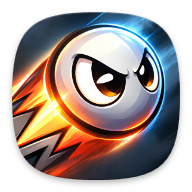
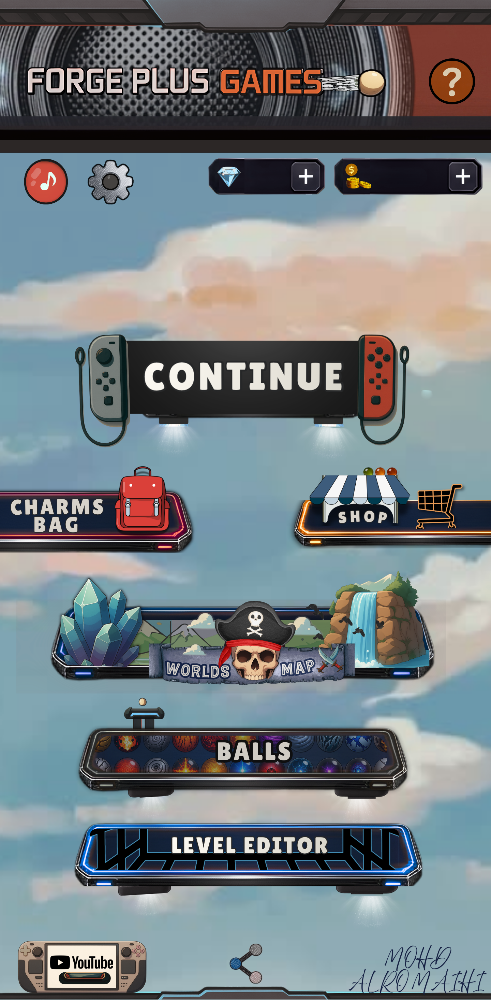
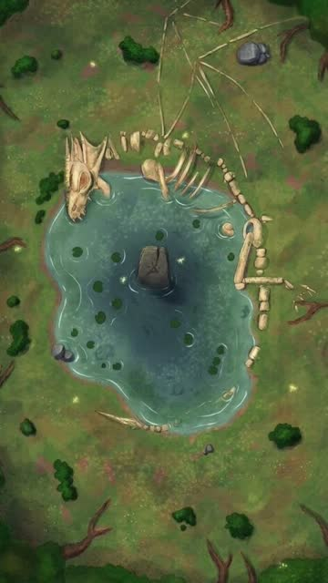
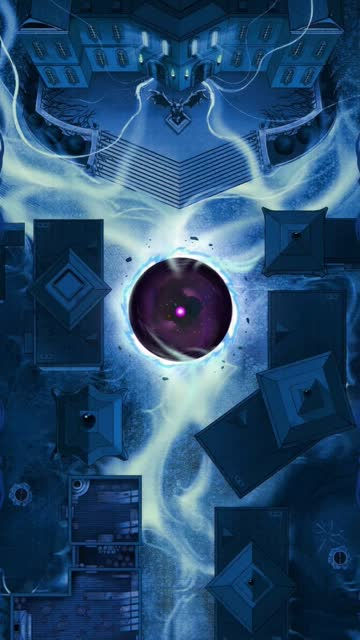

# Brick Breaker Ball

**صوّب. أطلق. واكسر طريقك عبر تسعة عوالم.**

[English](README.md) · [العب من المتصفح](https://bricks-breaker-ball.vercel.app/en/play) · [آخر إصدار لأندرويد](https://github.com/Msr7799/Brick_Breaker_GAME/releases/latest)

**Brick Breaker Ball** لعبة أندرويد عمودية مطوّرة باستخدام **Kotlin وLibGDX**. صوّب دفعات الكرات نحو التشكيلات الهابطة، جهّز عناصر ORBS، وافتح كرات أقوى مع تقدّمك عبر تسعة عوالم مختلفة.

## صور من اللعبة

  
  
  

الصور أعلاه مأخوذة من ملفات اللعبة المستخدمة فعليًا على أندرويد. يضم المشروع خلفيات المراحل والزعماء والطوب والموسيقى ورسومات الواجهة.

## أين تلعب؟ والخدمات المرتبطة

| الخدمة | دورها |
| --- | --- |
|  | صفحة اللعبة على متجر أندرويد. قد يكون APK الموجود في GitHub أحدث من نسخة المتجر. |
| [ Google Play Games](https://developers.google.com/games/services) | يتضمن تطبيق أندرويد تسجيل الدخول إلى Play Games وميزات التقدم المرتبطة بالحساب. |
| [ Google AdMob](https://admob.google.com/) | إعلانات بمكافآت مدمجة في اللعبة. |
| [العب على الموقع](https://bricks-breaker-ball.vercel.app/en/play) | تجربة اللعبة مباشرة من المتصفح. |

تحتاج ميزات Google Play Games وAdMob إلى توفر خدماتها على الجهاز. وتعتمد عمليات الشراء والإعلانات على إعدادات الخدمة والحساب.

## تنزيل نسخة أندرويد

نزّل ملف **APK الموقّع** من [إصدارات GitHub](https://github.com/Msr7799/Brick_Breaker_GAME/releases/latest)، أو ثبّت [نسخة Google Play](https://play.google.com/store/apps/details?id=com.forgepulse.brickbreakerball). ملفات APK تُنشر في قسم الإصدارات، وليست ضمن ملفات الكود.

## تدرّج اللاعب والكرات

كرة Pearl White هي كرة البداية المجانية. لبقية أشكال الكرات سعر واضح بالعملات أو الجواهر، ويمكن فتح بعض أشكال Normal وRare بإكمال مراحل الحملة أيضًا. تبقى الملكية دائمة. اضغط على صورة أي كرة في المتجر لفحصها، أو OWNED لفتح الكرة نفسها في المجموعة.

تعتمد الجولات الجديدة على مستوى لاعب محفوظ مستقل وORBS المجهّزة. يبدأ لاعب المستوى الأول بلا أوربز بـ **10 كرات وضرر 1 لكل إصابة**. لا تضيف أشكال الكرات قوة أو عددًا أو قدرات تلقائية. يزيد المستوى نسبة الضرر الأساسي 10% كل عشرة مستويات مع مرحلتي التقريب الأصليتين، وتصل مكافأته لعدد البداية إلى +10. رقم المرحلة لا يحل محل مستوى اللاعب، والضرر لا يتناسب تلقائيًا مع حياة الهدف.

تستخدم Normal وHard وExtreme منحنيات حياة مختلفة. تبقى الحياة الكسرية داخليًا ويعرض جزؤها الصحيح؛ يموت البريك العادي المستورد عندما تصبح حياته أقل من 1. تحتفظ أهداف عداد الإصابات والبلوكرات الثابتة بقواعدها المنفصلة. يبدأ مستوى القتال المستقل عند 1 وXP صفر دون تغيير المراحل المفتوحة أو اختراع XP سابق. تستمر الجولات المحفوظة القديمة بقواعدها السابقة حتى انتهائها.

### عرض الكرات

تستخدم BALLS الحجر المحفور والخشب والزخارف الخيالية نفسها الموجودة في المتجر وحقيبة ORBS. تظهر الكرة بحجم كبير فوق حلقة إضاءة شفافة، مع تبويبات الندرة والأسهم والسحب الأفقي. تعرض صينية مختصرة ضرر الضربة الحقيقي و**إجمالي** كرات الدفعة ومستوى اللاعب، مع تقدم XP وشرح اختياري. تصف الندرة مجموعة المظهر وليست مضاعفًا قتاليًا مستقلًا.

اضغط على الإحصائية أو **؟** لعرض الشرح. يظهر زر رئيسي واحد حسب الحالة: EQUIP أو EQUIPPED أو UNLOCK، مع السعر وبديل الفتح بالتقدم إن وجد. يفتح UNLOCK الكرة نفسها في المتجر من دون إنفاق عملات داخل هذه الشاشة. تعرض الجولات القديمة المحفوظة إحصائيات قواعدها السابقة. تبقى الملكية والمخزون والمراحل المكتملة محفوظة، ولا يباع تطوير قوة مستقل لكل كرة. يدعم التوزيع الشاشات الطولية والعريضة والمناطق الآمنة وإعداد Reduce Motion.

## مواجهات الزعماء

يظهر زعيم كل عالم بعد نهاية تشكيل المرحلة. تحميه أقفال على بركس الجمجمة: قفلان للعوالم 1–3، وثلاثة للعوالم 4–6، وأربعة للعوالم 7–9. اكسر جميع الأقفال قبل أن تتمكن من إنقاص حياة الزعيم. هزيمته لا تمسح أهداف المرحلة المتبقية.

## هيكل المشروع

اضغط على كل مجلد لعرض وظيفته. في القسم المطوي الأخير فهرس لكل ملف عام من الكود وملفات تشغيل اللعبة مع وصف قصير.

<strong>جذر المشروع والبناء</strong>

| المسار | الوظيفة |
| --- | --- |
| `app/` | وحدة تطبيق أندرويد. |
| `app/build.gradle.kts` | معرف التطبيق والنسخة والمكتبات وأنواع البناء وإعداد التوقيع. |
| `app/proguard-rules.pro` | قواعد تصغير الكود لإصدار النشر. |
| `app/src/main/AndroidManifest.xml` | مكوّنات أندرويد والأذونات وإعدادات التطبيق. |
| `build.gradle.kts` | إعداد إضافات Gradle الأساسية. |
| `settings.gradle.kts` | تعريف المشروع والوحدات. |
| `gradle/libs.versions.toml` | نسخ المكتبات وأسماؤها المختصرة. |
| `gradle/wrapper/` | ملفات نسخة Gradle المثبتة للمشروع. |
| `gradle.properties` | إعدادات Gradle العامة. |
| `gradlew`, `gradlew.bat` | تشغيل Gradle على أنظمة Unix وWindows. |
| `readme-assets/` | شعارات الخدمات المحمّلة لعرضها في الريدمي. |
| `README.md`, `README_AR.md` | شرح المشروع بالإنجليزية والعربية. |

<strong>كود اللعبة · app/src/main/java</strong>

| المجلد | الوظيفة |
| --- | --- |
| `app/` | الربط مع أندرويد والتنقل والحسابات وواجهات التقدم. |
| `assets/` | تحميل الصور والأطالس ورسومات العوالم. |
| `campaign/` | العوالم والمراحل والتقدم وترحيل بيانات الحفظ. |
| `cosmetics/` | مظاهر الكرات والقدرات وفتح العناصر. |
| `economy/` | المكافآت والمتجر والفوترة والإعلانات. |
| `gameplay/` | الفيزياء والتصادم وجلسات Volley وتوليد المراحل. |
| `ui/` | شاشات LibGDX والرسم والتحكم والشروحات. |
| `MainActivity.kt` | نقطة دخول أندرويد وربط خدمات الجهاز. |
| `BrickBreakerGame.kt` | دورة حياة اللعبة والتنقل بين الشاشات. |

<strong>رسومات التشغيل وموارد أندرويد</strong>

| المجلد | الوظيفة |
| --- | --- |
| `app/src/main/assets/atlases/` | أطالس اللعبة وخرائط إحداثيات الصور. |
| `audio/` | الموسيقى والمؤثرات الصوتية. |
| `backgrounds/` | صور البداية والإعدادات وخريطة العوالم. |
| `fonts/` | الخطوط التي تحمّلها اللعبة. |
| `hazard/`, `rules/`, `privacy/` | صور المخاطر وشرح القواعد ومحتوى الخصوصية. |
| `sprites/`, `ui/` | رسومات الكرات والألواح والأزرار والواجهة. |
| `volley-loading/`, `volley-orbs/` | صور تحميل Volley والعناصر القابلة للجمع. |
| `volley-source/` | بيانات المراحل ورسومات الطوب وبياناتها اللازمة للتشغيل. |
| `volley-world/` | خلفيات مراحل تسعة عوالم وزعماؤها وصور التحميل والمعاينات. |
| `app/src/main/res/mipmap-*/` | أحجام أيقونة التطبيق؛ أيقونة أعلى الصفحة من `mipmap-xxxhdpi/ic_launcher.png`. |
| `app/src/main/res/values/`, `xml/` | النصوص والسمات وإعدادات أندرويد. |

كل المسارات بعد `atlases/` في الجدول تبدأ بـ `app/src/main/assets/`.

<!-- FILE_INDEX_START -->

<strong>فهرس الملفات العامة كاملًا · 490 ملفًا</strong>

Android resources / mipmap-anydpi-v26 · 2

- [`app/src/main/res/mipmap-anydpi-v26/ic_launcher.xml`](app/src/main/res/mipmap-anydpi-v26/ic_launcher.xml) — طبقة أيقونة التشغيل لهذا الحجم على أندرويد.
- [`app/src/main/res/mipmap-anydpi-v26/ic_launcher_round.xml`](app/src/main/res/mipmap-anydpi-v26/ic_launcher_round.xml) — طبقة أيقونة التشغيل لهذا الحجم على أندرويد.

Android resources / mipmap-hdpi · 4

- [`app/src/main/res/mipmap-hdpi/ic_launcher.png`](app/src/main/res/mipmap-hdpi/ic_launcher.png) — طبقة أيقونة التشغيل لهذا الحجم على أندرويد.
- [`app/src/main/res/mipmap-hdpi/ic_launcher_background.png`](app/src/main/res/mipmap-hdpi/ic_launcher_background.png) — طبقة أيقونة التشغيل لهذا الحجم على أندرويد.
- [`app/src/main/res/mipmap-hdpi/ic_launcher_foreground.png`](app/src/main/res/mipmap-hdpi/ic_launcher_foreground.png) — طبقة أيقونة التشغيل لهذا الحجم على أندرويد.
- [`app/src/main/res/mipmap-hdpi/ic_launcher_monochrome.png`](app/src/main/res/mipmap-hdpi/ic_launcher_monochrome.png) — طبقة أيقونة التشغيل لهذا الحجم على أندرويد.

Android resources / mipmap-mdpi · 4

- [`app/src/main/res/mipmap-mdpi/ic_launcher.png`](app/src/main/res/mipmap-mdpi/ic_launcher.png) — طبقة أيقونة التشغيل لهذا الحجم على أندرويد.
- [`app/src/main/res/mipmap-mdpi/ic_launcher_background.png`](app/src/main/res/mipmap-mdpi/ic_launcher_background.png) — طبقة أيقونة التشغيل لهذا الحجم على أندرويد.
- [`app/src/main/res/mipmap-mdpi/ic_launcher_foreground.png`](app/src/main/res/mipmap-mdpi/ic_launcher_foreground.png) — طبقة أيقونة التشغيل لهذا الحجم على أندرويد.
- [`app/src/main/res/mipmap-mdpi/ic_launcher_monochrome.png`](app/src/main/res/mipmap-mdpi/ic_launcher_monochrome.png) — طبقة أيقونة التشغيل لهذا الحجم على أندرويد.

Android resources / mipmap-xhdpi · 4

- [`app/src/main/res/mipmap-xhdpi/ic_launcher.png`](app/src/main/res/mipmap-xhdpi/ic_launcher.png) — طبقة أيقونة التشغيل لهذا الحجم على أندرويد.
- [`app/src/main/res/mipmap-xhdpi/ic_launcher_background.png`](app/src/main/res/mipmap-xhdpi/ic_launcher_background.png) — طبقة أيقونة التشغيل لهذا الحجم على أندرويد.
- [`app/src/main/res/mipmap-xhdpi/ic_launcher_foreground.png`](app/src/main/res/mipmap-xhdpi/ic_launcher_foreground.png) — طبقة أيقونة التشغيل لهذا الحجم على أندرويد.
- [`app/src/main/res/mipmap-xhdpi/ic_launcher_monochrome.png`](app/src/main/res/mipmap-xhdpi/ic_launcher_monochrome.png) — طبقة أيقونة التشغيل لهذا الحجم على أندرويد.

Android resources / mipmap-xxhdpi · 4

- [`app/src/main/res/mipmap-xxhdpi/ic_launcher.png`](app/src/main/res/mipmap-xxhdpi/ic_launcher.png) — طبقة أيقونة التشغيل لهذا الحجم على أندرويد.
- [`app/src/main/res/mipmap-xxhdpi/ic_launcher_background.png`](app/src/main/res/mipmap-xxhdpi/ic_launcher_background.png) — طبقة أيقونة التشغيل لهذا الحجم على أندرويد.
- [`app/src/main/res/mipmap-xxhdpi/ic_launcher_foreground.png`](app/src/main/res/mipmap-xxhdpi/ic_launcher_foreground.png) — طبقة أيقونة التشغيل لهذا الحجم على أندرويد.
- [`app/src/main/res/mipmap-xxhdpi/ic_launcher_monochrome.png`](app/src/main/res/mipmap-xxhdpi/ic_launcher_monochrome.png) — طبقة أيقونة التشغيل لهذا الحجم على أندرويد.

Android resources / mipmap-xxxhdpi · 4

- [`app/src/main/res/mipmap-xxxhdpi/ic_launcher.png`](app/src/main/res/mipmap-xxxhdpi/ic_launcher.png) — طبقة أيقونة التشغيل لهذا الحجم على أندرويد.
- [`app/src/main/res/mipmap-xxxhdpi/ic_launcher_background.png`](app/src/main/res/mipmap-xxxhdpi/ic_launcher_background.png) — طبقة أيقونة التشغيل لهذا الحجم على أندرويد.
- [`app/src/main/res/mipmap-xxxhdpi/ic_launcher_foreground.png`](app/src/main/res/mipmap-xxxhdpi/ic_launcher_foreground.png) — طبقة أيقونة التشغيل لهذا الحجم على أندرويد.
- [`app/src/main/res/mipmap-xxxhdpi/ic_launcher_monochrome.png`](app/src/main/res/mipmap-xxxhdpi/ic_launcher_monochrome.png) — طبقة أيقونة التشغيل لهذا الحجم على أندرويد.

Android resources / play_store_512.png · 1

- [`app/src/main/res/play_store_512.png`](app/src/main/res/play_store_512.png) — مورد صورة لنظام أندرويد.

Android resources / values · 2

- [`app/src/main/res/values/strings.xml`](app/src/main/res/values/strings.xml) — مورد XML أو إعداد لنظام أندرويد.
- [`app/src/main/res/values/themes.xml`](app/src/main/res/values/themes.xml) — مورد XML أو إعداد لنظام أندرويد.

Android resources / values-night · 1

- [`app/src/main/res/values-night/themes.xml`](app/src/main/res/values-night/themes.xml) — مورد XML أو إعداد لنظام أندرويد.

Android resources / xml · 2

- [`app/src/main/res/xml/backup_rules.xml`](app/src/main/res/xml/backup_rules.xml) — مورد XML أو إعداد لنظام أندرويد.
- [`app/src/main/res/xml/data_extraction_rules.xml`](app/src/main/res/xml/data_extraction_rules.xml) — مورد XML أو إعداد لنظام أندرويد.

Code / app · 8

- [`app/src/main/java/com/example/brick_breaker_ball/app/CloudProgress.kt`](app/src/main/java/com/example/brick_breaker_ball/app/CloudProgress.kt) — تمثيل تقدم اللاعب المرتبط بالسحابة.
- [`app/src/main/java/com/example/brick_breaker_ball/app/CloudProgressApiClient.kt`](app/src/main/java/com/example/brick_breaker_ball/app/CloudProgressApiClient.kt) — الاتصال بخدمة تقدم اللاعب السحابية.
- [`app/src/main/java/com/example/brick_breaker_ball/app/DailyRewardApiClient.kt`](app/src/main/java/com/example/brick_breaker_ball/app/DailyRewardApiClient.kt) — منطق Daily Reward Api Client ضمن خدمات أندرويد والتنقل.
- [`app/src/main/java/com/example/brick_breaker_ball/app/DevelopmentAccess.kt`](app/src/main/java/com/example/brick_breaker_ball/app/DevelopmentAccess.kt) — منطق Development Access ضمن خدمات أندرويد والتنقل.
- [`app/src/main/java/com/example/brick_breaker_ball/app/Navigator.kt`](app/src/main/java/com/example/brick_breaker_ball/app/Navigator.kt) — منطق Navigator ضمن خدمات أندرويد والتنقل.
- [`app/src/main/java/com/example/brick_breaker_ball/app/PlatformActions.kt`](app/src/main/java/com/example/brick_breaker_ball/app/PlatformActions.kt) — منطق Platform Actions ضمن خدمات أندرويد والتنقل.
- [`app/src/main/java/com/example/brick_breaker_ball/app/PlayGamesBridgeClient.kt`](app/src/main/java/com/example/brick_breaker_ball/app/PlayGamesBridgeClient.kt) — ربط إجراءات اللعبة بخدمات Play Games.
- [`app/src/main/java/com/example/brick_breaker_ball/app/QaDiagnosticsOverlay.kt`](app/src/main/java/com/example/brick_breaker_ball/app/QaDiagnosticsOverlay.kt) — منطق Qa Diagnostics Overlay ضمن خدمات أندرويد والتنقل.

Code / assets · 13

- [`app/src/main/java/com/example/brick_breaker_ball/assets/BoardAtlasRepository.kt`](app/src/main/java/com/example/brick_breaker_ball/assets/BoardAtlasRepository.kt) — منطق Board Atlas Repository ضمن تحميل الصور والموارد.
- [`app/src/main/java/com/example/brick_breaker_ball/assets/BoardSpriteNames.kt`](app/src/main/java/com/example/brick_breaker_ball/assets/BoardSpriteNames.kt) — منطق Board Sprite Names ضمن تحميل الصور والموارد.
- [`app/src/main/java/com/example/brick_breaker_ball/assets/EnglishDigitGlyphs.kt`](app/src/main/java/com/example/brick_breaker_ball/assets/EnglishDigitGlyphs.kt) — منطق English Digit Glyphs ضمن تحميل الصور والموارد.
- [`app/src/main/java/com/example/brick_breaker_ball/assets/GameAssets.kt`](app/src/main/java/com/example/brick_breaker_ball/assets/GameAssets.kt) — تحميل ملفات الوسائط وتخزينها مؤقتًا.
- [`app/src/main/java/com/example/brick_breaker_ball/assets/GuideHelpText.kt`](app/src/main/java/com/example/brick_breaker_ball/assets/GuideHelpText.kt) — منطق Guide Help Text ضمن تحميل الصور والموارد.
- [`app/src/main/java/com/example/brick_breaker_ball/assets/SpriteId.kt`](app/src/main/java/com/example/brick_breaker_ball/assets/SpriteId.kt) — منطق Sprite Id ضمن تحميل الصور والموارد.
- [`app/src/main/java/com/example/brick_breaker_ball/assets/VisualUiArt.kt`](app/src/main/java/com/example/brick_breaker_ball/assets/VisualUiArt.kt) — منطق Visual Ui Art ضمن تحميل الصور والموارد.
- [`app/src/main/java/com/example/brick_breaker_ball/assets/VolleyAssetCatalog.kt`](app/src/main/java/com/example/brick_breaker_ball/assets/VolleyAssetCatalog.kt) — منطق Volley Asset Catalog ضمن تحميل الصور والموارد.
- [`app/src/main/java/com/example/brick_breaker_ball/assets/VolleyBrickPalette.kt`](app/src/main/java/com/example/brick_breaker_ball/assets/VolleyBrickPalette.kt) — منطق Volley Brick Palette ضمن تحميل الصور والموارد.
- [`app/src/main/java/com/example/brick_breaker_ball/assets/VolleySourceBrickArt.kt`](app/src/main/java/com/example/brick_breaker_ball/assets/VolleySourceBrickArt.kt) — منطق Volley Source Brick Art ضمن تحميل الصور والموارد.
- [`app/src/main/java/com/example/brick_breaker_ball/assets/VolleyWorldArt.kt`](app/src/main/java/com/example/brick_breaker_ball/assets/VolleyWorldArt.kt) — منطق Volley World Art ضمن تحميل الصور والموارد.
- [`app/src/main/java/com/example/brick_breaker_ball/assets/WebpAssets.kt`](app/src/main/java/com/example/brick_breaker_ball/assets/WebpAssets.kt) — منطق Webp Assets ضمن تحميل الصور والموارد.
- [`app/src/main/java/com/example/brick_breaker_ball/assets/WorldVideoBackgrounds.kt`](app/src/main/java/com/example/brick_breaker_ball/assets/WorldVideoBackgrounds.kt) — منطق World Video Backgrounds ضمن تحميل الصور والموارد.

Code / campaign · 12

- [`app/src/main/java/com/example/brick_breaker_ball/campaign/Campaign.kt`](app/src/main/java/com/example/brick_breaker_ball/campaign/Campaign.kt) — منطق Campaign ضمن التقدم والمراحل والحفظ.
- [`app/src/main/java/com/example/brick_breaker_ball/campaign/CampaignBrickPalette.kt`](app/src/main/java/com/example/brick_breaker_ball/campaign/CampaignBrickPalette.kt) — منطق Campaign Brick Palette ضمن التقدم والمراحل والحفظ.
- [`app/src/main/java/com/example/brick_breaker_ball/campaign/CampaignGemPolicy.kt`](app/src/main/java/com/example/brick_breaker_ball/campaign/CampaignGemPolicy.kt) — منطق Campaign Gem Policy ضمن التقدم والمراحل والحفظ.
- [`app/src/main/java/com/example/brick_breaker_ball/campaign/CloudProgressSync.kt`](app/src/main/java/com/example/brick_breaker_ball/campaign/CloudProgressSync.kt) — منطق Cloud Progress Sync ضمن التقدم والمراحل والحفظ.
- [`app/src/main/java/com/example/brick_breaker_ball/campaign/CloudSaveCodec.kt`](app/src/main/java/com/example/brick_breaker_ball/campaign/CloudSaveCodec.kt) — منطق Cloud Save Codec ضمن التقدم والمراحل والحفظ.
- [`app/src/main/java/com/example/brick_breaker_ball/campaign/VolleyCampaign.kt`](app/src/main/java/com/example/brick_breaker_ball/campaign/VolleyCampaign.kt) — إعداد عوالم Volley ومراحلها.
- [`app/src/main/java/com/example/brick_breaker_ball/campaign/VolleyOrbInventory.kt`](app/src/main/java/com/example/brick_breaker_ball/campaign/VolleyOrbInventory.kt) — منطق Volley Orb Inventory ضمن التقدم والمراحل والحفظ.
- [`app/src/main/java/com/example/brick_breaker_ball/campaign/VolleyPausedSessionStore.kt`](app/src/main/java/com/example/brick_breaker_ball/campaign/VolleyPausedSessionStore.kt) — منطق Volley Paused Session Store ضمن التقدم والمراحل والحفظ.
- [`app/src/main/java/com/example/brick_breaker_ball/campaign/VolleyProgressMigration.kt`](app/src/main/java/com/example/brick_breaker_ball/campaign/VolleyProgressMigration.kt) — منطق Volley Progress Migration ضمن التقدم والمراحل والحفظ.
- [`app/src/main/java/com/example/brick_breaker_ball/campaign/VolleySourceHealth.kt`](app/src/main/java/com/example/brick_breaker_ball/campaign/VolleySourceHealth.kt) — منطق Volley Source Health ضمن التقدم والمراحل والحفظ.
- [`app/src/main/java/com/example/brick_breaker_ball/campaign/VolleySourceStageData.kt`](app/src/main/java/com/example/brick_breaker_ball/campaign/VolleySourceStageData.kt) — تحويل بيانات المراحل إلى مستويات قابلة للعب.
- [`app/src/main/java/com/example/brick_breaker_ball/campaign/WorldMapSelectionPolicy.kt`](app/src/main/java/com/example/brick_breaker_ball/campaign/WorldMapSelectionPolicy.kt) — منطق World Map Selection Policy ضمن التقدم والمراحل والحفظ.

Code / cosmetics · 5

- [`app/src/main/java/com/example/brick_breaker_ball/cosmetics/BallAbilities.kt`](app/src/main/java/com/example/brick_breaker_ball/cosmetics/BallAbilities.kt) — منطق Ball Abilities ضمن مظاهر الكرات وقدراتها.
- [`app/src/main/java/com/example/brick_breaker_ball/cosmetics/BallCollectionCatalog.kt`](app/src/main/java/com/example/brick_breaker_ball/cosmetics/BallCollectionCatalog.kt) — منطق Ball Collection Catalog ضمن مظاهر الكرات وقدراتها.
- [`app/src/main/java/com/example/brick_breaker_ball/cosmetics/CosmeticModels.kt`](app/src/main/java/com/example/brick_breaker_ball/cosmetics/CosmeticModels.kt) — منطق Cosmetic Models ضمن مظاهر الكرات وقدراتها.
- [`app/src/main/java/com/example/brick_breaker_ball/cosmetics/CosmeticProgression.kt`](app/src/main/java/com/example/brick_breaker_ball/cosmetics/CosmeticProgression.kt) — منطق Cosmetic Progression ضمن مظاهر الكرات وقدراتها.
- [`app/src/main/java/com/example/brick_breaker_ball/cosmetics/CosmeticSpriteRepository.kt`](app/src/main/java/com/example/brick_breaker_ball/cosmetics/CosmeticSpriteRepository.kt) — منطق Cosmetic Sprite Repository ضمن مظاهر الكرات وقدراتها.

Code / economy · 9

- [`app/src/main/java/com/example/brick_breaker_ball/economy/AndroidMonetization.kt`](app/src/main/java/com/example/brick_breaker_ball/economy/AndroidMonetization.kt) — دمج فوترة أندرويد وإعلانات AdMob بالمكافآت.
- [`app/src/main/java/com/example/brick_breaker_ball/economy/BoosterStores.kt`](app/src/main/java/com/example/brick_breaker_ball/economy/BoosterStores.kt) — منطق Booster Stores ضمن المتجر والمكافآت والربح.
- [`app/src/main/java/com/example/brick_breaker_ball/economy/Economy.kt`](app/src/main/java/com/example/brick_breaker_ball/economy/Economy.kt) — منطق Economy ضمن المتجر والمكافآت والربح.
- [`app/src/main/java/com/example/brick_breaker_ball/economy/EnglishPlayPrice.kt`](app/src/main/java/com/example/brick_breaker_ball/economy/EnglishPlayPrice.kt) — منطق English Play Price ضمن المتجر والمكافآت والربح.
- [`app/src/main/java/com/example/brick_breaker_ball/economy/MonetizationServices.kt`](app/src/main/java/com/example/brick_breaker_ball/economy/MonetizationServices.kt) — منطق Monetization Services ضمن المتجر والمكافآت والربح.
- [`app/src/main/java/com/example/brick_breaker_ball/economy/OrbShopPricing.kt`](app/src/main/java/com/example/brick_breaker_ball/economy/OrbShopPricing.kt) — منطق Orb Shop Pricing ضمن المتجر والمكافآت والربح.
- [`app/src/main/java/com/example/brick_breaker_ball/economy/ShopModels.kt`](app/src/main/java/com/example/brick_breaker_ball/economy/ShopModels.kt) — منطق Shop Models ضمن المتجر والمكافآت والربح.
- [`app/src/main/java/com/example/brick_breaker_ball/economy/ShopPagination.kt`](app/src/main/java/com/example/brick_breaker_ball/economy/ShopPagination.kt) — منطق Shop Pagination ضمن المتجر والمكافآت والربح.
- [`app/src/main/java/com/example/brick_breaker_ball/economy/StorePurchaseConfirmation.kt`](app/src/main/java/com/example/brick_breaker_ball/economy/StorePurchaseConfirmation.kt) — منطق Store Purchase Confirmation ضمن المتجر والمكافآت والربح.

Code / entry points · 2

- [`app/src/main/java/com/example/brick_breaker_ball/BrickBreakerGame.kt`](app/src/main/java/com/example/brick_breaker_ball/BrickBreakerGame.kt) — دورة حياة LibGDX والتنسيق بين الشاشات.
- [`app/src/main/java/com/example/brick_breaker_ball/MainActivity.kt`](app/src/main/java/com/example/brick_breaker_ball/MainActivity.kt) — نقطة دخول أندرويد وربط خدمات Google.

Code / gameplay · 22

- [`app/src/main/java/com/example/brick_breaker_ball/gameplay/GameModels.kt`](app/src/main/java/com/example/brick_breaker_ball/gameplay/GameModels.kt) — منطق Game Models ضمن الفيزياء وقواعد اللعب.
- [`app/src/main/java/com/example/brick_breaker_ball/gameplay/GameplayMode.kt`](app/src/main/java/com/example/brick_breaker_ball/gameplay/GameplayMode.kt) — منطق Gameplay Mode ضمن الفيزياء وقواعد اللعب.
- [`app/src/main/java/com/example/brick_breaker_ball/gameplay/GameplayTuning.kt`](app/src/main/java/com/example/brick_breaker_ball/gameplay/GameplayTuning.kt) — منطق Gameplay Tuning ضمن الفيزياء وقواعد اللعب.
- [`app/src/main/java/com/example/brick_breaker_ball/gameplay/ItemEffectCatalog.kt`](app/src/main/java/com/example/brick_breaker_ball/gameplay/ItemEffectCatalog.kt) — منطق Item Effect Catalog ضمن الفيزياء وقواعد اللعب.
- [`app/src/main/java/com/example/brick_breaker_ball/gameplay/SweptCollision.kt`](app/src/main/java/com/example/brick_breaker_ball/gameplay/SweptCollision.kt) — منطق Swept Collision ضمن الفيزياء وقواعد اللعب.
- [`app/src/main/java/com/example/brick_breaker_ball/gameplay/VolleyAimGesture.kt`](app/src/main/java/com/example/brick_breaker_ball/gameplay/VolleyAimGesture.kt) — منطق Volley Aim Gesture ضمن الفيزياء وقواعد اللعب.
- [`app/src/main/java/com/example/brick_breaker_ball/gameplay/VolleyEditorData.kt`](app/src/main/java/com/example/brick_breaker_ball/gameplay/VolleyEditorData.kt) — منطق Volley Editor Data ضمن الفيزياء وقواعد اللعب.
- [`app/src/main/java/com/example/brick_breaker_ball/gameplay/VolleyGeneratedLevelJson.kt`](app/src/main/java/com/example/brick_breaker_ball/gameplay/VolleyGeneratedLevelJson.kt) — منطق Volley Generated Level Json ضمن الفيزياء وقواعد اللعب.
- [`app/src/main/java/com/example/brick_breaker_ball/gameplay/VolleyGeneratorFeature.kt`](app/src/main/java/com/example/brick_breaker_ball/gameplay/VolleyGeneratorFeature.kt) — منطق Volley Generator Feature ضمن الفيزياء وقواعد اللعب.
- [`app/src/main/java/com/example/brick_breaker_ball/gameplay/VolleyGeneratorSamples.kt`](app/src/main/java/com/example/brick_breaker_ball/gameplay/VolleyGeneratorSamples.kt) — منطق Volley Generator Samples ضمن الفيزياء وقواعد اللعب.
- [`app/src/main/java/com/example/brick_breaker_ball/gameplay/VolleyItemController.kt`](app/src/main/java/com/example/brick_breaker_ball/gameplay/VolleyItemController.kt) — منطق Volley Item Controller ضمن الفيزياء وقواعد اللعب.
- [`app/src/main/java/com/example/brick_breaker_ball/gameplay/VolleyLayout.kt`](app/src/main/java/com/example/brick_breaker_ball/gameplay/VolleyLayout.kt) — منطق Volley Layout ضمن الفيزياء وقواعد اللعب.
- [`app/src/main/java/com/example/brick_breaker_ball/gameplay/VolleyLevelGenerator.kt`](app/src/main/java/com/example/brick_breaker_ball/gameplay/VolleyLevelGenerator.kt) — منطق Volley Level Generator ضمن الفيزياء وقواعد اللعب.
- [`app/src/main/java/com/example/brick_breaker_ball/gameplay/VolleyLevelProbe.kt`](app/src/main/java/com/example/brick_breaker_ball/gameplay/VolleyLevelProbe.kt) — منطق Volley Level Probe ضمن الفيزياء وقواعد اللعب.
- [`app/src/main/java/com/example/brick_breaker_ball/gameplay/VolleyModels.kt`](app/src/main/java/com/example/brick_breaker_ball/gameplay/VolleyModels.kt) — منطق Volley Models ضمن الفيزياء وقواعد اللعب.
- [`app/src/main/java/com/example/brick_breaker_ball/gameplay/VolleyOpeningSalvo.kt`](app/src/main/java/com/example/brick_breaker_ball/gameplay/VolleyOpeningSalvo.kt) — منطق Volley Opening Salvo ضمن الفيزياء وقواعد اللعب.
- [`app/src/main/java/com/example/brick_breaker_ball/gameplay/VolleyOrbCatalog.kt`](app/src/main/java/com/example/brick_breaker_ball/gameplay/VolleyOrbCatalog.kt) — منطق Volley Orb Catalog ضمن الفيزياء وقواعد اللعب.
- [`app/src/main/java/com/example/brick_breaker_ball/gameplay/VolleyOrbEffects.kt`](app/src/main/java/com/example/brick_breaker_ball/gameplay/VolleyOrbEffects.kt) — منطق Volley Orb Effects ضمن الفيزياء وقواعد اللعب.
- [`app/src/main/java/com/example/brick_breaker_ball/gameplay/VolleyRankedFormation.kt`](app/src/main/java/com/example/brick_breaker_ball/gameplay/VolleyRankedFormation.kt) — منطق Volley Ranked Formation ضمن الفيزياء وقواعد اللعب.
- [`app/src/main/java/com/example/brick_breaker_ball/gameplay/VolleyRankedGeometry.kt`](app/src/main/java/com/example/brick_breaker_ball/gameplay/VolleyRankedGeometry.kt) — منطق Volley Ranked Geometry ضمن الفيزياء وقواعد اللعب.
- [`app/src/main/java/com/example/brick_breaker_ball/gameplay/VolleySession.kt`](app/src/main/java/com/example/brick_breaker_ball/gameplay/VolleySession.kt) — حالة جولة Volley وأدوارها.
- [`app/src/main/java/com/example/brick_breaker_ball/gameplay/VolleySourceOrbDrops.kt`](app/src/main/java/com/example/brick_breaker_ball/gameplay/VolleySourceOrbDrops.kt) — منطق Volley Source Orb Drops ضمن الفيزياء وقواعد اللعب.

Code / ui · 37

- [`app/src/main/java/com/example/brick_breaker_ball/ui/AppUpdateScreen.kt`](app/src/main/java/com/example/brick_breaker_ball/ui/AppUpdateScreen.kt) — منطق App Update Screen ضمن شاشات اللعبة والتحكم.
- [`app/src/main/java/com/example/brick_breaker_ball/ui/BagScrollMath.kt`](app/src/main/java/com/example/brick_breaker_ball/ui/BagScrollMath.kt) — منطق Bag Scroll Math ضمن شاشات اللعبة والتحكم.
- [`app/src/main/java/com/example/brick_breaker_ball/ui/BallPowerDetailScreen.kt`](app/src/main/java/com/example/brick_breaker_ball/ui/BallPowerDetailScreen.kt) — ربط معاينة المتجر بشاشة عرض الكرة الموحدة.
- [`app/src/main/java/com/example/brick_breaker_ball/ui/BallPowerPreview.kt`](app/src/main/java/com/example/brick_breaker_ball/ui/BallPowerPreview.kt) — قراءة العدد والضرر الحقيقيين ومواعيد زيادة هجوم الحملة.
- [`app/src/main/java/com/example/brick_breaker_ball/ui/BallShowcaseArt.kt`](app/src/main/java/com/example/brick_breaker_ball/ui/BallShowcaseArt.kt) — خامات الأطلس الخيالية المشتركة وإضاءة المنصة الشفافة.
- [`app/src/main/java/com/example/brick_breaker_ball/ui/BallShowcaseLayout.kt`](app/src/main/java/com/example/brick_breaker_ball/ui/BallShowcaseLayout.kt) — توزيع الواجهة ومساحات اللمس للشاشات الطولية والعريضة.
- [`app/src/main/java/com/example/brick_breaker_ball/ui/BallShowcaseScreen.kt`](app/src/main/java/com/example/brick_breaker_ball/ui/BallShowcaseScreen.kt) — عرض الكرة الخيالي والإحصائيات المختصرة والشرح الاختياري والتحكم المحفوظ.
- [`app/src/main/java/com/example/brick_breaker_ball/ui/CharmTutorial.kt`](app/src/main/java/com/example/brick_breaker_ball/ui/CharmTutorial.kt) — منطق Charm Tutorial ضمن شاشات اللعبة والتحكم.
- [`app/src/main/java/com/example/brick_breaker_ball/ui/CloudSaveScreen.kt`](app/src/main/java/com/example/brick_breaker_ball/ui/CloudSaveScreen.kt) — منطق Cloud Save Screen ضمن شاشات اللعبة والتحكم.
- [`app/src/main/java/com/example/brick_breaker_ball/ui/CosmeticUnlockRevealScreen.kt`](app/src/main/java/com/example/brick_breaker_ball/ui/CosmeticUnlockRevealScreen.kt) — منطق Cosmetic Unlock Reveal Screen ضمن شاشات اللعبة والتحكم.
- [`app/src/main/java/com/example/brick_breaker_ball/ui/CustomizationScreen.kt`](app/src/main/java/com/example/brick_breaker_ball/ui/CustomizationScreen.kt) — ربط مجموعة الكرات والحقيبة واللعبة المتوقفة بشاشة عرض الكرة.
- [`app/src/main/java/com/example/brick_breaker_ball/ui/DailyRewardsScreen.kt`](app/src/main/java/com/example/brick_breaker_ball/ui/DailyRewardsScreen.kt) — منطق Daily Rewards Screen ضمن شاشات اللعبة والتحكم.
- [`app/src/main/java/com/example/brick_breaker_ball/ui/ForgeUiPalette.kt`](app/src/main/java/com/example/brick_breaker_ball/ui/ForgeUiPalette.kt) — منطق Forge Ui Palette ضمن شاشات اللعبة والتحكم.
- [`app/src/main/java/com/example/brick_breaker_ball/ui/ForgeUiRenderer.kt`](app/src/main/java/com/example/brick_breaker_ball/ui/ForgeUiRenderer.kt) — منطق Forge Ui Renderer ضمن شاشات اللعبة والتحكم.
- [`app/src/main/java/com/example/brick_breaker_ball/ui/ForgeUiTheme.kt`](app/src/main/java/com/example/brick_breaker_ball/ui/ForgeUiTheme.kt) — منطق Forge Ui Theme ضمن شاشات اللعبة والتحكم.
- [`app/src/main/java/com/example/brick_breaker_ball/ui/HeroGuide.kt`](app/src/main/java/com/example/brick_breaker_ball/ui/HeroGuide.kt) — منطق Hero Guide ضمن شاشات اللعبة والتحكم.
- [`app/src/main/java/com/example/brick_breaker_ball/ui/HeroStoryScreen.kt`](app/src/main/java/com/example/brick_breaker_ball/ui/HeroStoryScreen.kt) — منطق Hero Story Screen ضمن شاشات اللعبة والتحكم.
- [`app/src/main/java/com/example/brick_breaker_ball/ui/Pressable.kt`](app/src/main/java/com/example/brick_breaker_ball/ui/Pressable.kt) — منطق Pressable ضمن شاشات اللعبة والتحكم.
- [`app/src/main/java/com/example/brick_breaker_ball/ui/PrivacyPolicyScreen.kt`](app/src/main/java/com/example/brick_breaker_ball/ui/PrivacyPolicyScreen.kt) — منطق Privacy Policy Screen ضمن شاشات اللعبة والتحكم.
- [`app/src/main/java/com/example/brick_breaker_ball/ui/RewardFxSystem.kt`](app/src/main/java/com/example/brick_breaker_ball/ui/RewardFxSystem.kt) — منطق Reward Fx System ضمن شاشات اللعبة والتحكم.
- [`app/src/main/java/com/example/brick_breaker_ball/ui/RewardRevealScreen.kt`](app/src/main/java/com/example/brick_breaker_ball/ui/RewardRevealScreen.kt) — منطق Reward Reveal Screen ضمن شاشات اللعبة والتحكم.
- [`app/src/main/java/com/example/brick_breaker_ball/ui/RulesScreen.kt`](app/src/main/java/com/example/brick_breaker_ball/ui/RulesScreen.kt) — منطق Rules Screen ضمن شاشات اللعبة والتحكم.
- [`app/src/main/java/com/example/brick_breaker_ball/ui/ShopScreen.kt`](app/src/main/java/com/example/brick_breaker_ball/ui/ShopScreen.kt) — منطق Shop Screen ضمن شاشات اللعبة والتحكم.
- [`app/src/main/java/com/example/brick_breaker_ball/ui/UiConfirmation.kt`](app/src/main/java/com/example/brick_breaker_ball/ui/UiConfirmation.kt) — منطق Ui Confirmation ضمن شاشات اللعبة والتحكم.
- [`app/src/main/java/com/example/brick_breaker_ball/ui/UiFeedback.kt`](app/src/main/java/com/example/brick_breaker_ball/ui/UiFeedback.kt) — منطق Ui Feedback ضمن شاشات اللعبة والتحكم.
- [`app/src/main/java/com/example/brick_breaker_ball/ui/UiMetrics.kt`](app/src/main/java/com/example/brick_breaker_ball/ui/UiMetrics.kt) — منطق Ui Metrics ضمن شاشات اللعبة والتحكم.
- [`app/src/main/java/com/example/brick_breaker_ball/ui/UiMotion.kt`](app/src/main/java/com/example/brick_breaker_ball/ui/UiMotion.kt) — منطق Ui Motion ضمن شاشات اللعبة والتحكم.
- [`app/src/main/java/com/example/brick_breaker_ball/ui/UiScreens.kt`](app/src/main/java/com/example/brick_breaker_ball/ui/UiScreens.kt) — منطق Ui Screens ضمن شاشات اللعبة والتحكم.
- [`app/src/main/java/com/example/brick_breaker_ball/ui/VisualGameUi.kt`](app/src/main/java/com/example/brick_breaker_ball/ui/VisualGameUi.kt) — منطق Visual Game Ui ضمن شاشات اللعبة والتحكم.
- [`app/src/main/java/com/example/brick_breaker_ball/ui/VisualHelpOverlay.kt`](app/src/main/java/com/example/brick_breaker_ball/ui/VisualHelpOverlay.kt) — منطق Visual Help Overlay ضمن شاشات اللعبة والتحكم.
- [`app/src/main/java/com/example/brick_breaker_ball/ui/VolleyBossDialogueScreen.kt`](app/src/main/java/com/example/brick_breaker_ball/ui/VolleyBossDialogueScreen.kt) — منطق Volley Boss Dialogue Screen ضمن شاشات اللعبة والتحكم.
- [`app/src/main/java/com/example/brick_breaker_ball/ui/VolleyControlTutorial.kt`](app/src/main/java/com/example/brick_breaker_ball/ui/VolleyControlTutorial.kt) — منطق Volley Control Tutorial ضمن شاشات اللعبة والتحكم.
- [`app/src/main/java/com/example/brick_breaker_ball/ui/VolleyGameScreen.kt`](app/src/main/java/com/example/brick_breaker_ball/ui/VolleyGameScreen.kt) — منطق Volley Game Screen ضمن شاشات اللعبة والتحكم.
- [`app/src/main/java/com/example/brick_breaker_ball/ui/VolleyLevelEditorScreen.kt`](app/src/main/java/com/example/brick_breaker_ball/ui/VolleyLevelEditorScreen.kt) — منطق Volley Level Editor Screen ضمن شاشات اللعبة والتحكم.
- [`app/src/main/java/com/example/brick_breaker_ball/ui/VolleyLoadingScreen.kt`](app/src/main/java/com/example/brick_breaker_ball/ui/VolleyLoadingScreen.kt) — منطق Volley Loading Screen ضمن شاشات اللعبة والتحكم.
- [`app/src/main/java/com/example/brick_breaker_ball/ui/VolleyOrbsScreen.kt`](app/src/main/java/com/example/brick_breaker_ball/ui/VolleyOrbsScreen.kt) — منطق Volley Orbs Screen ضمن شاشات اللعبة والتحكم.
- [`app/src/main/java/com/example/brick_breaker_ball/ui/WalletText.kt`](app/src/main/java/com/example/brick_breaker_ball/ui/WalletText.kt) — منطق Wallet Text ضمن شاشات اللعبة والتحكم.

Game assets / atlases · 8

- [`app/src/main/assets/atlases/assets_sheet_atlas.atlas`](app/src/main/assets/atlases/assets_sheet_atlas.atlas) — ملف تشغيل: أطلس الصور.
- [`app/src/main/assets/atlases/assets_sheet_atlas.png`](app/src/main/assets/atlases/assets_sheet_atlas.png) — ملف تشغيل: أطلس الصور.
- [`app/src/main/assets/atlases/balls.atlas`](app/src/main/assets/atlases/balls.atlas) — ملف تشغيل: أطلس الصور.
- [`app/src/main/assets/atlases/balls.png`](app/src/main/assets/atlases/balls.png) — ملف تشغيل: أطلس الصور.
- [`app/src/main/assets/atlases/particles.atlas`](app/src/main/assets/atlases/particles.atlas) — ملف تشغيل: أطلس الصور.
- [`app/src/main/assets/atlases/particles.png`](app/src/main/assets/atlases/particles.png) — ملف تشغيل: أطلس الصور.
- [`app/src/main/assets/atlases/volley.atlas`](app/src/main/assets/atlases/volley.atlas) — ملف تشغيل: أطلس الصور.
- [`app/src/main/assets/atlases/volley.png`](app/src/main/assets/atlases/volley.png) — ملف تشغيل: أطلس الصور.

Game assets / audio · 32

- [`app/src/main/assets/audio/boss_final_war_drums.ogg`](app/src/main/assets/audio/boss_final_war_drums.ogg) — ملف تشغيل: موسيقى أو مؤثر صوتي.
- [`app/src/main/assets/audio/boss_intro_evil_laugh.ogg`](app/src/main/assets/audio/boss_intro_evil_laugh.ogg) — ملف تشغيل: موسيقى أو مؤثر صوتي.
- [`app/src/main/assets/audio/brick_hit.ogg`](app/src/main/assets/audio/brick_hit.ogg) — ملف تشغيل: موسيقى أو مؤثر صوتي.
- [`app/src/main/assets/audio/explosion.ogg`](app/src/main/assets/audio/explosion.ogg) — ملف تشغيل: موسيقى أو مؤثر صوتي.
- [`app/src/main/assets/audio/glass_hit.ogg`](app/src/main/assets/audio/glass_hit.ogg) — ملف تشغيل: موسيقى أو مؤثر صوتي.
- [`app/src/main/assets/audio/laser_fire.ogg`](app/src/main/assets/audio/laser_fire.ogg) — ملف تشغيل: موسيقى أو مؤثر صوتي.
- [`app/src/main/assets/audio/level_up.ogg`](app/src/main/assets/audio/level_up.ogg) — ملف تشغيل: موسيقى أو مؤثر صوتي.
- [`app/src/main/assets/audio/menu_intro_theme.ogg`](app/src/main/assets/audio/menu_intro_theme.ogg) — ملف تشغيل: موسيقى أو مؤثر صوتي.
- [`app/src/main/assets/audio/metal_hit.ogg`](app/src/main/assets/audio/metal_hit.ogg) — ملف تشغيل: موسيقى أو مؤثر صوتي.
- [`app/src/main/assets/audio/pop_shoot.wav`](app/src/main/assets/audio/pop_shoot.wav) — ملف تشغيل: موسيقى أو مؤثر صوتي.
- [`app/src/main/assets/audio/powerup.ogg`](app/src/main/assets/audio/powerup.ogg) — ملف تشغيل: موسيقى أو مؤثر صوتي.
- [`app/src/main/assets/audio/source_orb_found.wav`](app/src/main/assets/audio/source_orb_found.wav) — ملف تشغيل: موسيقى أو مؤثر صوتي.
- [`app/src/main/assets/audio/source_orb_legendary.wav`](app/src/main/assets/audio/source_orb_legendary.wav) — ملف تشغيل: موسيقى أو مؤثر صوتي.
- [`app/src/main/assets/audio/thud3.mp3`](app/src/main/assets/audio/thud3.mp3) — ملف تشغيل: موسيقى أو مؤثر صوتي.
- [`app/src/main/assets/audio/ui_click.ogg`](app/src/main/assets/audio/ui_click.ogg) — ملف تشغيل: موسيقى أو مؤثر صوتي.
- [`app/src/main/assets/audio/ui_pop.ogg`](app/src/main/assets/audio/ui_pop.ogg) — ملف تشغيل: موسيقى أو مؤثر صوتي.
- [`app/src/main/assets/audio/wall_hit.ogg`](app/src/main/assets/audio/wall_hit.ogg) — ملف تشغيل: موسيقى أو مؤثر صوتي.
- [`app/src/main/assets/audio/world_01_forest_theme.ogg`](app/src/main/assets/audio/world_01_forest_theme.ogg) — ملف تشغيل: موسيقى أو مؤثر صوتي.
- [`app/src/main/assets/audio/world_02_venom_theme.ogg`](app/src/main/assets/audio/world_02_venom_theme.ogg) — ملف تشغيل: موسيقى أو مؤثر صوتي.
- [`app/src/main/assets/audio/world_02_water_drips.ogg`](app/src/main/assets/audio/world_02_water_drips.ogg) — ملف تشغيل: موسيقى أو مؤثر صوتي.
- [`app/src/main/assets/audio/world_03_04_aqua_desert_theme.ogg`](app/src/main/assets/audio/world_03_04_aqua_desert_theme.ogg) — ملف تشغيل: موسيقى أو مؤثر صوتي.
- [`app/src/main/assets/audio/world_05_blizzard_ambience.ogg`](app/src/main/assets/audio/world_05_blizzard_ambience.ogg) — ملف تشغيل: موسيقى أو مؤثر صوتي.
- [`app/src/main/assets/audio/world_06_ghost_whisper.ogg`](app/src/main/assets/audio/world_06_ghost_whisper.ogg) — ملف تشغيل: موسيقى أو مؤثر صوتي.
- [`app/src/main/assets/audio/world_06_raven_call.ogg`](app/src/main/assets/audio/world_06_raven_call.ogg) — ملف تشغيل: موسيقى أو مؤثر صوتي.
- [`app/src/main/assets/audio/world_06_souls_theme.ogg`](app/src/main/assets/audio/world_06_souls_theme.ogg) — ملف تشغيل: موسيقى أو مؤثر صوتي.
- [`app/src/main/assets/audio/world_06_wolf_howl.ogg`](app/src/main/assets/audio/world_06_wolf_howl.ogg) — ملف تشغيل: موسيقى أو مؤثر صوتي.
- [`app/src/main/assets/audio/world_07_moon_theme.ogg`](app/src/main/assets/audio/world_07_moon_theme.ogg) — ملف تشغيل: موسيقى أو مؤثر صوتي.
- [`app/src/main/assets/audio/world_08_dragon_breath.ogg`](app/src/main/assets/audio/world_08_dragon_breath.ogg) — ملف تشغيل: موسيقى أو مؤثر صوتي.
- [`app/src/main/assets/audio/world_08_dragon_exhale.ogg`](app/src/main/assets/audio/world_08_dragon_exhale.ogg) — ملف تشغيل: موسيقى أو مؤثر صوتي.
- [`app/src/main/assets/audio/world_08_fire_crackling.ogg`](app/src/main/assets/audio/world_08_fire_crackling.ogg) — ملف تشغيل: موسيقى أو مؤثر صوتي.
- [`app/src/main/assets/audio/world_08_infernal_theme.ogg`](app/src/main/assets/audio/world_08_infernal_theme.ogg) — ملف تشغيل: موسيقى أو مؤثر صوتي.
- [`app/src/main/assets/audio/world_09_final_eclipse_theme.ogg`](app/src/main/assets/audio/world_09_final_eclipse_theme.ogg) — ملف تشغيل: موسيقى أو مؤثر صوتي.

Game assets / backgrounds · 22

- [`app/src/main/assets/backgrounds/splash.mp4`](app/src/main/assets/backgrounds/splash.mp4) — ملف تشغيل: صورة للقائمة أو الخريطة.
- [`app/src/main/assets/backgrounds/start-screen/lock-icon.png`](app/src/main/assets/backgrounds/start-screen/lock-icon.png) — ملف تشغيل: صورة للقائمة أو الخريطة.
- [`app/src/main/assets/backgrounds/start-screen/main-screen/main-screen-FINAIL.json`](app/src/main/assets/backgrounds/start-screen/main-screen/main-screen-FINAIL.json) — بيانات تشغيل أو إحداثيات صورة للقائمة أو الخريطة.
- [`app/src/main/assets/backgrounds/start-screen/main-screen/main-screen-volley.mp4`](app/src/main/assets/backgrounds/start-screen/main-screen/main-screen-volley.mp4) — ملف تشغيل: صورة للقائمة أو الخريطة.
- [`app/src/main/assets/backgrounds/start-screen/main-screen/main-screen-volley.png`](app/src/main/assets/backgrounds/start-screen/main-screen/main-screen-volley.png) — ملف تشغيل: صورة للقائمة أو الخريطة.
- [`app/src/main/assets/backgrounds/start-screen/main-screen/new-game-btn-final.png`](app/src/main/assets/backgrounds/start-screen/main-screen/new-game-btn-final.png) — ملف تشغيل: صورة للقائمة أو الخريطة.
- [`app/src/main/assets/backgrounds/start-screen/main-screen/sound-off-btn-final.png`](app/src/main/assets/backgrounds/start-screen/main-screen/sound-off-btn-final.png) — ملف تشغيل: صورة للقائمة أو الخريطة.
- [`app/src/main/assets/backgrounds/start-screen/setting/check-off.png`](app/src/main/assets/backgrounds/start-screen/setting/check-off.png) — ملف تشغيل: صورة للقائمة أو الخريطة.
- [`app/src/main/assets/backgrounds/start-screen/setting/check-on.png`](app/src/main/assets/backgrounds/start-screen/setting/check-on.png) — ملف تشغيل: صورة للقائمة أو الخريطة.
- [`app/src/main/assets/backgrounds/start-screen/setting/color-blind-palette.png`](app/src/main/assets/backgrounds/start-screen/setting/color-blind-palette.png) — ملف تشغيل: صورة للقائمة أو الخريطة.
- [`app/src/main/assets/backgrounds/start-screen/setting/contrest-ball.png`](app/src/main/assets/backgrounds/start-screen/setting/contrest-ball.png) — ملف تشغيل: صورة للقائمة أو الخريطة.
- [`app/src/main/assets/backgrounds/start-screen/setting/game-developer.png`](app/src/main/assets/backgrounds/start-screen/setting/game-developer.png) — ملف تشغيل: صورة للقائمة أو الخريطة.
- [`app/src/main/assets/backgrounds/start-screen/setting/github.png`](app/src/main/assets/backgrounds/start-screen/setting/github.png) — ملف تشغيل: صورة للقائمة أو الخريطة.
- [`app/src/main/assets/backgrounds/start-screen/setting/haptics.png`](app/src/main/assets/backgrounds/start-screen/setting/haptics.png) — ملف تشغيل: صورة للقائمة أو الخريطة.
- [`app/src/main/assets/backgrounds/start-screen/setting/motion.png`](app/src/main/assets/backgrounds/start-screen/setting/motion.png) — ملف تشغيل: صورة للقائمة أو الخريطة.
- [`app/src/main/assets/backgrounds/start-screen/setting/save&amp;back.png`](app/src/main/assets/backgrounds/start-screen/setting/save%26back.png) — ملف تشغيل: صورة للقائمة أو الخريطة.
- [`app/src/main/assets/backgrounds/start-screen/setting/sound-btn-off.png`](app/src/main/assets/backgrounds/start-screen/setting/sound-btn-off.png) — ملف تشغيل: صورة للقائمة أو الخريطة.
- [`app/src/main/assets/backgrounds/start-screen/setting/sound-btn.png`](app/src/main/assets/backgrounds/start-screen/setting/sound-btn.png) — ملف تشغيل: صورة للقائمة أو الخريطة.
- [`app/src/main/assets/backgrounds/start-screen/setting/sound.png`](app/src/main/assets/backgrounds/start-screen/setting/sound.png) — ملف تشغيل: صورة للقائمة أو الخريطة.
- [`app/src/main/assets/backgrounds/worlds-map-images/star-off.png`](app/src/main/assets/backgrounds/worlds-map-images/star-off.png) — ملف تشغيل: صورة للقائمة أو الخريطة.
- [`app/src/main/assets/backgrounds/worlds-map-images/star-on.png`](app/src/main/assets/backgrounds/worlds-map-images/star-on.png) — ملف تشغيل: صورة للقائمة أو الخريطة.
- [`app/src/main/assets/backgrounds/worlds-map-images/worlds-maps-lock-icon.png`](app/src/main/assets/backgrounds/worlds-map-images/worlds-maps-lock-icon.png) — ملف تشغيل: صورة للقائمة أو الخريطة.

Game assets / fonts · 3

- [`app/src/main/assets/fonts/GOTHAM-BOLD.TTF`](app/src/main/assets/fonts/GOTHAM-BOLD.TTF) — ملف تشغيل: خط اللعبة.
- [`app/src/main/assets/fonts/Insignia.ttf`](app/src/main/assets/fonts/Insignia.ttf) — ملف تشغيل: خط اللعبة.
- [`app/src/main/assets/fonts/TANHEADLINE-Regular.ttf`](app/src/main/assets/fonts/TANHEADLINE-Regular.ttf) — ملف تشغيل: خط اللعبة.

Game assets / hazard · 1

- [`app/src/main/assets/hazard/electric_floor_wire.png`](app/src/main/assets/hazard/electric_floor_wire.png) — ملف تشغيل: صورة عنصر خطر.

Game assets / privacy · 1

- [`app/src/main/assets/privacy/privacy_policy.txt`](app/src/main/assets/privacy/privacy_policy.txt) — ملف تشغيل: محتوى الخصوصية.

Game assets / rules · 1

- [`app/src/main/assets/rules/BrickBreakerBall_Volley_Rules_EN.txt`](app/src/main/assets/rules/BrickBreakerBall_Volley_Rules_EN.txt) — ملف تشغيل: صورة توضيح قاعدة اللعب.

Game assets / sprites · 2

- [`app/src/main/assets/sprites/balls-sprites/New-Balls.json`](app/src/main/assets/sprites/balls-sprites/New-Balls.json) — بيانات تشغيل أو إحداثيات صورة كرة أو مضرب.
- [`app/src/main/assets/sprites/balls-sprites/New-Balls.png`](app/src/main/assets/sprites/balls-sprites/New-Balls.png) — ملف تشغيل: صورة كرة أو مضرب.

Game assets / ui · 31

- [`app/src/main/assets/ui/ball_collection_buttons.json`](app/src/main/assets/ui/ball_collection_buttons.json) — بيانات تشغيل أو إحداثيات صورة من واجهة اللعبة.
- [`app/src/main/assets/ui/ball_collection_buttons.png`](app/src/main/assets/ui/ball_collection_buttons.png) — ملف تشغيل: صورة من واجهة اللعبة.
- [`app/src/main/assets/ui/boards.json`](app/src/main/assets/ui/boards.json) — بيانات تشغيل أو إحداثيات صورة من واجهة اللعبة.
- [`app/src/main/assets/ui/boards1.png`](app/src/main/assets/ui/boards1.png) — ملف تشغيل: صورة من واجهة اللعبة.
- [`app/src/main/assets/ui/boards2.json`](app/src/main/assets/ui/boards2.json) — بيانات تشغيل أو إحداثيات صورة من واجهة اللعبة.
- [`app/src/main/assets/ui/boards2.png`](app/src/main/assets/ui/boards2.png) — ملف تشغيل: صورة من واجهة اللعبة.
- [`app/src/main/assets/ui/game-icons/back.png`](app/src/main/assets/ui/game-icons/back.png) — ملف تشغيل: صورة من واجهة اللعبة.
- [`app/src/main/assets/ui/game-icons/ball.png`](app/src/main/assets/ui/game-icons/ball.png) — ملف تشغيل: صورة من واجهة اللعبة.
- [`app/src/main/assets/ui/game-icons/home.png`](app/src/main/assets/ui/game-icons/home.png) — ملف تشغيل: صورة من واجهة اللعبة.
- [`app/src/main/assets/ui/game-icons/pause.png`](app/src/main/assets/ui/game-icons/pause.png) — ملف تشغيل: صورة من واجهة اللعبة.
- [`app/src/main/assets/ui/game-icons/play.png`](app/src/main/assets/ui/game-icons/play.png) — ملف تشغيل: صورة من واجهة اللعبة.
- [`app/src/main/assets/ui/game-icons/restart.png`](app/src/main/assets/ui/game-icons/restart.png) — ملف تشغيل: صورة من واجهة اللعبة.
- [`app/src/main/assets/ui/game-icons/use.png`](app/src/main/assets/ui/game-icons/use.png) — ملف تشغيل: صورة من واجهة اللعبة.
- [`app/src/main/assets/ui/game-symbols/balls.png`](app/src/main/assets/ui/game-symbols/balls.png) — ملف تشغيل: صورة من واجهة اللعبة.
- [`app/src/main/assets/ui/game-symbols/check.png`](app/src/main/assets/ui/game-symbols/check.png) — ملف تشغيل: صورة من واجهة اللعبة.
- [`app/src/main/assets/ui/game-symbols/damage.png`](app/src/main/assets/ui/game-symbols/damage.png) — ملف تشغيل: صورة من واجهة اللعبة.
- [`app/src/main/assets/ui/game-symbols/details.png`](app/src/main/assets/ui/game-symbols/details.png) — ملف تشغيل: صورة من واجهة اللعبة.
- [`app/src/main/assets/ui/game-symbols/help.png`](app/src/main/assets/ui/game-symbols/help.png) — ملف تشغيل: صورة من واجهة اللعبة.
- [`app/src/main/assets/ui/game-symbols/manifest.json`](app/src/main/assets/ui/game-symbols/manifest.json) — بيانات تشغيل أو إحداثيات صورة من واجهة اللعبة.
- [`app/src/main/assets/ui/game-symbols/spread.png`](app/src/main/assets/ui/game-symbols/spread.png) — ملف تشغيل: صورة من واجهة اللعبة.
- [`app/src/main/assets/ui/game-symbols/straight.png`](app/src/main/assets/ui/game-symbols/straight.png) — ملف تشغيل: صورة من واجهة اللعبة.
- [`app/src/main/assets/ui/hero-guide/forge_dragon_guide.png`](app/src/main/assets/ui/hero-guide/forge_dragon_guide.png) — ملف تشغيل: صورة من واجهة اللعبة.
- [`app/src/main/assets/ui/hero-guide/help-en.json`](app/src/main/assets/ui/hero-guide/help-en.json) — بيانات تشغيل أو إحداثيات صورة من واجهة اللعبة.
- [`app/src/main/assets/ui/hero-guide/orb_sage_guide.png`](app/src/main/assets/ui/hero-guide/orb_sage_guide.png) — ملف تشغيل: صورة من واجهة اللعبة.
- [`app/src/main/assets/ui/splash_keyart.png`](app/src/main/assets/ui/splash_keyart.png) — ملف تشغيل: صورة من واجهة اللعبة.
- [`app/src/main/assets/ui/star_icon.png`](app/src/main/assets/ui/star_icon.png) — ملف تشغيل: صورة من واجهة اللعبة.
- [`app/src/main/assets/ui/volley_editor_atlas.json`](app/src/main/assets/ui/volley_editor_atlas.json) — بيانات تشغيل أو إحداثيات صورة من واجهة اللعبة.
- [`app/src/main/assets/ui/volley_editor_atlas.png`](app/src/main/assets/ui/volley_editor_atlas.png) — ملف تشغيل: صورة من واجهة اللعبة.
- [`app/src/main/assets/ui/volley_editor_controls.json`](app/src/main/assets/ui/volley_editor_controls.json) — بيانات تشغيل أو إحداثيات صورة من واجهة اللعبة.
- [`app/src/main/assets/ui/volley_editor_controls.png`](app/src/main/assets/ui/volley_editor_controls.png) — ملف تشغيل: صورة من واجهة اللعبة.
- [`app/src/main/assets/ui/world_done_icon.png`](app/src/main/assets/ui/world_done_icon.png) — ملف تشغيل: صورة من واجهة اللعبة.

Game assets / volley-loading · 12

- [`app/src/main/assets/volley-loading/loader/frame_00.png`](app/src/main/assets/volley-loading/loader/frame_00.png) — ملف تشغيل: صورة تحميل Volley.
- [`app/src/main/assets/volley-loading/loader/frame_01.png`](app/src/main/assets/volley-loading/loader/frame_01.png) — ملف تشغيل: صورة تحميل Volley.
- [`app/src/main/assets/volley-loading/loader/frame_02.png`](app/src/main/assets/volley-loading/loader/frame_02.png) — ملف تشغيل: صورة تحميل Volley.
- [`app/src/main/assets/volley-loading/loader/frame_03.png`](app/src/main/assets/volley-loading/loader/frame_03.png) — ملف تشغيل: صورة تحميل Volley.
- [`app/src/main/assets/volley-loading/loader/frame_04.png`](app/src/main/assets/volley-loading/loader/frame_04.png) — ملف تشغيل: صورة تحميل Volley.
- [`app/src/main/assets/volley-loading/loader/frame_05.png`](app/src/main/assets/volley-loading/loader/frame_05.png) — ملف تشغيل: صورة تحميل Volley.
- [`app/src/main/assets/volley-loading/loader/frame_06.png`](app/src/main/assets/volley-loading/loader/frame_06.png) — ملف تشغيل: صورة تحميل Volley.
- [`app/src/main/assets/volley-loading/loader/frame_07.png`](app/src/main/assets/volley-loading/loader/frame_07.png) — ملف تشغيل: صورة تحميل Volley.
- [`app/src/main/assets/volley-loading/loader/frame_08.png`](app/src/main/assets/volley-loading/loader/frame_08.png) — ملف تشغيل: صورة تحميل Volley.
- [`app/src/main/assets/volley-loading/loader/frame_09.png`](app/src/main/assets/volley-loading/loader/frame_09.png) — ملف تشغيل: صورة تحميل Volley.
- [`app/src/main/assets/volley-loading/loader/frame_10.png`](app/src/main/assets/volley-loading/loader/frame_10.png) — ملف تشغيل: صورة تحميل Volley.
- [`app/src/main/assets/volley-loading/loader/frame_11.png`](app/src/main/assets/volley-loading/loader/frame_11.png) — ملف تشغيل: صورة تحميل Volley.

Game assets / volley-orbs · 2

- [`app/src/main/assets/volley-orbs/orb-atlas.json`](app/src/main/assets/volley-orbs/orb-atlas.json) — بيانات تشغيل أو إحداثيات صورة عنصر Volley.
- [`app/src/main/assets/volley-orbs/orb-atlas.png`](app/src/main/assets/volley-orbs/orb-atlas.png) — ملف تشغيل: صورة عنصر Volley.

Game assets / volley-source · 71

- [`app/src/main/assets/volley-source/bricks/Enemies/Addons/Enemy_reinforced_top1.png`](app/src/main/assets/volley-source/bricks/Enemies/Addons/Enemy_reinforced_top1.png) — ملف تشغيل: صورة طوب من مراحل Volley.
- [`app/src/main/assets/volley-source/bricks/Enemies/Addons/Enemy_reinforced_top3.png`](app/src/main/assets/volley-source/bricks/Enemies/Addons/Enemy_reinforced_top3.png) — ملف تشغيل: صورة طوب من مراحل Volley.
- [`app/src/main/assets/volley-source/bricks/Enemies/Black/Enemy_black_2x2_DL.png`](app/src/main/assets/volley-source/bricks/Enemies/Black/Enemy_black_2x2_DL.png) — ملف تشغيل: صورة طوب من مراحل Volley.
- [`app/src/main/assets/volley-source/bricks/Enemies/Black/Enemy_black_2x2_DR.png`](app/src/main/assets/volley-source/bricks/Enemies/Black/Enemy_black_2x2_DR.png) — ملف تشغيل: صورة طوب من مراحل Volley.
- [`app/src/main/assets/volley-source/bricks/Enemies/Black/Enemy_black_2x2_SQ.png`](app/src/main/assets/volley-source/bricks/Enemies/Black/Enemy_black_2x2_SQ.png) — ملف تشغيل: صورة طوب من مراحل Volley.
- [`app/src/main/assets/volley-source/bricks/Enemies/Black/Enemy_black_2x2_UL.png`](app/src/main/assets/volley-source/bricks/Enemies/Black/Enemy_black_2x2_UL.png) — ملف تشغيل: صورة طوب من مراحل Volley.
- [`app/src/main/assets/volley-source/bricks/Enemies/Black/Enemy_black_2x2_UR.png`](app/src/main/assets/volley-source/bricks/Enemies/Black/Enemy_black_2x2_UR.png) — ملف تشغيل: صورة طوب من مراحل Volley.
- [`app/src/main/assets/volley-source/bricks/Enemies/Blocker/Black1/Enemy_black_block_SQ112.png`](app/src/main/assets/volley-source/bricks/Enemies/Blocker/Black1/Enemy_black_block_SQ112.png) — ملف تشغيل: صورة طوب من مراحل Volley.
- [`app/src/main/assets/volley-source/bricks/Enemies/Blocker/Black1/Enemy_black_blocker_DL2.png`](app/src/main/assets/volley-source/bricks/Enemies/Blocker/Black1/Enemy_black_blocker_DL2.png) — ملف تشغيل: صورة طوب من مراحل Volley.
- [`app/src/main/assets/volley-source/bricks/Enemies/Blocker/Black1/Enemy_black_blocker_DR2.png`](app/src/main/assets/volley-source/bricks/Enemies/Blocker/Black1/Enemy_black_blocker_DR2.png) — ملف تشغيل: صورة طوب من مراحل Volley.
- [`app/src/main/assets/volley-source/bricks/Enemies/Blocker/Black1/Enemy_black_blocker_UL2.png`](app/src/main/assets/volley-source/bricks/Enemies/Blocker/Black1/Enemy_black_blocker_UL2.png) — ملف تشغيل: صورة طوب من مراحل Volley.
- [`app/src/main/assets/volley-source/bricks/Enemies/Blocker/Black1/Enemy_black_blocker_UR2.png`](app/src/main/assets/volley-source/bricks/Enemies/Blocker/Black1/Enemy_black_blocker_UR2.png) — ملف تشغيل: صورة طوب من مراحل Volley.
- [`app/src/main/assets/volley-source/bricks/Enemies/Blocker/DestroyableDF/Enemy_DestroyableDF_2x2_DL.png`](app/src/main/assets/volley-source/bricks/Enemies/Blocker/DestroyableDF/Enemy_DestroyableDF_2x2_DL.png) — ملف تشغيل: صورة طوب من مراحل Volley.
- [`app/src/main/assets/volley-source/bricks/Enemies/Blocker/DestroyableDF/Enemy_DestroyableDF_2x2_DR.png`](app/src/main/assets/volley-source/bricks/Enemies/Blocker/DestroyableDF/Enemy_DestroyableDF_2x2_DR.png) — ملف تشغيل: صورة طوب من مراحل Volley.
- [`app/src/main/assets/volley-source/bricks/Enemies/Blocker/DestroyableDF/Enemy_DestroyableDF_2x2_SQ.png`](app/src/main/assets/volley-source/bricks/Enemies/Blocker/DestroyableDF/Enemy_DestroyableDF_2x2_SQ.png) — ملف تشغيل: صورة طوب من مراحل Volley.
- [`app/src/main/assets/volley-source/bricks/Enemies/Blocker/DestroyableDF/Enemy_DestroyableDF_2x2_UL.png`](app/src/main/assets/volley-source/bricks/Enemies/Blocker/DestroyableDF/Enemy_DestroyableDF_2x2_UL.png) — ملف تشغيل: صورة طوب من مراحل Volley.
- [`app/src/main/assets/volley-source/bricks/Enemies/Blocker/DestroyableDF/Enemy_DestroyableDF_2x2_UR.png`](app/src/main/assets/volley-source/bricks/Enemies/Blocker/DestroyableDF/Enemy_DestroyableDF_2x2_UR.png) — ملف تشغيل: صورة طوب من مراحل Volley.
- [`app/src/main/assets/volley-source/bricks/Enemies/Blocker/Ice_Block1/Enemy_ice_block1_2x2_DL.png`](app/src/main/assets/volley-source/bricks/Enemies/Blocker/Ice_Block1/Enemy_ice_block1_2x2_DL.png) — ملف تشغيل: صورة طوب من مراحل Volley.
- [`app/src/main/assets/volley-source/bricks/Enemies/Blocker/Ice_Block1/Enemy_ice_block1_2x2_DR.png`](app/src/main/assets/volley-source/bricks/Enemies/Blocker/Ice_Block1/Enemy_ice_block1_2x2_DR.png) — ملف تشغيل: صورة طوب من مراحل Volley.
- [`app/src/main/assets/volley-source/bricks/Enemies/Blocker/Ice_Block1/Enemy_ice_block1_2x2_SQ.png`](app/src/main/assets/volley-source/bricks/Enemies/Blocker/Ice_Block1/Enemy_ice_block1_2x2_SQ.png) — ملف تشغيل: صورة طوب من مراحل Volley.
- [`app/src/main/assets/volley-source/bricks/Enemies/Blocker/Ice_Block1/Enemy_ice_block1_2x2_UR.png`](app/src/main/assets/volley-source/bricks/Enemies/Blocker/Ice_Block1/Enemy_ice_block1_2x2_UR.png) — ملف تشغيل: صورة طوب من مراحل Volley.
- [`app/src/main/assets/volley-source/bricks/Enemies/Blocker/Ice_Block1/Enemy_ice_blocker1_2x2_UL.png`](app/src/main/assets/volley-source/bricks/Enemies/Blocker/Ice_Block1/Enemy_ice_blocker1_2x2_UL.png) — ملف تشغيل: صورة طوب من مراحل Volley.
- [`app/src/main/assets/volley-source/bricks/Enemies/Blocker/Rock1/Enemy_Rock1_2x2_DL.png`](app/src/main/assets/volley-source/bricks/Enemies/Blocker/Rock1/Enemy_Rock1_2x2_DL.png) — ملف تشغيل: صورة طوب من مراحل Volley.
- [`app/src/main/assets/volley-source/bricks/Enemies/Blocker/Rock1/Enemy_Rock1_2x2_DR.png`](app/src/main/assets/volley-source/bricks/Enemies/Blocker/Rock1/Enemy_Rock1_2x2_DR.png) — ملف تشغيل: صورة طوب من مراحل Volley.
- [`app/src/main/assets/volley-source/bricks/Enemies/Blocker/Rock1/Enemy_Rock1_2x2_SQ.png`](app/src/main/assets/volley-source/bricks/Enemies/Blocker/Rock1/Enemy_Rock1_2x2_SQ.png) — ملف تشغيل: صورة طوب من مراحل Volley.
- [`app/src/main/assets/volley-source/bricks/Enemies/Blocker/Rock1/Enemy_Rock1_2x2_UL.png`](app/src/main/assets/volley-source/bricks/Enemies/Blocker/Rock1/Enemy_Rock1_2x2_UL.png) — ملف تشغيل: صورة طوب من مراحل Volley.
- [`app/src/main/assets/volley-source/bricks/Enemies/Blocker/Rock1/Enemy_Rock1_2x2_UR.png`](app/src/main/assets/volley-source/bricks/Enemies/Blocker/Rock1/Enemy_Rock1_2x2_UR.png) — ملف تشغيل: صورة طوب من مراحل Volley.
- [`app/src/main/assets/volley-source/bricks/Enemies/Blocker/Sliders/Enemy_Barrens_Slider_2x2.png`](app/src/main/assets/volley-source/bricks/Enemies/Blocker/Sliders/Enemy_Barrens_Slider_2x2.png) — ملف تشغيل: صورة طوب من مراحل Volley.
- [`app/src/main/assets/volley-source/bricks/Enemies/Blocker/Stone1/Enemy_Stone1_256x320_2x2_block_SQ.png`](app/src/main/assets/volley-source/bricks/Enemies/Blocker/Stone1/Enemy_Stone1_256x320_2x2_block_SQ.png) — ملف تشغيل: صورة طوب من مراحل Volley.
- [`app/src/main/assets/volley-source/bricks/Enemies/Blocker/Stone1/Enemy_Stone1_2x2_DL.png`](app/src/main/assets/volley-source/bricks/Enemies/Blocker/Stone1/Enemy_Stone1_2x2_DL.png) — ملف تشغيل: صورة طوب من مراحل Volley.
- [`app/src/main/assets/volley-source/bricks/Enemies/Blocker/Stone1/Enemy_Stone1_2x2_DR.png`](app/src/main/assets/volley-source/bricks/Enemies/Blocker/Stone1/Enemy_Stone1_2x2_DR.png) — ملف تشغيل: صورة طوب من مراحل Volley.
- [`app/src/main/assets/volley-source/bricks/Enemies/Blocker/Stone1/Enemy_Stone1_2x2_UL.png`](app/src/main/assets/volley-source/bricks/Enemies/Blocker/Stone1/Enemy_Stone1_2x2_UL.png) — ملف تشغيل: صورة طوب من مراحل Volley.
- [`app/src/main/assets/volley-source/bricks/Enemies/Blocker/Stone1/Enemy_Stone1_2x2_UR.png`](app/src/main/assets/volley-source/bricks/Enemies/Blocker/Stone1/Enemy_Stone1_2x2_UR.png) — ملف تشغيل: صورة طوب من مراحل Volley.
- [`app/src/main/assets/volley-source/bricks/Enemies/Burn/Enemy_burn_SQ.png`](app/src/main/assets/volley-source/bricks/Enemies/Burn/Enemy_burn_SQ.png) — ملف تشغيل: صورة طوب من مراحل Volley.
- [`app/src/main/assets/volley-source/bricks/Enemies/Dynamite/Enemy_Dynamite_2x2.png`](app/src/main/assets/volley-source/bricks/Enemies/Dynamite/Enemy_Dynamite_2x2.png) — ملف تشغيل: صورة طوب من مراحل Volley.
- [`app/src/main/assets/volley-source/bricks/Enemies/Grass/Enemy_Grass_256x320_2x2_block_SQ.png`](app/src/main/assets/volley-source/bricks/Enemies/Grass/Enemy_Grass_256x320_2x2_block_SQ.png) — ملف تشغيل: صورة طوب من مراحل Volley.
- [`app/src/main/assets/volley-source/bricks/Enemies/Grass/Enemy_Grass_256x384_2x2_DL.png`](app/src/main/assets/volley-source/bricks/Enemies/Grass/Enemy_Grass_256x384_2x2_DL.png) — ملف تشغيل: صورة طوب من مراحل Volley.
- [`app/src/main/assets/volley-source/bricks/Enemies/Grass/Enemy_Grass_256x384_2x2_DR.png`](app/src/main/assets/volley-source/bricks/Enemies/Grass/Enemy_Grass_256x384_2x2_DR.png) — ملف تشغيل: صورة طوب من مراحل Volley.
- [`app/src/main/assets/volley-source/bricks/Enemies/Grass/Enemy_Grass_256x384_2x2_UL.png`](app/src/main/assets/volley-source/bricks/Enemies/Grass/Enemy_Grass_256x384_2x2_UL.png) — ملف تشغيل: صورة طوب من مراحل Volley.
- [`app/src/main/assets/volley-source/bricks/Enemies/Grass/Enemy_Grass_256x384_2x2_UR.png`](app/src/main/assets/volley-source/bricks/Enemies/Grass/Enemy_Grass_256x384_2x2_UR.png) — ملف تشغيل: صورة طوب من مراحل Volley.
- [`app/src/main/assets/volley-source/bricks/Enemies/Ice/Enemy_ice_2x2_DL.png`](app/src/main/assets/volley-source/bricks/Enemies/Ice/Enemy_ice_2x2_DL.png) — ملف تشغيل: صورة طوب من مراحل Volley.
- [`app/src/main/assets/volley-source/bricks/Enemies/Ice/Enemy_ice_2x2_DR.png`](app/src/main/assets/volley-source/bricks/Enemies/Ice/Enemy_ice_2x2_DR.png) — ملف تشغيل: صورة طوب من مراحل Volley.
- [`app/src/main/assets/volley-source/bricks/Enemies/Ice/Enemy_ice_2x2_SQ.png`](app/src/main/assets/volley-source/bricks/Enemies/Ice/Enemy_ice_2x2_SQ.png) — ملف تشغيل: صورة طوب من مراحل Volley.
- [`app/src/main/assets/volley-source/bricks/Enemies/Ice/Enemy_ice_2x2_UL.png`](app/src/main/assets/volley-source/bricks/Enemies/Ice/Enemy_ice_2x2_UL.png) — ملف تشغيل: صورة طوب من مراحل Volley.
- [`app/src/main/assets/volley-source/bricks/Enemies/Ice/Enemy_ice_2x2_UR.png`](app/src/main/assets/volley-source/bricks/Enemies/Ice/Enemy_ice_2x2_UR.png) — ملف تشغيل: صورة طوب من مراحل Volley.
- [`app/src/main/assets/volley-source/bricks/Enemies/Ice_Freeze/Enemy_ice_Freeze_SQ.png`](app/src/main/assets/volley-source/bricks/Enemies/Ice_Freeze/Enemy_ice_Freeze_SQ.png) — ملف تشغيل: صورة طوب من مراحل Volley.
- [`app/src/main/assets/volley-source/bricks/Enemies/Ice_Freeze/Ice_Freeze_orb256.png`](app/src/main/assets/volley-source/bricks/Enemies/Ice_Freeze/Ice_Freeze_orb256.png) — ملف تشغيل: صورة طوب من مراحل Volley.
- [`app/src/main/assets/volley-source/bricks/Enemies/OSB/Enemy_SandOSB_down_2x2.png`](app/src/main/assets/volley-source/bricks/Enemies/OSB/Enemy_SandOSB_down_2x2.png) — ملف تشغيل: صورة طوب من مراحل Volley.
- [`app/src/main/assets/volley-source/bricks/Enemies/OSB/Enemy_SandOSB_left_2x2.png`](app/src/main/assets/volley-source/bricks/Enemies/OSB/Enemy_SandOSB_left_2x2.png) — ملف تشغيل: صورة طوب من مراحل Volley.
- [`app/src/main/assets/volley-source/bricks/Enemies/OSB/Enemy_SandOSB_right_2x2.png`](app/src/main/assets/volley-source/bricks/Enemies/OSB/Enemy_SandOSB_right_2x2.png) — ملف تشغيل: صورة طوب من مراحل Volley.
- [`app/src/main/assets/volley-source/bricks/Enemies/OSB/Enemy_SandOSB_up_2x2.png`](app/src/main/assets/volley-source/bricks/Enemies/OSB/Enemy_SandOSB_up_2x2.png) — ملف تشغيل: صورة طوب من مراحل Volley.
- [`app/src/main/assets/volley-source/bricks/Enemies/Rotating/Enemy_rotating_black.png`](app/src/main/assets/volley-source/bricks/Enemies/Rotating/Enemy_rotating_black.png) — ملف تشغيل: صورة طوب من مراحل Volley.
- [`app/src/main/assets/volley-source/bricks/Enemies/Sand/Enemy_sand_2x2_DL.png`](app/src/main/assets/volley-source/bricks/Enemies/Sand/Enemy_sand_2x2_DL.png) — ملف تشغيل: صورة طوب من مراحل Volley.
- [`app/src/main/assets/volley-source/bricks/Enemies/Sand/Enemy_sand_2x2_DR.png`](app/src/main/assets/volley-source/bricks/Enemies/Sand/Enemy_sand_2x2_DR.png) — ملف تشغيل: صورة طوب من مراحل Volley.
- [`app/src/main/assets/volley-source/bricks/Enemies/Sand/Enemy_sand_2x2_SQ.png`](app/src/main/assets/volley-source/bricks/Enemies/Sand/Enemy_sand_2x2_SQ.png) — ملف تشغيل: صورة طوب من مراحل Volley.
- [`app/src/main/assets/volley-source/bricks/Enemies/Sand/Enemy_sand_2x2_UL.png`](app/src/main/assets/volley-source/bricks/Enemies/Sand/Enemy_sand_2x2_UL.png) — ملف تشغيل: صورة طوب من مراحل Volley.
- [`app/src/main/assets/volley-source/bricks/Enemies/Sand/Enemy_sand_2x2_UR.png`](app/src/main/assets/volley-source/bricks/Enemies/Sand/Enemy_sand_2x2_UR.png) — ملف تشغيل: صورة طوب من مراحل Volley.
- [`app/src/main/assets/volley-source/bricks/Enemies/Suicide/Enemy_Suicide_256x320_2x2.png`](app/src/main/assets/volley-source/bricks/Enemies/Suicide/Enemy_Suicide_256x320_2x2.png) — ملف تشغيل: صورة طوب من مراحل Volley.
- [`app/src/main/assets/volley-source/bricks/Enemies/Torch/Enemy_Torch_Ice_2x2.png`](app/src/main/assets/volley-source/bricks/Enemies/Torch/Enemy_Torch_Ice_2x2.png) — ملف تشغيل: صورة طوب من مراحل Volley.
- [`app/src/main/assets/volley-source/bricks/Enemies/protector/Enemy_protector_black.png`](app/src/main/assets/volley-source/bricks/Enemies/protector/Enemy_protector_black.png) — ملف تشغيل: صورة طوب من مراحل Volley.
- [`app/src/main/assets/volley-source/bricks/Forge/Addons/barrier.png`](app/src/main/assets/volley-source/bricks/Forge/Addons/barrier.png) — ملف تشغيل: صورة طوب من مراحل Volley.
- [`app/src/main/assets/volley-source/bricks/Forge/Addons/bonus_balls.png`](app/src/main/assets/volley-source/bricks/Forge/Addons/bonus_balls.png) — ملف تشغيل: صورة طوب من مراحل Volley.
- [`app/src/main/assets/volley-source/bricks/Forge/Addons/damage_boost.png`](app/src/main/assets/volley-source/bricks/Forge/Addons/damage_boost.png) — ملف تشغيل: صورة طوب من مراحل Volley.
- [`app/src/main/assets/volley-source/bricks/Forge/Addons/four_way_blast.png`](app/src/main/assets/volley-source/bricks/Forge/Addons/four_way_blast.png) — ملف تشغيل: صورة طوب من مراحل Volley.
- [`app/src/main/assets/volley-source/bricks/Forge/Addons/linked_bomb.png`](app/src/main/assets/volley-source/bricks/Forge/Addons/linked_bomb.png) — ملف تشغيل: صورة طوب من مراحل Volley.
- [`app/src/main/assets/volley-source/bricks/manifest.json`](app/src/main/assets/volley-source/bricks/manifest.json) — بيانات تشغيل أو إحداثيات صورة طوب من مراحل Volley.
- [`app/src/main/assets/volley-source/orbs.json`](app/src/main/assets/volley-source/orbs.json) — تعريفات عناصر Volley القابلة للجمع.
- [`app/src/main/assets/volley-source/solvability_gates.json`](app/src/main/assets/volley-source/solvability_gates.json) — الممرات اللازمة لهندسة مراحل Volley.
- [`app/src/main/assets/volley-source/special-brick-behaviors.json`](app/src/main/assets/volley-source/special-brick-behaviors.json) — إعدادات الطوب الخاص في المراحل.
- [`app/src/main/assets/volley-source/stages.json`](app/src/main/assets/volley-source/stages.json) — تشكيلات مراحل Volley الـ160 الأصلية.
- [`app/src/main/assets/volley-source/world-brick-palettes.json`](app/src/main/assets/volley-source/world-brick-palettes.json) — بيانات تشغيل أو إحداثيات صورة طوب من مراحل Volley.

Game assets / volley-world · 148

- [`app/src/main/assets/volley-world/01_Mystery_Forest/1.webp`](app/src/main/assets/volley-world/01_Mystery_Forest/1.webp) — خلفية عمودية لمرحلة في العالم.
- [`app/src/main/assets/volley-world/01_Mystery_Forest/10.webp`](app/src/main/assets/volley-world/01_Mystery_Forest/10.webp) — خلفية عمودية لمرحلة في العالم.
- [`app/src/main/assets/volley-world/01_Mystery_Forest/2.webp`](app/src/main/assets/volley-world/01_Mystery_Forest/2.webp) — خلفية عمودية لمرحلة في العالم.
- [`app/src/main/assets/volley-world/01_Mystery_Forest/3.webp`](app/src/main/assets/volley-world/01_Mystery_Forest/3.webp) — خلفية عمودية لمرحلة في العالم.
- [`app/src/main/assets/volley-world/01_Mystery_Forest/4.webp`](app/src/main/assets/volley-world/01_Mystery_Forest/4.webp) — خلفية عمودية لمرحلة في العالم.
- [`app/src/main/assets/volley-world/01_Mystery_Forest/5.webp`](app/src/main/assets/volley-world/01_Mystery_Forest/5.webp) — خلفية عمودية لمرحلة في العالم.
- [`app/src/main/assets/volley-world/01_Mystery_Forest/6.webp`](app/src/main/assets/volley-world/01_Mystery_Forest/6.webp) — خلفية عمودية لمرحلة في العالم.
- [`app/src/main/assets/volley-world/01_Mystery_Forest/7.webp`](app/src/main/assets/volley-world/01_Mystery_Forest/7.webp) — خلفية عمودية لمرحلة في العالم.
- [`app/src/main/assets/volley-world/01_Mystery_Forest/8.webp`](app/src/main/assets/volley-world/01_Mystery_Forest/8.webp) — خلفية عمودية لمرحلة في العالم.
- [`app/src/main/assets/volley-world/01_Mystery_Forest/9.webp`](app/src/main/assets/volley-world/01_Mystery_Forest/9.webp) — خلفية عمودية لمرحلة في العالم.
- [`app/src/main/assets/volley-world/01_Mystery_Forest/Boss_Enemy1.webp`](app/src/main/assets/volley-world/01_Mystery_Forest/Boss_Enemy1.webp) — صورة زعيم العالم.
- [`app/src/main/assets/volley-world/01_Mystery_Forest/Mystery_Forest_Cannon.webp`](app/src/main/assets/volley-world/01_Mystery_Forest/Mystery_Forest_Cannon.webp) — صفحة صور أو رسمة خاصة بالعالم.
- [`app/src/main/assets/volley-world/01_Mystery_Forest/atlas-pic.json`](app/src/main/assets/volley-world/01_Mystery_Forest/atlas-pic.json) — صفحة صور أو رسمة خاصة بالعالم.
- [`app/src/main/assets/volley-world/01_Mystery_Forest/atlas-pic.webp`](app/src/main/assets/volley-world/01_Mystery_Forest/atlas-pic.webp) — صفحة صور أو رسمة خاصة بالعالم.
- [`app/src/main/assets/volley-world/02_Venom_Wilds/1.webp`](app/src/main/assets/volley-world/02_Venom_Wilds/1.webp) — خلفية عمودية لمرحلة في العالم.
- [`app/src/main/assets/volley-world/02_Venom_Wilds/10.webp`](app/src/main/assets/volley-world/02_Venom_Wilds/10.webp) — خلفية عمودية لمرحلة في العالم.
- [`app/src/main/assets/volley-world/02_Venom_Wilds/2.webp`](app/src/main/assets/volley-world/02_Venom_Wilds/2.webp) — خلفية عمودية لمرحلة في العالم.
- [`app/src/main/assets/volley-world/02_Venom_Wilds/3.webp`](app/src/main/assets/volley-world/02_Venom_Wilds/3.webp) — خلفية عمودية لمرحلة في العالم.
- [`app/src/main/assets/volley-world/02_Venom_Wilds/4.webp`](app/src/main/assets/volley-world/02_Venom_Wilds/4.webp) — خلفية عمودية لمرحلة في العالم.
- [`app/src/main/assets/volley-world/02_Venom_Wilds/5.webp`](app/src/main/assets/volley-world/02_Venom_Wilds/5.webp) — خلفية عمودية لمرحلة في العالم.
- [`app/src/main/assets/volley-world/02_Venom_Wilds/6.webp`](app/src/main/assets/volley-world/02_Venom_Wilds/6.webp) — خلفية عمودية لمرحلة في العالم.
- [`app/src/main/assets/volley-world/02_Venom_Wilds/7.webp`](app/src/main/assets/volley-world/02_Venom_Wilds/7.webp) — خلفية عمودية لمرحلة في العالم.
- [`app/src/main/assets/volley-world/02_Venom_Wilds/8.webp`](app/src/main/assets/volley-world/02_Venom_Wilds/8.webp) — خلفية عمودية لمرحلة في العالم.
- [`app/src/main/assets/volley-world/02_Venom_Wilds/9.webp`](app/src/main/assets/volley-world/02_Venom_Wilds/9.webp) — خلفية عمودية لمرحلة في العالم.
- [`app/src/main/assets/volley-world/02_Venom_Wilds/Boss_Enemy2.webp`](app/src/main/assets/volley-world/02_Venom_Wilds/Boss_Enemy2.webp) — صورة زعيم العالم.
- [`app/src/main/assets/volley-world/02_Venom_Wilds/Venom_Wilds_Cannon.webp`](app/src/main/assets/volley-world/02_Venom_Wilds/Venom_Wilds_Cannon.webp) — صفحة صور أو رسمة خاصة بالعالم.
- [`app/src/main/assets/volley-world/02_Venom_Wilds/atlas-pic.json`](app/src/main/assets/volley-world/02_Venom_Wilds/atlas-pic.json) — صفحة صور أو رسمة خاصة بالعالم.
- [`app/src/main/assets/volley-world/02_Venom_Wilds/atlas.json`](app/src/main/assets/volley-world/02_Venom_Wilds/atlas.json) — صفحة صور أو رسمة خاصة بالعالم.
- [`app/src/main/assets/volley-world/02_Venom_Wilds/spritesheet.webp`](app/src/main/assets/volley-world/02_Venom_Wilds/spritesheet.webp) — صفحة صور أو رسمة خاصة بالعالم.
- [`app/src/main/assets/volley-world/03_Aqua_Vortex/1.webp`](app/src/main/assets/volley-world/03_Aqua_Vortex/1.webp) — خلفية عمودية لمرحلة في العالم.
- [`app/src/main/assets/volley-world/03_Aqua_Vortex/10.webp`](app/src/main/assets/volley-world/03_Aqua_Vortex/10.webp) — خلفية عمودية لمرحلة في العالم.
- [`app/src/main/assets/volley-world/03_Aqua_Vortex/2.webp`](app/src/main/assets/volley-world/03_Aqua_Vortex/2.webp) — خلفية عمودية لمرحلة في العالم.
- [`app/src/main/assets/volley-world/03_Aqua_Vortex/3.webp`](app/src/main/assets/volley-world/03_Aqua_Vortex/3.webp) — خلفية عمودية لمرحلة في العالم.
- [`app/src/main/assets/volley-world/03_Aqua_Vortex/4.webp`](app/src/main/assets/volley-world/03_Aqua_Vortex/4.webp) — خلفية عمودية لمرحلة في العالم.
- [`app/src/main/assets/volley-world/03_Aqua_Vortex/5.webp`](app/src/main/assets/volley-world/03_Aqua_Vortex/5.webp) — خلفية عمودية لمرحلة في العالم.
- [`app/src/main/assets/volley-world/03_Aqua_Vortex/6.webp`](app/src/main/assets/volley-world/03_Aqua_Vortex/6.webp) — خلفية عمودية لمرحلة في العالم.
- [`app/src/main/assets/volley-world/03_Aqua_Vortex/7.webp`](app/src/main/assets/volley-world/03_Aqua_Vortex/7.webp) — خلفية عمودية لمرحلة في العالم.
- [`app/src/main/assets/volley-world/03_Aqua_Vortex/8.webp`](app/src/main/assets/volley-world/03_Aqua_Vortex/8.webp) — خلفية عمودية لمرحلة في العالم.
- [`app/src/main/assets/volley-world/03_Aqua_Vortex/9.webp`](app/src/main/assets/volley-world/03_Aqua_Vortex/9.webp) — خلفية عمودية لمرحلة في العالم.
- [`app/src/main/assets/volley-world/03_Aqua_Vortex/Aqua_Vortex_Cannon.webp`](app/src/main/assets/volley-world/03_Aqua_Vortex/Aqua_Vortex_Cannon.webp) — صفحة صور أو رسمة خاصة بالعالم.
- [`app/src/main/assets/volley-world/03_Aqua_Vortex/Boss_Enemy3.webp`](app/src/main/assets/volley-world/03_Aqua_Vortex/Boss_Enemy3.webp) — صورة زعيم العالم.
- [`app/src/main/assets/volley-world/03_Aqua_Vortex/atlas.json`](app/src/main/assets/volley-world/03_Aqua_Vortex/atlas.json) — صفحة صور أو رسمة خاصة بالعالم.
- [`app/src/main/assets/volley-world/03_Aqua_Vortex/spritesheet.webp`](app/src/main/assets/volley-world/03_Aqua_Vortex/spritesheet.webp) — صفحة صور أو رسمة خاصة بالعالم.
- [`app/src/main/assets/volley-world/04_Desert_Spirits/1.webp`](app/src/main/assets/volley-world/04_Desert_Spirits/1.webp) — خلفية عمودية لمرحلة في العالم.
- [`app/src/main/assets/volley-world/04_Desert_Spirits/10.webp`](app/src/main/assets/volley-world/04_Desert_Spirits/10.webp) — خلفية عمودية لمرحلة في العالم.
- [`app/src/main/assets/volley-world/04_Desert_Spirits/2.webp`](app/src/main/assets/volley-world/04_Desert_Spirits/2.webp) — خلفية عمودية لمرحلة في العالم.
- [`app/src/main/assets/volley-world/04_Desert_Spirits/3.webp`](app/src/main/assets/volley-world/04_Desert_Spirits/3.webp) — خلفية عمودية لمرحلة في العالم.
- [`app/src/main/assets/volley-world/04_Desert_Spirits/4.webp`](app/src/main/assets/volley-world/04_Desert_Spirits/4.webp) — خلفية عمودية لمرحلة في العالم.
- [`app/src/main/assets/volley-world/04_Desert_Spirits/5.webp`](app/src/main/assets/volley-world/04_Desert_Spirits/5.webp) — خلفية عمودية لمرحلة في العالم.
- [`app/src/main/assets/volley-world/04_Desert_Spirits/6.webp`](app/src/main/assets/volley-world/04_Desert_Spirits/6.webp) — خلفية عمودية لمرحلة في العالم.
- [`app/src/main/assets/volley-world/04_Desert_Spirits/7.webp`](app/src/main/assets/volley-world/04_Desert_Spirits/7.webp) — خلفية عمودية لمرحلة في العالم.
- [`app/src/main/assets/volley-world/04_Desert_Spirits/8.webp`](app/src/main/assets/volley-world/04_Desert_Spirits/8.webp) — خلفية عمودية لمرحلة في العالم.
- [`app/src/main/assets/volley-world/04_Desert_Spirits/9.webp`](app/src/main/assets/volley-world/04_Desert_Spirits/9.webp) — خلفية عمودية لمرحلة في العالم.
- [`app/src/main/assets/volley-world/04_Desert_Spirits/Boss_Enemy4.webp`](app/src/main/assets/volley-world/04_Desert_Spirits/Boss_Enemy4.webp) — صورة زعيم العالم.
- [`app/src/main/assets/volley-world/04_Desert_Spirits/Desert_Spirits_Cannon.webp`](app/src/main/assets/volley-world/04_Desert_Spirits/Desert_Spirits_Cannon.webp) — صفحة صور أو رسمة خاصة بالعالم.
- [`app/src/main/assets/volley-world/04_Desert_Spirits/atlas.json`](app/src/main/assets/volley-world/04_Desert_Spirits/atlas.json) — صفحة صور أو رسمة خاصة بالعالم.
- [`app/src/main/assets/volley-world/04_Desert_Spirits/spritesheet.webp`](app/src/main/assets/volley-world/04_Desert_Spirits/spritesheet.webp) — صفحة صور أو رسمة خاصة بالعالم.
- [`app/src/main/assets/volley-world/05_Ice_Grave/1.webp`](app/src/main/assets/volley-world/05_Ice_Grave/1.webp) — خلفية عمودية لمرحلة في العالم.
- [`app/src/main/assets/volley-world/05_Ice_Grave/10.webp`](app/src/main/assets/volley-world/05_Ice_Grave/10.webp) — خلفية عمودية لمرحلة في العالم.
- [`app/src/main/assets/volley-world/05_Ice_Grave/2.webp`](app/src/main/assets/volley-world/05_Ice_Grave/2.webp) — خلفية عمودية لمرحلة في العالم.
- [`app/src/main/assets/volley-world/05_Ice_Grave/3.webp`](app/src/main/assets/volley-world/05_Ice_Grave/3.webp) — خلفية عمودية لمرحلة في العالم.
- [`app/src/main/assets/volley-world/05_Ice_Grave/4.webp`](app/src/main/assets/volley-world/05_Ice_Grave/4.webp) — خلفية عمودية لمرحلة في العالم.
- [`app/src/main/assets/volley-world/05_Ice_Grave/5.webp`](app/src/main/assets/volley-world/05_Ice_Grave/5.webp) — خلفية عمودية لمرحلة في العالم.
- [`app/src/main/assets/volley-world/05_Ice_Grave/6.webp`](app/src/main/assets/volley-world/05_Ice_Grave/6.webp) — خلفية عمودية لمرحلة في العالم.
- [`app/src/main/assets/volley-world/05_Ice_Grave/7.webp`](app/src/main/assets/volley-world/05_Ice_Grave/7.webp) — خلفية عمودية لمرحلة في العالم.
- [`app/src/main/assets/volley-world/05_Ice_Grave/8.webp`](app/src/main/assets/volley-world/05_Ice_Grave/8.webp) — خلفية عمودية لمرحلة في العالم.
- [`app/src/main/assets/volley-world/05_Ice_Grave/9.webp`](app/src/main/assets/volley-world/05_Ice_Grave/9.webp) — خلفية عمودية لمرحلة في العالم.
- [`app/src/main/assets/volley-world/05_Ice_Grave/Boss_enemy5.webp`](app/src/main/assets/volley-world/05_Ice_Grave/Boss_enemy5.webp) — صورة زعيم العالم.
- [`app/src/main/assets/volley-world/05_Ice_Grave/Ice_Grave_Cannon.webp`](app/src/main/assets/volley-world/05_Ice_Grave/Ice_Grave_Cannon.webp) — صفحة صور أو رسمة خاصة بالعالم.
- [`app/src/main/assets/volley-world/05_Ice_Grave/atlas.json`](app/src/main/assets/volley-world/05_Ice_Grave/atlas.json) — صفحة صور أو رسمة خاصة بالعالم.
- [`app/src/main/assets/volley-world/05_Ice_Grave/spritesheet.webp`](app/src/main/assets/volley-world/05_Ice_Grave/spritesheet.webp) — صفحة صور أو رسمة خاصة بالعالم.
- [`app/src/main/assets/volley-world/06_Tormented_Souls/1.webp`](app/src/main/assets/volley-world/06_Tormented_Souls/1.webp) — خلفية عمودية لمرحلة في العالم.
- [`app/src/main/assets/volley-world/06_Tormented_Souls/10.webp`](app/src/main/assets/volley-world/06_Tormented_Souls/10.webp) — خلفية عمودية لمرحلة في العالم.
- [`app/src/main/assets/volley-world/06_Tormented_Souls/2.webp`](app/src/main/assets/volley-world/06_Tormented_Souls/2.webp) — خلفية عمودية لمرحلة في العالم.
- [`app/src/main/assets/volley-world/06_Tormented_Souls/3.webp`](app/src/main/assets/volley-world/06_Tormented_Souls/3.webp) — خلفية عمودية لمرحلة في العالم.
- [`app/src/main/assets/volley-world/06_Tormented_Souls/4.webp`](app/src/main/assets/volley-world/06_Tormented_Souls/4.webp) — خلفية عمودية لمرحلة في العالم.
- [`app/src/main/assets/volley-world/06_Tormented_Souls/5.webp`](app/src/main/assets/volley-world/06_Tormented_Souls/5.webp) — خلفية عمودية لمرحلة في العالم.
- [`app/src/main/assets/volley-world/06_Tormented_Souls/6.webp`](app/src/main/assets/volley-world/06_Tormented_Souls/6.webp) — خلفية عمودية لمرحلة في العالم.
- [`app/src/main/assets/volley-world/06_Tormented_Souls/7.webp`](app/src/main/assets/volley-world/06_Tormented_Souls/7.webp) — خلفية عمودية لمرحلة في العالم.
- [`app/src/main/assets/volley-world/06_Tormented_Souls/8.webp`](app/src/main/assets/volley-world/06_Tormented_Souls/8.webp) — خلفية عمودية لمرحلة في العالم.
- [`app/src/main/assets/volley-world/06_Tormented_Souls/9.webp`](app/src/main/assets/volley-world/06_Tormented_Souls/9.webp) — خلفية عمودية لمرحلة في العالم.
- [`app/src/main/assets/volley-world/06_Tormented_Souls/Boss_Enemy-6.webp`](app/src/main/assets/volley-world/06_Tormented_Souls/Boss_Enemy-6.webp) — صورة زعيم العالم.
- [`app/src/main/assets/volley-world/06_Tormented_Souls/Tormented_Souls_Cannon.webp`](app/src/main/assets/volley-world/06_Tormented_Souls/Tormented_Souls_Cannon.webp) — صفحة صور أو رسمة خاصة بالعالم.
- [`app/src/main/assets/volley-world/06_Tormented_Souls/atlas.json`](app/src/main/assets/volley-world/06_Tormented_Souls/atlas.json) — صفحة صور أو رسمة خاصة بالعالم.
- [`app/src/main/assets/volley-world/06_Tormented_Souls/spritesheet.webp`](app/src/main/assets/volley-world/06_Tormented_Souls/spritesheet.webp) — صفحة صور أو رسمة خاصة بالعالم.
- [`app/src/main/assets/volley-world/07_Moon_light/1.webp`](app/src/main/assets/volley-world/07_Moon_light/1.webp) — خلفية عمودية لمرحلة في العالم.
- [`app/src/main/assets/volley-world/07_Moon_light/10.webp`](app/src/main/assets/volley-world/07_Moon_light/10.webp) — خلفية عمودية لمرحلة في العالم.
- [`app/src/main/assets/volley-world/07_Moon_light/2.webp`](app/src/main/assets/volley-world/07_Moon_light/2.webp) — خلفية عمودية لمرحلة في العالم.
- [`app/src/main/assets/volley-world/07_Moon_light/3.webp`](app/src/main/assets/volley-world/07_Moon_light/3.webp) — خلفية عمودية لمرحلة في العالم.
- [`app/src/main/assets/volley-world/07_Moon_light/4.webp`](app/src/main/assets/volley-world/07_Moon_light/4.webp) — خلفية عمودية لمرحلة في العالم.
- [`app/src/main/assets/volley-world/07_Moon_light/5.webp`](app/src/main/assets/volley-world/07_Moon_light/5.webp) — خلفية عمودية لمرحلة في العالم.
- [`app/src/main/assets/volley-world/07_Moon_light/6.webp`](app/src/main/assets/volley-world/07_Moon_light/6.webp) — خلفية عمودية لمرحلة في العالم.
- [`app/src/main/assets/volley-world/07_Moon_light/7.webp`](app/src/main/assets/volley-world/07_Moon_light/7.webp) — خلفية عمودية لمرحلة في العالم.
- [`app/src/main/assets/volley-world/07_Moon_light/8.webp`](app/src/main/assets/volley-world/07_Moon_light/8.webp) — خلفية عمودية لمرحلة في العالم.
- [`app/src/main/assets/volley-world/07_Moon_light/9.webp`](app/src/main/assets/volley-world/07_Moon_light/9.webp) — خلفية عمودية لمرحلة في العالم.
- [`app/src/main/assets/volley-world/07_Moon_light/Boss_Enemy7.webp`](app/src/main/assets/volley-world/07_Moon_light/Boss_Enemy7.webp) — صورة زعيم العالم.
- [`app/src/main/assets/volley-world/07_Moon_light/Moon_Light_Cannon.webp`](app/src/main/assets/volley-world/07_Moon_light/Moon_Light_Cannon.webp) — صفحة صور أو رسمة خاصة بالعالم.
- [`app/src/main/assets/volley-world/07_Moon_light/atlas.json`](app/src/main/assets/volley-world/07_Moon_light/atlas.json) — صفحة صور أو رسمة خاصة بالعالم.
- [`app/src/main/assets/volley-world/07_Moon_light/spritesheet.webp`](app/src/main/assets/volley-world/07_Moon_light/spritesheet.webp) — صفحة صور أو رسمة خاصة بالعالم.
- [`app/src/main/assets/volley-world/08_Infernal_Gates/1.webp`](app/src/main/assets/volley-world/08_Infernal_Gates/1.webp) — خلفية عمودية لمرحلة في العالم.
- [`app/src/main/assets/volley-world/08_Infernal_Gates/10.webp`](app/src/main/assets/volley-world/08_Infernal_Gates/10.webp) — خلفية عمودية لمرحلة في العالم.
- [`app/src/main/assets/volley-world/08_Infernal_Gates/2.webp`](app/src/main/assets/volley-world/08_Infernal_Gates/2.webp) — خلفية عمودية لمرحلة في العالم.
- [`app/src/main/assets/volley-world/08_Infernal_Gates/3.webp`](app/src/main/assets/volley-world/08_Infernal_Gates/3.webp) — خلفية عمودية لمرحلة في العالم.
- [`app/src/main/assets/volley-world/08_Infernal_Gates/4.webp`](app/src/main/assets/volley-world/08_Infernal_Gates/4.webp) — خلفية عمودية لمرحلة في العالم.
- [`app/src/main/assets/volley-world/08_Infernal_Gates/5.webp`](app/src/main/assets/volley-world/08_Infernal_Gates/5.webp) — خلفية عمودية لمرحلة في العالم.
- [`app/src/main/assets/volley-world/08_Infernal_Gates/6.webp`](app/src/main/assets/volley-world/08_Infernal_Gates/6.webp) — خلفية عمودية لمرحلة في العالم.
- [`app/src/main/assets/volley-world/08_Infernal_Gates/7.webp`](app/src/main/assets/volley-world/08_Infernal_Gates/7.webp) — خلفية عمودية لمرحلة في العالم.
- [`app/src/main/assets/volley-world/08_Infernal_Gates/8.webp`](app/src/main/assets/volley-world/08_Infernal_Gates/8.webp) — خلفية عمودية لمرحلة في العالم.
- [`app/src/main/assets/volley-world/08_Infernal_Gates/9.webp`](app/src/main/assets/volley-world/08_Infernal_Gates/9.webp) — خلفية عمودية لمرحلة في العالم.
- [`app/src/main/assets/volley-world/08_Infernal_Gates/Boss_Enemy-7.webp`](app/src/main/assets/volley-world/08_Infernal_Gates/Boss_Enemy-7.webp) — صورة زعيم العالم.
- [`app/src/main/assets/volley-world/08_Infernal_Gates/Infernal_Gates_Cannon.webp`](app/src/main/assets/volley-world/08_Infernal_Gates/Infernal_Gates_Cannon.webp) — صفحة صور أو رسمة خاصة بالعالم.
- [`app/src/main/assets/volley-world/08_Infernal_Gates/atlas.json`](app/src/main/assets/volley-world/08_Infernal_Gates/atlas.json) — صفحة صور أو رسمة خاصة بالعالم.
- [`app/src/main/assets/volley-world/08_Infernal_Gates/spritesheet.webp`](app/src/main/assets/volley-world/08_Infernal_Gates/spritesheet.webp) — صفحة صور أو رسمة خاصة بالعالم.
- [`app/src/main/assets/volley-world/09_Final_Eclipse/1.webp`](app/src/main/assets/volley-world/09_Final_Eclipse/1.webp) — خلفية عمودية لمرحلة في العالم.
- [`app/src/main/assets/volley-world/09_Final_Eclipse/10.webp`](app/src/main/assets/volley-world/09_Final_Eclipse/10.webp) — خلفية عمودية لمرحلة في العالم.
- [`app/src/main/assets/volley-world/09_Final_Eclipse/2.webp`](app/src/main/assets/volley-world/09_Final_Eclipse/2.webp) — خلفية عمودية لمرحلة في العالم.
- [`app/src/main/assets/volley-world/09_Final_Eclipse/3.webp`](app/src/main/assets/volley-world/09_Final_Eclipse/3.webp) — خلفية عمودية لمرحلة في العالم.
- [`app/src/main/assets/volley-world/09_Final_Eclipse/4.webp`](app/src/main/assets/volley-world/09_Final_Eclipse/4.webp) — خلفية عمودية لمرحلة في العالم.
- [`app/src/main/assets/volley-world/09_Final_Eclipse/5.webp`](app/src/main/assets/volley-world/09_Final_Eclipse/5.webp) — خلفية عمودية لمرحلة في العالم.
- [`app/src/main/assets/volley-world/09_Final_Eclipse/6.webp`](app/src/main/assets/volley-world/09_Final_Eclipse/6.webp) — خلفية عمودية لمرحلة في العالم.
- [`app/src/main/assets/volley-world/09_Final_Eclipse/7.webp`](app/src/main/assets/volley-world/09_Final_Eclipse/7.webp) — خلفية عمودية لمرحلة في العالم.
- [`app/src/main/assets/volley-world/09_Final_Eclipse/8.webp`](app/src/main/assets/volley-world/09_Final_Eclipse/8.webp) — خلفية عمودية لمرحلة في العالم.
- [`app/src/main/assets/volley-world/09_Final_Eclipse/9.webp`](app/src/main/assets/volley-world/09_Final_Eclipse/9.webp) — خلفية عمودية لمرحلة في العالم.
- [`app/src/main/assets/volley-world/09_Final_Eclipse/Boss_Enemy9.webp`](app/src/main/assets/volley-world/09_Final_Eclipse/Boss_Enemy9.webp) — صورة زعيم العالم.
- [`app/src/main/assets/volley-world/09_Final_Eclipse/Final_Eclipse_Cannon.webp`](app/src/main/assets/volley-world/09_Final_Eclipse/Final_Eclipse_Cannon.webp) — صفحة صور أو رسمة خاصة بالعالم.
- [`app/src/main/assets/volley-world/09_Final_Eclipse/atlas.json`](app/src/main/assets/volley-world/09_Final_Eclipse/atlas.json) — صفحة صور أو رسمة خاصة بالعالم.
- [`app/src/main/assets/volley-world/09_Final_Eclipse/spritesheet.webp`](app/src/main/assets/volley-world/09_Final_Eclipse/spritesheet.webp) — صفحة صور أو رسمة خاصة بالعالم.
- [`app/src/main/assets/volley-world/Loading_Screen/loading-screen1.webp`](app/src/main/assets/volley-world/Loading_Screen/loading-screen1.webp) — صورة عرض أثناء تحميل عالم Volley.
- [`app/src/main/assets/volley-world/Loading_Screen/loading-screen10.webp`](app/src/main/assets/volley-world/Loading_Screen/loading-screen10.webp) — صورة عرض أثناء تحميل عالم Volley.
- [`app/src/main/assets/volley-world/Loading_Screen/loading-screen11.webp`](app/src/main/assets/volley-world/Loading_Screen/loading-screen11.webp) — صورة عرض أثناء تحميل عالم Volley.
- [`app/src/main/assets/volley-world/Loading_Screen/loading-screen12.webp`](app/src/main/assets/volley-world/Loading_Screen/loading-screen12.webp) — صورة عرض أثناء تحميل عالم Volley.
- [`app/src/main/assets/volley-world/Loading_Screen/loading-screen13.webp`](app/src/main/assets/volley-world/Loading_Screen/loading-screen13.webp) — صورة عرض أثناء تحميل عالم Volley.
- [`app/src/main/assets/volley-world/Loading_Screen/loading-screen2.webp`](app/src/main/assets/volley-world/Loading_Screen/loading-screen2.webp) — صورة عرض أثناء تحميل عالم Volley.
- [`app/src/main/assets/volley-world/Loading_Screen/loading-screen3.webp`](app/src/main/assets/volley-world/Loading_Screen/loading-screen3.webp) — صورة عرض أثناء تحميل عالم Volley.
- [`app/src/main/assets/volley-world/Loading_Screen/loading-screen4.webp`](app/src/main/assets/volley-world/Loading_Screen/loading-screen4.webp) — صورة عرض أثناء تحميل عالم Volley.
- [`app/src/main/assets/volley-world/Loading_Screen/loading-screen5.webp`](app/src/main/assets/volley-world/Loading_Screen/loading-screen5.webp) — صورة عرض أثناء تحميل عالم Volley.
- [`app/src/main/assets/volley-world/Loading_Screen/loading-screen6.jpg`](app/src/main/assets/volley-world/Loading_Screen/loading-screen6.jpg) — صورة عرض أثناء تحميل عالم Volley.
- [`app/src/main/assets/volley-world/Loading_Screen/loading-screen8.webp`](app/src/main/assets/volley-world/Loading_Screen/loading-screen8.webp) — صورة عرض أثناء تحميل عالم Volley.
- [`app/src/main/assets/volley-world/Loading_Screen/loading-screen9.webp`](app/src/main/assets/volley-world/Loading_Screen/loading-screen9.webp) — صورة عرض أثناء تحميل عالم Volley.
- [`app/src/main/assets/volley-world/thumbnails/world_01.jpg`](app/src/main/assets/volley-world/thumbnails/world_01.jpg) — صورة معاينة لاختيار العالم.
- [`app/src/main/assets/volley-world/thumbnails/world_02.jpg`](app/src/main/assets/volley-world/thumbnails/world_02.jpg) — صورة معاينة لاختيار العالم.
- [`app/src/main/assets/volley-world/thumbnails/world_03.webp`](app/src/main/assets/volley-world/thumbnails/world_03.webp) — صورة معاينة لاختيار العالم.
- [`app/src/main/assets/volley-world/thumbnails/world_04.jpg`](app/src/main/assets/volley-world/thumbnails/world_04.jpg) — صورة معاينة لاختيار العالم.
- [`app/src/main/assets/volley-world/thumbnails/world_05.jpg`](app/src/main/assets/volley-world/thumbnails/world_05.jpg) — صورة معاينة لاختيار العالم.
- [`app/src/main/assets/volley-world/thumbnails/world_06.jpg`](app/src/main/assets/volley-world/thumbnails/world_06.jpg) — صورة معاينة لاختيار العالم.
- [`app/src/main/assets/volley-world/thumbnails/world_07.jpg`](app/src/main/assets/volley-world/thumbnails/world_07.jpg) — صورة معاينة لاختيار العالم.
- [`app/src/main/assets/volley-world/thumbnails/world_08.jpg`](app/src/main/assets/volley-world/thumbnails/world_08.jpg) — صورة معاينة لاختيار العالم.
- [`app/src/main/assets/volley-world/thumbnails/world_09.jpg`](app/src/main/assets/volley-world/thumbnails/world_09.jpg) — صورة معاينة لاختيار العالم.

Project and build files · 17

- [`.editorconfig`](.editorconfig) — قواعد تنسيق المحرر.
- [`.gitignore`](.gitignore) — استبعاد الملفات المحلية والناتجة عن البناء.
- [`README.md`](README.md) — شرح اللعبة والمشروع بالإنجليزية.
- [`README_AR.md`](README_AR.md) — شرح اللعبة والمشروع بالعربية.
- [`app/.gitignore`](app/.gitignore) — استبعاد الملفات الناتجة داخل وحدة التطبيق.
- [`app/build.gradle.kts`](app/build.gradle.kts) — مكتبات التطبيق ونسخه وتوقيعه.
- [`app/proguard-rules.pro`](app/proguard-rules.pro) — قواعد تقليص إصدار النشر وحفظ الكلاسات.
- [`app/src/main/AndroidManifest.xml`](app/src/main/AndroidManifest.xml) — ملف لإعداد المشروع.
- [`build.gradle.kts`](build.gradle.kts) — إعداد إضافات Gradle الأساسية.
- [`gradle.properties`](gradle.properties) — إعدادات Gradle المشتركة.
- [`gradle/gradle-daemon-jvm.properties`](gradle/gradle-daemon-jvm.properties) — نسخة JVM لخدمة Gradle.
- [`gradle/libs.versions.toml`](gradle/libs.versions.toml) — فهرس نسخ المكتبات والإضافات.
- [`gradle/wrapper/gradle-wrapper.jar`](gradle/wrapper/gradle-wrapper.jar) — ملف تشغيل نسخة Gradle المحددة.
- [`gradle/wrapper/gradle-wrapper.properties`](gradle/wrapper/gradle-wrapper.properties) — نسخة Gradle ورابط تنزيلها.
- [`gradlew`](gradlew) — مشغّل Gradle لأنظمة Unix.
- [`gradlew.bat`](gradlew.bat) — مشغّل Gradle لنظام Windows.
- [`settings.gradle.kts`](settings.gradle.kts) — تعريف المشروع والوحدات.

README artwork · 3

- [`readme-assets/google-admob.svg`](readme-assets/google-admob.svg) — شعار خدمة محمّل للاستخدام في الريدمي.
- [`readme-assets/google-play-badge.png`](readme-assets/google-play-badge.png) — شعار خدمة محمّل للاستخدام في الريدمي.
- [`readme-assets/google-play-games.svg`](readme-assets/google-play-games.svg) — شعار خدمة محمّل للاستخدام في الريدمي.

<!-- FILE_INDEX_END -->

## البناء من الكود

افتح جذر المشروع في Android Studio مع Android SDK وJDK متوافقين. على Windows ينشئ الأمر `gradlew.bat :app:assembleDebug` ملف APK محليًا للتجربة. بناء إصدار موقّع يحتاج إعدادات توقيع وخدمات محلية خاصة بك. يتجاهل Git ملفات APK الناتجة وملفات التوقيع والإعدادات المحلية ومخرجات البناء.

## مصادر الشعارات

شارة Google Play من [Google Play](https://play.google.com/intl/en_us/badges/static/images/badges/en_badge_web_generic.png). شعارات [Google Play Games](https://commons.wikimedia.org/wiki/File:Google_Play_Games_logo_(2023).svg) و[Google AdMob](https://commons.wikimedia.org/wiki/File:Google_AdMob_logo.svg) علامات تابعة لـ Google ومستخدمة هنا لتوضيح الخدمات.
